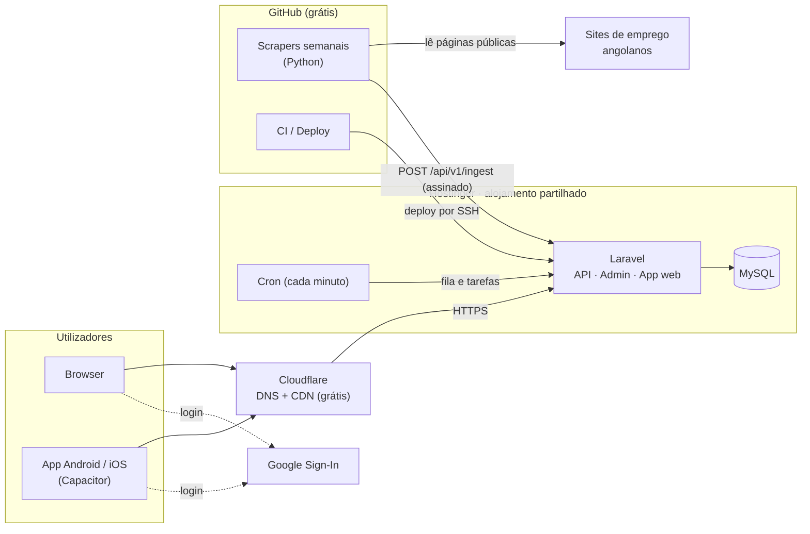
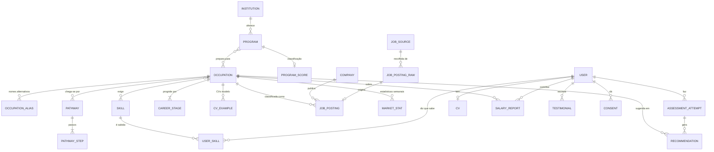
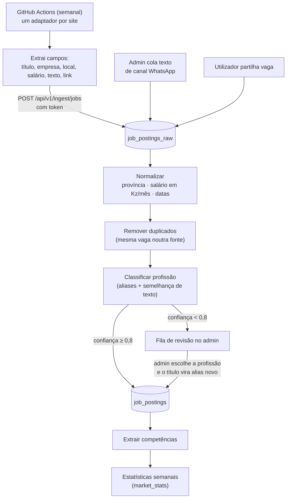

# Kayé — Arquitetura Técnica

Versão 2 · 23 de outubro de 2026 (v1: 19 de outubro) · Âmbito: MVP "Kayé Tech" e o caminho para crescer.

> Os diagramas usam Mermaid. Aparecem desenhados no GitHub, ou no VS Code com a extensão *Markdown Preview Mermaid Support*.

## 0. Resumo num minuto

- **O Kayé orienta, não recruta.** É uma app de orientação vocacional e profissional, não um site de emprego. Ajuda cada jovem a:
  - descobrir as profissões que combinam com ele;
  - perceber o que cada uma faz e exige;
  - planear o caminho até lá: estudos, formação profissional e experiência.

  As vagas recolhidas servem só para medir o que o mercado pede e **nunca são publicadas** ([fontes-de-vagas.md](fontes-de-vagas.md)).
- **Um só servidor.** Laravel (PHP) + MySQL na Hostinger partilhada servem a API, o painel de administração e a app web React.
- **Uma só app.** O mesmo código React corre no browser e no telemóvel; o Capacitor gera as apps Android e iOS.
- **O trabalho pesado sai da Hostinger.** A recolha de vagas corre grátis no GitHub Actions, uma vez por semana, e envia os resultados para a API.
- **Tudo gira em torno da Profissão**, com base na taxonomia europeia ESCO (gratuita, em pt/en/fr).
- **Os números são calculados uma vez por semana** e guardados prontos a ler. Quando alguém abre uma página, o servidor só lê; nunca faz contas pesadas.
- **Crescer é mudar configuração, não código.** Num VPS, o Laravel troca a fila e a cache por Redis só no ficheiro `.env`.

## 1. Restrições e princípios

### Restrições

| Restrição | O que obriga no desenho |
|---|---|
| Alojamento partilhado (sem VPS) | Sem processos sempre ligados, sem Redis, sem browser automático, tempo de execução limitado. Filas guardadas na base de dados e acionadas por cron; scraping fora da Hostinger. |
| Equipa: Eduardo + Claude | Frameworks que já trazem muito feito (Laravel, Filament). Um só repositório e um só deploy. |
| Orçamento perto de zero | Serviços com plano grátis: GitHub Actions, Google Sign-In, Cloudflare, Sentry. |
| Público 14–30 anos em Angola | Android modestos e dados móveis caros: app leve, poucas imagens, funciona com rede fraca. |
| Lei n.º 22/11 + regras Apple/Google | Consentimentos registados, recolher só o necessário, apagar conta dentro da app, nenhum dado individual para terceiros. |
| Três idiomas | Traduções preparadas desde o primeiro dia. |

### Princípios

1. **Cada dado diz de onde vem.** Fonte e data de atualização em todos os registos e em todos os números mostrados.
2. **Ler é barato; calcular é agendado.** Estatísticas pré-calculadas por tarefas semanais.
3. **Guardar o bruto.** Tudo o que se recolhe fica guardado como veio, para reprocessar quando os algoritmos melhorarem.
4. **Recomendação neutra.** Nada pago entra no cálculo das recomendações.
5. **Escalar por configuração.** O código não sabe se corre em alojamento partilhado ou num VPS.
6. **Pronto para outros países.** Instituições, vagas e estatísticas levam `country_code` (por agora sempre `AO`) desde o início. Não custa nada agora e evita uma migração dolorosa depois.

## 2. Visão geral



| Componente | Tecnologia | Responsabilidade |
|---|---|---|
| App cliente | React + TypeScript + Vite + Capacitor | Toda a experiência do utilizador (web, Android, iOS) |
| API | Laravel (PHP 8.3+) | Regras de negócio, autenticação, acesso aos dados |
| Painel admin | Filament (dentro do Laravel) | Curadoria, moderação, revisão de vagas, métricas |
| Páginas públicas | Blade (Laravel) | Fase 2: perfil e cartão partilháveis, páginas de carreira para o Google |
| Base de dados | MySQL / MariaDB | Fonte única da verdade |
| Tarefas | Cron + fila na base de dados | Processar vagas, calcular estatísticas, enviar emails |
| Scrapers | Python no GitHub Actions | Recolher vagas de sites públicos |

### Porquê um só Laravel a servir tudo

Um domínio, um certificado, um deploy. A app web e a API ficam na mesma origem, por isso o browser não tem problemas de CORS. A app do telemóvel continua a precisar de CORS, que o Laravel já configura.

| Caminho | Quem responde |
|---|---|
| `/api/v1/*` | API (JSON) |
| `/admin` | Painel Filament |
| `/u/{nome}` | Página pública do utilizador (Fase 2) |
| tudo o resto | `index.html` da app React (o React trata da navegação) |

## 3. Tecnologias e porquê

### App (frontend)

| Peça | Escolha | Porquê |
|---|---|---|
| Linguagem | TypeScript | Apanha erros antes de chegarem ao utilizador. Sem testadores na equipa, é a primeira rede de segurança. |
| Build | Vite | Rápido e gera pacotes pequenos. |
| Navegação | React Router | Padrão. |
| Pedidos à API | TanStack Query | Cache automática; com persistência, as últimas páginas vistas abrem sem rede. |
| Formulários | React Hook Form + Zod | Onboarding e editor do CV com validação. |
| Estilos | Tailwind CSS | Rápido de escrever, CSS final pequeno. |
| Idiomas | react-i18next | Ficheiros `pt`, `en`, `fr`. |
| Nativo | Capacitor + plugins | Login social (Google; Apple mais tarde), Preferences (guardar a sessão), Filesystem + Share (guardar e partilhar o PDF do CV), notificações push (Fase 2). |

### Servidor (backend)

| Peça | Escolha | Porquê |
|---|---|---|
| Framework | Laravel 13 (exige PHP 8.4+) | Login, migrações, filas, tarefas agendadas, traduções e validação já feitos. Corre em alojamento partilhado. |
| Sessões da API | Laravel Sanctum (tokens) | Funciona igual no browser e no telemóvel. |
| Admin | Filament | Ecrãs de gestão e moderação gerados a partir dos modelos: dias em vez de semanas. |
| Conteúdo traduzível | spatie/laravel-translatable | Guarda `pt`/`en`/`fr` num campo JSON; mostra `pt` quando falta a tradução. |
| PDF do CV | barryvdh/laravel-dompdf | PHP puro, funciona no partilhado. |
| Login Google | google/apiclient | Biblioteca oficial para verificar o ID token. |
| Fila | driver `database` | Não há Redis no partilhado; o cron processa a fila a cada minuto. |
| Cache | driver `database` | Pela mesma razão. |
| Pesquisa | MySQL FULLTEXT, colação `utf8mb4_unicode_ci` | "informatica" encontra "Informática". Meilisearch só quando houver VPS. |

### Recolha de vagas

Python 3 com `httpx` e `selectolax` (ou BeautifulSoup). Playwright só para sites que precisem de JavaScript: o GitHub Actions corre browsers sem problema, ao contrário da Hostinger.

### Observabilidade

- **Erros:** Sentry (plano grátis) na app, na API e nos scrapers, sem dados pessoais.
- **Logs** em JSON com um `request_id` por pedido. O detalhe está em [observabilidade.md](observabilidade.md).
- **Métricas de produto:** tabela própria `events`, sem trackers de terceiros. É mais simples perante a lei, sobretudo com menores, e custa zero.

## 4. Modelo de dados

> O modelo que o backend constrói, tabela a tabela, está em [base-de-dados.md](base-de-dados.md#modelo-completo-adr-0019) (ADR 0019). Esta secção é a visão de longo prazo (vagas, estatísticas semanais, XP).

A base de dados é **relacional (MySQL)**. O Kayé é uma rede de ligações (profissão ↔ competência ↔ curso ↔ instituição ↔ vaga), e as bases relacionais existem para isso. Onde a informação é um documento lido sempre inteiro (o CV, os resultados do teste), usamos uma coluna JSON dentro do MySQL.

Nomes de tabelas e colunas em inglês (convenção do Laravel); tudo o que o utilizador vê está em pt/en/fr. Os campos marcados com `*` são traduzíveis.



### 4.1 Taxonomia (o mapa de profissões)

| Tabela | Campos principais | Notas |
|---|---|---|
| `sectors` | id, slug, name* | Fase 1: só `tecnologia`. |
| `occupations` | id, sector_id, slug, esco_uri, isco_code, name*, summary*, description*, day_to_day*, work_context* (JSON: ambiente, horários, viagens, trabalho em equipa), work_styles (JSON: as características profissionais, por exemplo atenção ao detalhe ou comunicação), riasec (6 valores 0–1), is_published, last_reviewed_at | A entidade central. |
| `career_stages` | occupation_id, position, level (estágio, júnior, pleno, sénior, liderança), title*, typical_years_min, typical_years_max, responsibilities*, what_changes* | O **histórico profissional**: como se progride na profissão e quanto tempo leva cada etapa. |
| `occupation_aliases` | occupation_id, alias, locale | "Programador PHP", "Dev Backend" → Desenvolvedor Backend. É o que permite classificar vagas. |
| `skills` | id, esco_uri, name*, kind (técnica, transversal, ferramenta) | Da ESCO, mais ferramentas tech (React, Laravel, AWS…). |
| `skill_aliases` | skill_id, alias | "ReactJS", "React.js" → React. |
| `occupation_skill` | occupation_id, skill_id, importance (essencial, opcional) | A ESCO já traz esta ligação. |

### 4.2 Formação

| Tabela | Campos principais | Notas |
|---|---|---|
| `institutions` | id, country_code, name, slug, type (universidade, instituto_medio, centro_formacao, online), ownership (pública, privada), province, municipality, address, lat, lng, website, phone, source_url, last_verified_at, claimed_at | `claimed_at` só na Fase 4. |
| `programs` | id, institution_id, name, level (formacao_profissional, medio_tecnico, licenciatura, mestrado, certificacao, curso_livre), duration_months, schedule (diurno, pós-laboral, online), enrollment_fee, tuition_amount, tuition_period (mensal, anual, total), other_costs_estimate, admission_requirements*, has_entrance_exam, description*, source_url, last_verified_at | Valores em Kz. |
| `occupation_program` | occupation_id, program_id, relevance (direta, relacionada) | Que cursos levam a que profissão. |
| `pathways` | id, occupation_id, name*, summary* | Ex.: "Via universitária", "Via técnica rápida". |
| `pathway_steps` | pathway_id, position, kind (académico, formação, certificação, portfólio, experiência), need (essencial, recomendado, opcional), self_taught, certificate (exigido, opcional), level, description*, typical_months | Um passo aponta para um nível, não para um curso concreto. A app mostra os cursos desse nível que levam à profissão. Os passos cobrem o **percurso académico**, a **formação** e a experiência. **Formação não é certificado:** aprender pode ser autodidata (cursos online, vídeos), e o certificado é muitas vezes opcional. Em várias carreiras (ex.: Frontend) o que decide é o **portfólio**. Os passos opcionais não contam para a duração nem para "faltam N passos". |
| `program_scores` | program_id, is_recognized, rating_avg, rating_n, total_cost_aoa, duration_months, score, criteria (JSON), computed_at | Calculada todas as semanas. É a base das "melhores instituições para este curso" (5.7). |
| `education_stats` | id, country_code, year, level (licenciatura, medio_tecnico, formacao_profissional), field (área de estudo), course_name, province, enrolled, graduates, source (INE, MESCTI), source_url | Planeada: dados oficiais de educação para o Mercado (diplomados por curso e área). Só números agregados, com a fonte e o ano. |

**Custo total do caminho.** Para cada passo de formação, soma-se inscrição + propina × duração + outros custos, para o curso mais barato e para o curso mediano disponíveis na província do utilizador. Mostra-se sempre como faixa ("entre X e Y Kz"), nunca como um número único.

**Duração típica por nível (estimada).** Enquanto as instituições não publicam a duração de cada curso, a app usa meses de propina por nível (10 propinas por ano letivo): formação profissional 9, certificação 3, médio técnico 40, licenciatura 40, mestrado 20, especialidade 30 (`TYPICAL_MONTHS` em `apps/web/src/domain/fees.ts`). O custo do estudo é a propina estimada × estes meses, do curso mais barato ao mais caro; o ensino público aparece como "grátis". As páginas da carreira e do curso mostram-no ao lado do salário, com "recuperas o investimento em ~N meses" (custo máximo ÷ salário), sempre com a etiqueta "Estimativa".

### 4.3 Mercado de trabalho

| Tabela | Campos principais | Notas |
|---|---|---|
| `job_sources` | id, name, kind (site, whatsapp_manual, utilizador, parceiro), base_url, enabled, terms_checked_at, last_run_at | Uma linha por fonte. |
| `job_postings_raw` | id, source_id, external_id, url, payload (JSON tal como veio), content_hash, fetched_at, status (pendente, processada, duplicada, rejeitada) | Único por (source_id, external_id). Nunca se apaga. |
| `companies` | id, name, normalized_name, slug, website, province | |
| `job_postings` | id, country_code, raw_id, source_id, company_id, title_original, occupation_id, match_confidence (0–1), needs_review, province, work_mode (presencial, remoto, híbrido), contract_type, experience_min_years, education_level_required, certifications (JSON), salary_min_aoa, salary_max_aoa, salary_original_text, salary_disclosed, posted_at, expires_at, url, dedupe_key, status (ativa, expirada, oculta) | `occupation_id` pode ficar vazio até alguém rever. **Nunca é mostrada a ninguém**: só entra nas estatísticas. |
| `job_posting_skill` | job_posting_id, skill_id | Competências pedidas na vaga. |
| `salary_reports` | id, country_code, user_id, occupation_id, seniority (júnior, pleno, sénior), monthly_gross_aoa, province, company_size, reported_year, status (pendente, aprovado, rejeitado) | `user_id` nunca é exposto. Só para maiores de 18. |
| `market_stats` | occupation_id, country_code, province (vazio = nacional), week_start, postings_90d, postings_trend_pct, salary_p25, salary_p50, salary_p75, salary_n, salary_basis (vagas, relatos, misto, grupo_semelhante), top_companies (JSON), top_skills (JSON), education_levels (JSON: % por nível pedido), top_certifications (JSON), experience_years_p50, computed_at | Uma linha por profissão por semana: o histórico de tendências sai daqui sem custo extra. |

### 4.4 Utilizadores e comunidade

| Tabela | Campos principais | Notas |
|---|---|---|
| `users` | id, google_sub, apple_sub, email, name, avatar_url, birth_year, province, current_education_level, locale, role (user, moderator, admin), xp, created_at, deleted_at | Ano de nascimento em vez da data completa. |
| `consents` | user_id, kind (termos, privacidade, menor_encarregado_informado, contribuicao_salarial, emails), version, granted_at, revoked_at | Prova de consentimento exigida pela lei. |
| `assessment_questions` | id, version, dimension (R, I, A, S, E, C), text*, position | |
| `assessment_attempts` | id, user_id, version, started_at, completed_at, scores (JSON), code (ex.: "IAC") | |
| `assessment_answers` | attempt_id, question_id, value (1–5) | Guardadas para poder recalcular se a fórmula mudar. |
| `recommendations` | attempt_id, occupation_id, rank, score, fit, market, feasibility, reasons (JSON) | |
| `saved_items` | user_id, item_type, item_id | Carreiras, cursos e instituições guardados. |
| `user_skills` | user_id, skill_id, level (a aprender, sei fazer, domino), updated_at | O que a pessoa diz que sabe. Alimenta o encaixe (5.4). |
| `cvs` | id, user_id, template, locale, data (JSON), updated_at | O CV é um documento: o JSON evita seis tabelas. |
| `cv_examples` | id, occupation_id, seniority (primeiro emprego, júnior, experiente), locale, template, data (JSON, no formato de `cvs`), annotations* (JSON), is_published, reviewed_at | **CVs modelo** de pessoas fictícias, escritos pela equipa. Nunca de pessoas reais. |
| `testimonials` | id, user_id, target_type, target_id, author_role (estudante, ex-aluno, profissional), rating (1–5, só para cursos), body, status, moderated_by, moderated_at | Só aparece depois de aprovado. As notas dos cursos entram em `program_scores`. |
| `error_reports` | id, user_id, target_type, target_id, field, message, status | Botão "Reportar erro". |
| `xp_ledger` | user_id, action, points, ref_type, ref_id, created_at | Único por (user_id, action, ref): ninguém ganha pontos duas vezes pela mesma coisa. |
| `badges`, `user_badges` | | |
| `events` | user_id, name, props (JSON), created_at | Métricas de produto. |

## 5. Fluxos principais

### 5.1 Login com Google

**Na web** (OAuth do Google, com o Laravel Socialite):

1. No fim do onboarding, o perfil fica no aparelho e o botão "Continuar com o Google" leva a `/auth/google/redirect?next=/entrar?plano=1&next=…` (o `next` só pode ser um caminho do próprio site). No regresso, a app mostra "O teu plano" e segue para o que a pessoa tinha pedido. Só esta ida marca o aparelho para perguntar `GET /me`: quem nunca entrou não recebe um 401.
2. O Google mostra a escolha da conta e volta a `/auth/google/callback` com um código; o `state` confirma que é o mesmo browser.
3. A API troca o código pelos dados da conta (só aceita emails verificados), encontra ou cria a pessoa pelo `google_sub` (uma conta local com o mesmo email, como a do admin, fica ligada) e abre uma sessão do Laravel em cookie `HttpOnly`, `SameSite=Lax`, com um id novo. Volta a `next`.
4. Daí em diante o browser envia o cookie sozinho, e cada escrita leva o token CSRF (`X-XSRF-TOKEN`, que o cliente `api()` lê do cookie `XSRF-TOKEN`).

**No telemóvel** (Android):

1. A app pede ao Google um *ID token* com o plugin nativo, usando o ID de cliente web como *server client id*.
2. Envia-o para `POST /api/v1/auth/google` (10 tentativas por minuto).
3. A API confirma a assinatura (chaves públicas do Google), que o `aud` é o ID de cliente do Kayé, que o emissor é o Google, que não expirou e que o email está verificado (`App\Support\GoogleIdTokenVerifier`).
4. Encontra ou cria a pessoa como na web e devolve `{token, expiresAt, user}`: um token Sanctum válido 30 dias, que a app guarda no armazenamento seguro do sistema e envia em `Authorization: Bearer`. Ver [ADR-0003](decisoes/0003-sessao-web-em-cookie.md).

Uma conta apagada no painel (*soft delete*) não volta pelo login. `POST /auth/logout` apaga o token deste aparelho, ou termina a sessão web.

**Os dados da pessoa no servidor** (`state/accountSync.ts`, ADR 0019). A app continua a trabalhar na cópia do aparelho (`userStore`, offline primeiro):

1. **Primeiro login neste aparelho:** a app envia o que tem para `POST /me/data/merge` e o servidor **funde** com o que já existe na conta, sem apagar nada (`App\Support\UserDataMerger`). A app fica com o resultado e regista os consentimentos aceites no onboarding (termos, privacidade e, nos menores, o encarregado de educação).
2. **Depois:** cada mudança sobe 1,5 s depois, num `PUT /me/data` com a versão em que se baseou. Se outro aparelho escreveu antes, o servidor responde 409 e a app pede a fusão. Sem rede, a mudança fica marcada no aparelho e sobe quando a rede volta. Ao abrir, a app traz o que outro aparelho escreveu entretanto.
3. **Regras da fusão:** o que está vazio de um lado fica com o valor do outro; as listas juntam-se (nomes uma vez, registos com `id`, como os CVs, uma vez, e os eventos datados, como o percurso e os testes, do mais recente para o mais antigo); os registos juntam-se chave a chave, exceto o perfil, a descoberta, o plano e a página pública, que nunca se misturam; com dois valores diferentes fica o do servidor, exceto o tempo de estudo e as notas dos Kursos e a última abertura das notificações, onde fica o maior.
4. **A foto e a capa nunca saem do aparelho.** O servidor guarda o resto em `user_data` e copia do perfil o ano de nascimento, a província e a escolaridade para `users`, porque é o ano que decide quem é menor (idade < 18, calculada, nunca guardada; sem ano conta como menor). Passar a ser menor retira os consentimentos de marketing.
5. Só o build que o Laravel serve (`VITE_DATA_SOURCE=api`) tem contas; o site de teste no Vercel continua a simular o login.

**Primeiro acesso → onboarding** ([ADR-0012](decisoes/0012-conta-obrigatoria-e-onboarding-adaptativo.md); sem conta explora-se à vontade e o registo só aparece ao guardar, [ADR-0021](decisoes/0021-explorar-sem-conta.md); quem já tem conta usa "Entrar" e salta a conversa). Uma conversa com o guia que se adapta às respostas: idioma, voz, fase da vida, objetivo, até 3 áreas (ou "Ainda não sei", e o guia sugere-as) e no máximo 3 perguntas por área. Depois, o nome, o ano de nascimento, a província e a escolaridade. O login com o Google vem no fim, com a aceitação dos termos e da política de privacidade. Quem tem menos de 18 anos confirma aí que o encarregado de educação tem conhecimento e fica sem perfil público.

**iOS (Fase 2).** A Apple obriga a oferecer "Iniciar sessão com a Apple" sempre que há login social (regra 4.8). O fluxo é o mesmo, com `apple_sub`.

**Sem conta** vê-se só a página de entrada, os termos e a política de privacidade. Tudo o resto pede conta.

### 5.2 Recolha e tratamento de vagas



**Envio (token, não HMAC).** A corrida leve de 2 em 2 horas e a completa de sábado enviam os factos a `POST /ingest/jobs` com o segredo `INGEST_TOKEN`; a API guarda-os em `job_postings` (só factos). Os GitHub Actions têm 2000 minutos grátis por mês: a corrida leve é medida e, se o mês passar de 1500, passa para 3 em 3 horas (ver `scrapers/README.md`).

**Comentários.** `GET /comments?type=&id=` é público (sem cookie); `POST /comments`, `POST /comments/{id}/report`, `DELETE /comments/{id}` e `GET /me/comments` exigem conta. Limite de 20 pedidos por hora por conta; filtro automático (`CommentFilter`); 3 denúncias escondem; menores aparecem só com o primeiro nome.

**O sistema aprende com as correções.** Quando o admin classifica uma vaga à mão, o título original passa a ser um alias dessa profissão. Com o tempo, há cada vez menos vagas para rever.

**Regras de recolha**
- Respeitar o `robots.txt` e os termos de cada site. Um pedido a cada 3–5 segundos, com um User-Agent identificado e um contacto.
- Guardar os factos que interessam às estatísticas: profissão, competências, formação pedida, anos de experiência, certificações, salário, província e data. **As vagas nunca são mostradas:** só entram em números agregados, com as fontes citadas. Os termos de cada fonte e as decisões estão em [fontes-de-vagas.md](fontes-de-vagas.md).
- **WhatsApp nunca é automatizado:** violaria os termos do WhatsApp e exporia dados de pessoas. O admin cola o texto de canais e páginas públicas, o parser pré-preenche o formulário e o admin confirma. Os números de telefone pessoais são removidos.
- **Salário.** O parser entende "150.000 Kz", "AOA 150 000,00", "150 mil", "USD 500" (convertido à taxa do BNA do dia) e "a combinar" (não divulgado). O texto original fica guardado.
- **Duplicados.** Conta como a mesma vaga quando coincidem empresa, profissão, província e semana, ou quando o conteúdo é igual.
- **Começar cedo.** O histórico só se ganha com tempo, por isso o scraper deve ser das primeiras coisas a ligar. A recolha guarda o bruto mesmo antes de as profissões estarem prontas.

### 5.3 Estatísticas e salário estimado

Há uma tarefa semanal (domingo de madrugada, depois dos scrapers) que calcula, para cada profissão e província:

- **Procura:** vagas nos últimos 90 dias e variação face aos 90 dias anteriores.
- **Salário:** junta os salários divulgados nas vagas com os relatos aprovados dos utilizadores.
  - **Com 5 ou mais valores:** mostra a faixa onde está a maioria (p25–p75) e a mediana, com "baseado em N vagas e M relatos".
  - **Com menos de 5:** sobe um nível na taxonomia e usa o grupo ISCO (ex.: todos os "Desenvolvedores de software"), com a etiqueta "estimado a partir de profissões semelhantes".
  - **Se ainda houver menos de 5:** mostra "Ainda não temos dados suficientes" e o botão "Contribui com o teu salário".
- **Empresas que mais contratam** e **competências mais pedidas**.
- **O que os empregadores pedem.** Mostra a percentagem das vagas que pede cada competência, cada nível de formação e cada certificação, e os anos de experiência típicos (a mediana). Só aparece com 10 ou mais vagas da profissão. Por exemplo: "Em 64 vagas de Analista de Dados: 78% pedem SQL, 61% pedem licenciatura, 2 anos de experiência".

É esta a "probabilidade" honesta: um número com a incerteza declarada, nunca um número inventado.

**Privacidade dos relatos de salário.** Só aparecem agregados, e só quando há 5 ou mais pessoas, para que ninguém seja identificável.

### 5.4 Teste vocacional e recomendações

**Teste.** Modelo RIASEC (Holland), com 6 dimensões: Realista, Investigativo, Artístico, Social, Empreendedor e Convencional. São 42 afirmações (7 por dimensão) numa escala de 1 a 5, cerca de 7 minutos, com o progresso guardado. As frases cobrem todas as áreas do catálogo, com no máximo uma de tecnologia por dimensão, e chegam na língua do ecrã ([ADR 0017](decisoes/0017-teste-vocacional-geral-com-valencias.md)).

**Valências (parte 2, opcional).** Sete passos que se podem saltar, guardados em `userStore.strengths` à medida que se responde: línguas e nível, competências digitais, ofícios e competências técnicas das áreas da pessoa (as do catálogo das carreiras, guardadas em `user_skills`), competências transversais (privadas), o que já fez (trabalho, voluntariado, estágio, curso), como gosta de trabalhar e condições (até onde quer estudar, se pode estudar fora da província, se precisa de trabalhar já). Nunca pergunta religião, etnia, rendimento, morada, saúde nem data de nascimento.

**Perfil das profissões.** Cada profissão tem também 6 valores RIASEC, definidos na curadoria com a base O*NET (pública, licença aberta) como referência.

**Fórmula:**

```
pontuação = 0,60 × compatibilidade   perfil do utilizador vs perfil da profissão
          + 0,25 × mercado           procura e salário em Angola (pesados pela confiança dos dados)
          + 0,15 × viabilidade       nível de estudo, formação na província, precisa de trabalhar já
          + 0,05 × estilo            como gosta de trabalhar vs estilos de trabalho da profissão
```

- **Viabilidade** (`domain/recommend.ts`, `FEASIBILITY`): média das condições respondidas. Nível: cada nível acima do que a pessoa quer estudar (formação curta < médio técnico < licenciatura) tira 0,4, medido pelo caminho da profissão que pede menos escolaridade. Precisa de trabalhar já: formação curta e médio técnico valem 1, licenciatura 0,35. Não pode estudar fora: 1 se há formação na sua província ou online, 0,3 se só noutras, 0,6 se não se sabe. Sem respostas, 0,5.
- **Estilo:** parte das preferências que os estilos de trabalho da profissão mostram; "rendimento depressa" conta como um caminho sem licenciatura. Sem respostas, 0,5.
- A lista inclui pelo menos uma profissão sem ensino superior, quando há uma que combina.

- Os pesos ficam em configuração e ajustam-se sem mexer no código.
- A compatibilidade mede a semelhança entre os dois perfis (cosseno entre vetores centrados).
- Cada recomendação traz 2–3 razões em linguagem simples: "Combina com o teu lado Investigativo", "42 vagas em Luanda nos últimos 3 meses", "Há formação em Luanda a partir de 25.000 Kz/mês".

**Regras**
- A compatibilidade manda: o mercado nunca empurra uma profissão que não combina contigo.
- Nada pago entra na fórmula.
- Os resultados ficam guardados com a versão do teste, para se poderem recalcular.

**Encaixe com uma profissão.** Em cada página de carreira, a pessoa vê o seu encaixe em três partes, nunca reduzidas a um número mágico:

| Parte | Como se mede | O que mostra |
|---|---|---|
| Interesses | Perfil RIASEC do teste vs. perfil da profissão | "Combina muito", "em parte" ou "pouco", e porquê |
| Formação | Escolaridade atual vs. o primeiro passo de cada caminho | Quantos passos faltam e quanto tempo levam |
| Competências | As competências que a pessoa marcou (`user_skills`) vs. as essenciais da profissão | "Já tens 4 de 12", e a lista das que faltam |

O que falta passa a ser os próximos passos sugeridos e, na Fase 2, "O meu plano". Sem o teste, a parte dos interesses diz "Faz o teste para saber".

**Perfis fora da tecnologia.** O teste mede todas as áreas. Se o perfil apontar fortemente para outra área (ex.: Saúde), dizemos isso com honestidade ("A tua área forte é X, que chega ao Kayé em breve") e mostramos as profissões tech que combinam com esse perfil. A tecnologia tem lugar para todos os perfis:

| Perfil forte | Profissões tech que combinam |
|---|---|
| Social | Formador de TIC, Técnico de Suporte |
| Artístico | Designer UI/UX |
| Empreendedor | Product Manager, Comercial de TI |
| Convencional | Administrador de Base de Dados, QA |

**Porque não "pessoas como tu também gostaram de…".** Esse método precisa de milhares de utilizadores com histórico. A fórmula acima funciona logo com o primeiro utilizador e consegue explicar-se. Mais tarde (Fase 3+), os pesos podem ser afinados com o que as pessoas guardam e seguem.

### 5.5 CV

- **Por agora, o PDF gera-se no aparelho** (jsPDF, [ADR 0006](decisoes/0006-pdf-do-cv-gerado-no-aparelho.md)). Os 8 modelos visuais (Clássico, Moderno, Europeu, Retrato, Duas Colunas, Minimalista, Criativo e Destaque) são desenhados uma só vez, em milímetros, por `cvLayout.ts`: a pré-visualização pinta o resultado em SVG e o PDF em jsPDF, com as mesmas quebras de linha e de página. As fontes são TTF (só latinas) em `public/fonts/cv/`, o mesmo ficheiro para o ecrã e para o PDF. Quando o download for pago, o PDF do CV pessoal passa para o servidor, como descrito abaixo.
- **As regras do CV mudam por profissão** (`cvGuide`): o que incluir, o que evitar e o modelo visual recomendado. Por exemplo, um programador não põe foto e põe os links do GitHub e dos projetos; um DevOps destaca as certificações.
- **Um CV ideal por caminho.** No separador "CVs modelo" da carreira há uma miniatura por caminho do roteiro. Tocar abre um popup, sem sair da carreira, com o CV à esquerda e, à direita, porque funciona, as regras e as ações: descarregar, comparar (com outro modelo ou com o meu CV) e começar a partir do modelo.
- **Vários CVs.** Cada pessoa pode ter vários CVs, cada um com conteúdo, modelo e estilo próprios; "começar a partir deste modelo" cria um CV novo em vez de substituir. O estilo guarda só o que a pessoa mudou, e `domain/cvStyle.ts` completa-o com o do modelo e aplica os limites (margens, tamanhos, espaços, contraste das cores), por isso "repor modelo" nunca toca no conteúdo. Trocar de modelo mantém o conteúdo e o que a pessoa ajustou. Os modelos com foto (Retrato e Criativo) usam a foto do perfil, ou as iniciais se não houver, e a foto pode ser desligada; os CVs modelo nunca a mostram.
- **Conselhos por área e destino.** A pessoa diz para onde vai enviar o CV (área, profissão e tipo de destino) e vê sugestões de estrutura, cores, foto e comprimento, com um modelo sugerido que só se aplica se ela aceitar. As regras estão em `domain/cvAdvice.ts`, por área, com exceções por grupo e profissão; uma área nova obriga a acrescentar uma linha. São opiniões da equipa apresentadas como conselhos, sem números nem estatísticas.
- **Preenchimento a partir do que já sabemos.** O editor propõe nome, título, objetivo, localização, formação e competências, a partir do perfil, do guia, da carreira de interesse e da verificação de encaixe (`domain/cvFill.ts`). A pessoa vê cada item, escolhe e aplica: campos vazios vêm marcados e o que substituiria texto dela vem desmarcado e assinalado. Não se pedem dados novos e, nos menores, não se propõe a localização.
- **CV passo a passo e força do CV.** `/cv/passo-a-passo` (`CvWizardPage`) é por onde começa um CV novo: abre já preenchido uma única vez (`CvDocument.autofilled`; só o que não substitui texto da pessoa) e guia pergunta a pergunta. A "força" (`domain/cvStrength.ts`) vai de 0 a 100 e sobe a cada linha (resumo curto vale metade, experiência sem descrição 60%, cinco competências é o completo); é distinta de `cvCompleteness`, que só diz se o CV está pronto. As ideias por carreira (`domain/cvCareer.ts`) vêm dos CVs modelo da carreira e, depois, da área.
- **Organização personalizada.** `CvDocument.arrangement` guarda só o que a pessoa mudou: ordem, secções escondidas, listas na coluna do lado, forma de mostrar cada secção (`CvFormat`) e se o exemplo esbatido aparece. `domain/cvArrange.ts` dá o ponto de partida de cada modelo e resolve o resultado; `cvLayout.ts` lê-o, por isso o ecrã e o PDF concordam. O exemplo esbatido (`sample`) só entra na pré-visualização.
- **Cartão de visita.** Parte dos dados de um CV à escolha, em 10 modelos, frente e verso, com 85 × 55 mm (`cardLayout.ts`), com o mesmo motor do CV. Dados e aspeto editam-se no cartão sem alterar o CV. Exporta em PDF e PNG, no aparelho.
- **Página pública.** Opcional e só para adultos, em `/c/:slug`, com QR no cartão ([ADR 0014](decisoes/0014-pagina-publica-do-cartao.md)).
- **O editor é feito em React**, por secções. Guarda o JSON automaticamente, com um pequeno atraso para não enviar a cada tecla.
- **Pré-visualização:** `GET /api/v1/cv/preview?template=x` devolve HTML com a marca d'água "Pré-visualização", mostrado dentro da app.
- **Download:** `POST /api/v1/cv/export` devolve o PDF.
  - **Hoje é grátis para todos.**
  - A verificação de permissão (`cv.export`) já existe no servidor. Quando houver assinatura, basta mudar a regra, sem mudar a app.
  - Gerar o PDF no telemóvel seria mais simples, mas qualquer pessoa conseguiria contornar o pagamento no futuro.
- **Limitação:** o dompdf só entende CSS simples (sem flexbox nem grid). Os modelos são desenhados com tabelas e blocos, o que chega bem para CVs.
- **CVs modelo por profissão.** Cada profissão tem CVs modelo de pessoas fictícias, por nível (primeiro emprego, júnior, experiente). Têm notas que explicam porque cada parte funciona, por exemplo: "o resumo diz o que a pessoa faz e para onde quer ir".
  - São escritos pela equipa a partir do que as vagas pedem. **Nunca se usam CVs de pessoas reais.**
  - Usam o mesmo formato de dados e os mesmos modelos visuais do editor. "Começar o meu CV a partir deste modelo" copia a estrutura, não os dados.

### 5.6 Qualidade dos dados e moderação (3 camadas)

| Camada | Como funciona | Quando |
|---|---|---|
| Equipa | Tudo é editável no admin. Cada registo tem `source_url` e `last_verified_at`, e o admin lista os registos com mais de 6 meses sem verificação. | Fase 0 |
| Utilizadores | "Reportar erro" em qualquer dado, "Partilhar vaga" e "Partilhar salário" (anónimo, 18+). Tudo passa por uma fila de moderação. | Fase 1 |
| Instituições | Reclamam a sua página e atualizam cursos e preços, com aprovação. | Fase 4 |

A gamificação só dá pontos por contribuições **aprovadas**, o que desencoraja lixo.

### 5.7 As melhores instituições para cada curso

"Melhor" depende do que a pessoa precisa. Por isso a classificação é transparente e a pessoa pode reordená-la.

- **Só entram cursos com reconhecimento oficial confirmado:** MESCTI para o ensino superior; MED e INEFOP para o ensino técnico e a formação profissional. Os outros aparecem à parte, marcados "reconhecimento por confirmar".
- **Pontuação Kayé**, calculada todas as semanas em `program_scores`, com os pesos publicados na própria página:

| Critério | Peso | De onde vem |
|---|---|---|
| Avaliação de alunos e ex-alunos | 40% | Testemunhos moderados com nota de 1 a 5. Só conta com 5 ou mais avaliações |
| Custo total do curso | 25% | Inscrição, propinas e outros custos, recolhidos e verificados pela equipa |
| Ligação ao mercado | 20% | Fase 2: a percentagem de quem fez o curso e diz trabalhar na área (agregado, 5 ou mais pessoas). Até lá, este critério fica de fora e os outros pesos sobem na mesma proporção |
| Duração e horários | 15% | Os horários pós-laboral e online valem mais para quem já trabalha |

- A pessoa pode ordenar por pontuação, preço, proximidade (província) ou avaliação.
- Com dados insuficientes, diz-se isso. Nunca se inventa uma posição.
- **Nada pago entra na pontuação.** O conteúdo patrocinado aparece sempre marcado e à parte.
- Apresentar como "mais bem classificadas segundo os critérios do Kayé", nunca como verdade absoluta. Validar a forma com um advogado.

### 5.8 O que cada pessoa vê (filtro pelos gostos)

Cada pessoa só vê, por defeito, o que tem a ver com ela. Tudo vive no aparelho (frontend, sem rotas novas): o campo `interestAreas` de `UserData` (`null` = ainda não foi perguntado, `[]` = saltou, ou as áreas escolhidas).

- **Perfil de interesse** (`domain/interests.ts` + `domain/relevance.ts`, `lib/useInterestFilter.ts`): as áreas escolhidas (ecrã de entrada, guia do onboarding, Definições), mais as áreas das carreiras guardadas e do destino, mais as do resultado do teste; as carreiras e empresas que a pessoa guardou entram também. Um só módulo calcula a relevância de qualquer item (`isRelevant`, `onlyRelevant`), lendo o que cada tipo diz de si: áreas, carreiras, empresas (`careerSubject`, `companySubject`, `academySubject`, `courseSubject`, `areasSubject`).
- **Regra:** um item é relevante se toca uma área da pessoa, uma carreira dela ou uma empresa que guardou. O que não diz nada sobre áreas, carreiras ou empresas (notícia geral, bolsa aberta a qualquer área) é para toda a gente. Sem áreas, nada se esconde. Nada pago entra no cálculo.
- **Listas** (carreiras, empresas, academias, cursos, estágios, bolsas, novidades, início): escondem o que não tem relação nenhuma e dizem "A mostrar o que tem a ver contigo", com o número de itens escondidos e o botão "Ver outras áreas". O botão lembra-se só dessa lista (`kaye.others.<lista>` no aparelho). Se a pessoa escolhe ela própria uma área, uma carreira ou pesquisa dentro da lista, o filtro não se mete: foi ela que pediu.
- **Pesquisa:** encontra tudo, põe primeiro o relevante (dentro de cada grupo, a melhor correspondência primeiro) e marca o resto com "Fora das tuas áreas".
- **Sem perfil:** quem ainda não escolheu nada vê uma pergunta num só ecrã (`InterestGate`) com as áreas e "Saltar" (vê tudo). Quem passou pelo guia ou já respondeu não volta a ser perguntado.
- **Definições:** o perfil de interesse edita-se aí (cada toque guarda).
- **Páginas de empresa e de academia:** a empresa mostra as citações dos líderes (`quotes`, palavra por palavra, com quem, quando e a ligação). Um campo vazio mostra "Perfil em construção", nunca um "—" solto (`StatBlock`, resumo).
- **Ainda sem filtro:** rankings e simulações dentro de uma carreira (já são sobre a carreira aberta), os prazos e os totais do início, e o Mercado (mostra o país inteiro de propósito).

## 6. API v1

A lista final do fecho do backend (ADR 0019). Cada rota pública corresponde a uma função de `apps/web/src/data/source.ts` (ou a um módulo que a app lê diretamente) e devolve **exatamente a mesma forma** de `apps/web/src/data/types.ts`: o frontend troca de fonte sem mudar tipos, e o teste de paridade compara cada rota com o JSON exportado.

- Prefixo `/api/v1`, respostas em JSON, **sem envelope `data`** (`JsonResource::withoutWrapping()`): uma lista é um array, um detalhe é o objeto. Um detalhe que não existe (ou não está `published`) responde 404, que a app lê como `null`.
- Idioma por `Accept-Language` (`pt`, `en`, `fr`; o que falta vem em português).
- As listas vêm inteiras, como hoje (a maior, `/courses`, tem 775 KB, 60 KB com gzip); paginação só se uma lista passar de 1 MB.
- As leituras públicas respondem com `Cache-Control: public, max-age=300` e `ETag` (quem já tem a versão recebe 304) e ficam em cache na base de dados (5 minutos, por caminho e língua; limpa quando um modelo de conteúdo muda e no fim de cada `kaye:import`). Código: `App\Support\PublicContent`, um controller por recurso em `App\Http\Controllers\Api` e uma `JsonResource` por tipo em `App\Http\Resources`; o que se calcula de várias tabelas (instituições com as ofertas, `CatalogCourse`, `CareerTraits`, `/skills`) está em `App\Support\Catalog`.
- Só registos `published`, pela `position`; uma ligação a um registo que não está publicado não aparece (a carreira em rascunho sai das `careers` de uma oferta).
- **Paridade** (`ApiParityTest`): cada ficheiro de `apps/api/database/data`, nas três línguas, importado e pedido à sua rota, é igual ao JSON (só a ordem das chaves e o `position` da exportação ficam de fora). Um campo a mais ou a menos, outro valor ou outra ordem falham.
- As fotografias e os logótipos vêm como o caminho no código da app (`/src/assets/careers/…`, e `/eventos/…` de `public/`); em modo `api` a app troca-os pelos ficheiros do seu build (`apps/web/src/data/assets.ts`). Quando as fotos passarem para o servidor, a API manda URLs completos e a app deixa-os como estão.
- Web: sessão em cookie `HttpOnly` com CSRF (ADR 0003). Android: `Authorization: Bearer` com o token Sanctum.
- Limite de pedidos em todas: 300 leituras e 60 escritas por minuto, por conta ou IP ([seguranca.md](seguranca.md)); mais apertado nas escritas sem conta (lista de espera, críticas, entrevistas, cartões).
- **A app** lê estas rotas com `VITE_DATA_SOURCE=api` (o build que o Laravel serve, `apps/web/.env.production`); sem ela, os dados de demonstração. Por agora mudam de fonte as funções de `source.ts`; os módulos lidos diretamente (Kursos, exames de acesso, entrevistas, mentores, vídeos, psicotécnicos, províncias) já têm rota e passam quando a app os pedir por `source.ts`.

### Públicas (leitura)

| Método | Caminho | Função de `source.ts` (ou módulo) | Devolve |
|---|---|---|---|
| GET | `/areas`, `/career-groups` | (exportação: `areas`, `career-groups`) | As áreas do Mercado e os grupos de carreiras, `{id, name}` e `{id, area, name}`, com os nomes na língua pedida |
| GET | `/occupations` | `listCareers` | `CareerSummary[]` |
| GET | `/occupations?fields=traits` | `listCareerTraits` | `CareerTraits[]` |
| GET | `/occupations/{slug}` | `getCareer` | `Career` (com `selfEmployment` quando existe) |
| GET | `/occupations/{slug}/cv-examples`, `/cv-examples` | `listCvExamples` | `CvExample[]` |
| GET | `/occupations/{slug}/testimonials`, `/testimonials` | `listTestimonials` | `Testimonial[]` |
| GET | `/skills` | `listSkills` | `Skill[]` |
| GET | `/support-programs` | `listSupportPrograms` | `SupportProgram[]` |
| GET | `/programs?occupation=` | `listPrograms` | `Program[]` |
| GET | `/institutions`, `/institutions/{slug}` | `listAcademies`, `getAcademy` | `Academy[]`, `Academy` |
| GET | `/courses`, `/courses/{slug}` | `listCourses`, `getCourse` | `CatalogCourse[]`, `CatalogCourse` |
| GET | `/companies`, `/companies/{slug}` | `listCompanies`, `getCompany` | `Company[]`, `Company` |
| GET | `/market/jobs` | `getJobMarket` | `JobMarket` |
| GET | `/market/education` | `getEducation` | `EducationStats` |
| GET | `/market/employment` | `getEmployment` | `EmploymentStats` |
| GET | `/comments?type=&id=` | — | Comentários visíveis de uma notícia (`news`), empresa (`company`) ou simulação (`simulation`): id, autor (só o primeiro nome nos menores), texto e data |
| GET | `/news` | `listNews` | `NewsItem[]`, mais recentes primeiro |
| GET | `/scholarships` | `listScholarships` | `Scholarship[]` |
| GET | `/internships` | `listInternships` | `Internship[]` |
| GET | `/free-courses?occupation=` | `listFreeCourses` | `FreeCourse[]` |
| GET | `/admissions` | `listAdmissions` | `Admission[]` |
| GET | `/figures` | `listFigures` | `Figure[]` |
| GET | `/assessment` | `getAssessment` | `AssessmentQuestion[]` na língua pedida |
| GET | `/access-exams` | `data/demo/accessExams` | O banco de perguntas, cada uma com a sua disciplina e tema |
| GET | `/psychotech`, `/provinces` | `data/demo/psychotech`, `data/provinces` | As listas dos psicotécnicos e as 21 províncias, como estão |
| GET | `/interview-questions` | `data/demo/interviews` | As perguntas do treino de entrevistas |
| GET | `/mentors` | `data/demo/mentors` | `Mentor[]` (só `grupo` quando quem pede é menor) |
| GET | `/video-stories` | `data/demo/videoStories` | `VideoStory[]` |
| GET | `/simulations`, `/occupations/{slug}/simulations` | `data/demo/simulations` | `Simulation[]`: os dias de trabalho, com `example: true` enquanto esperam a revisão de um agente |
| GET | `/agents` | `data/demo/agents` | `Agent[]`: os agentes Kayé aprovados (por agora nenhum) |
| GET | `/kursos` | `data/kursos` | `{kursos, announced}`: os Kursos sem o texto das lições nem o exame, e os anunciados `{id, title, body, icon}` |
| GET | `/kursos/{slug}/units/{unit}` | `Unit.load` | `UnitContent` (404 enquanto a unidade não tem texto) |
| GET | `/kursos/{slug}/exam` | `Course.loadExam` | `ExamQuestion[]` |
| GET | `/public-cards/{slug}` | `getPublicCard` | `PublicCard` (404 = desligado) |

### Escritas sem conta

| Método | Caminho | Função | Notas |
|---|---|---|---|
| POST | `/public-cards` | `createPublicCard` | Devolve `{slug, secret}` uma só vez |
| PUT, DELETE | `/public-cards/{slug}` | `updatePublicCard`, `deletePublicCard` | `Authorization: Bearer <secret>` |
| POST | `/interviews` | `sendInterview` | Devolve `{id}` |
| POST | `/waitlist` | `data/waitlist.ts` | Campo-isco `website`; consentimento obrigatório |
| GET | `/waitlist/confirm/{token}` | | Confirmação dupla do email (URL assinada, 7 dias). Fora de `/api/v1`, como o seguinte: são links dos emails |
| GET, POST | `/unsubscribe/{token}?kind=…` | | "Deixar de receber" de cada email (URL assinada), sem conta; o `POST` é o botão de um clique do Gmail (`List-Unsubscribe-Post`) |
| GET | `/push/key` | `data/account.ts` | A chave pública VAPID do Web Push (`null`: push desligado) |
| POST | `/feedback` | `data/waitlist.ts` | Campo-isco `website` |
| GET | `/waitlist/export?kind=waitlist\|feedback` | | CSV para a equipa; token `WAITLIST_EXPORT_TOKEN` (`X-Export-Token`, `Bearer` ou `?token=`) |

Estas escritas vieram das funções do Vercel com as mesmas respostas: `{"error": "invalid"}` (422), `{"error": "too_many"}` (429), `{"error": "forbidden"}` (403) e `{"error": "not_found"}` (404), todas com `Cache-Control: no-store`. Limites por IP e por hora: lista de espera 10, críticas 10, entrevistas 6, cartões 30 (criar e mudar contam juntos). Os links dos emails: 20 por minuto.

### Com conta

| Método | Caminho | Para quê |
|---|---|---|
| GET | `/auth/google/redirect`, `/auth/google/callback` | Login na web (fora de `/api/v1`; cria o cookie) |
| POST | `/auth/google` | Android: troca o `id_token` Google (assinatura, `aud`, `exp` verificados) por um token Sanctum |
| POST | `/auth/logout` | Terminar sessão (apaga o token ou o cookie) |
| GET | `/me` | A conta: nome, email, foto do Google, ano de nascimento, província, escolaridade, língua, `minor` e os consentimentos ativos. O perfil muda-se em `/me/data` (o servidor copia-o para `users`); não há `PATCH /me` |
| GET, PUT | `/me/data` | `{version, data}`: o `UserData` sem a foto e a capa (até 1 MB). Um `PUT` com uma versão antiga recebe 409 com a cópia atual |
| POST | `/me/data/merge` | Primeiro login: o aparelho envia o que tem e o servidor funde (nunca apaga) |
| GET, POST | `/me/consents` | Ver e dar consentimentos (menores não podem dar os de marketing) |
| DELETE | `/me/consents/{kind}` | Retirar um consentimento |
| POST, DELETE | `/me/push-subscriptions` | Ligar e desligar o Web Push neste browser (só com um consentimento push) |
| POST | `/comments` | Comentar (`type`, `id`, `body` até 500 caracteres); recusado com 422 se tiver palavrões, telefones, emails ou ligações; 20 por hora por conta |
| POST | `/comments/{id}/report` | Denunciar; 3 denúncias escondem o comentário |
| DELETE, GET | `/comments/{id}`, `/me/comments` | O autor apaga o seu; os ids dos meus comentários |
| GET | `/me/export` | Os meus dados em JSON (Lei n.º 22/11) |
| DELETE | `/me` | Apagar a conta e tudo o que é da pessoa |

### Máquinas e painel

| Método | Caminho | Para quê | Autenticação |
|---|---|---|---|
| POST | `/ingest/jobs` | Entrada dos scrapers: factos das vagas (até 500 por pedido, atualiza por `external_id`) | Token `INGEST_TOKEN` (`Authorization: Bearer` ou `X-Ingest-Token`), comparado em tempo constante; menos de 16 caracteres = fechado |
| GET, POST | `/webhooks/whatsapp` | Estado das entregas e "PARAR" (WhatsApp Cloud API, mais tarde: por agora o WhatsApp vai à mão) | `X-Hub-Signature-256` da Meta |
| — | `/mcp` | Servidor MCP para a IA: lê o conteúdo público, escreve só em `revisions` | Token Sanctum de um editor, com a permissão `ai` |
| — | `/admin` | Painel Filament | Sessão, papéis `admin`, `editor`, `revisor` |

### Planeadas depois do fecho

Ficam no aparelho por agora e só passam a rotas quando forem precisas no servidor: tentativas do teste e recomendações no servidor, `/occupations/{slug}/fit`, `/me/skills` à parte de `user_data`, CV e PDF no servidor (ADR 0006), contribuições de vagas e salários, `/reports`, testemunhos escritos por utilizadores, `/me/progress` e `/events`.

## 7. App (frontend)

### Navegação

- **Computador:** uma barra lateral preta flutuante, que se minimiza só com ícones. Tem dois grupos e, em baixo, Suporte e Configurações.
- **Telemóvel:** uma barra de baixo com os 5 destinos mais usados. Na barra de cima ficam o sino das notificações e o menu (hamburger), que tem o resto.

| Grupo | Secção | Conteúdo | Telemóvel |
|---|---|---|---|
| Explorar | Início | Teste vocacional, recomendações, progresso, próxima ação | Barra de baixo |
| | Pesquisa | Carreiras (também os ofícios), cursos, academias, bolsas, estágios, empresas, as pessoas das empresas (só nome e cargo) e as páginas da app ("plano", "exames de acesso"…) num só sítio | Barra de baixo |
| | Carreiras | Todas as profissões e a página de cada uma (ver abaixo) | Barra de baixo |
| | Testes (`/testes`) | Todos os testes num só sítio, com o estado de cada um: teste vocacional (`/teste`), psicotécnicos (`/treino`), simulação de entrevistas (`/entrevistas`), treino para os exames de acesso (`/exames-de-acesso`: disciplinas e datas do exame de cada curso, treino por disciplina e simulação com tempo) e exames dos Kursos. O item fica ativo também nessas páginas | Menu |
| | Cursos | O que estudar: cursos classificados por carreira, comparar, custos | Barra de baixo |
| | Kursos (`/kursos`) | Cursos curtos grátis do Kayé, com lições, exame e certificado sem validade (ADR 0016) | Menu |
| | Academias | Universidades e centros de formação profissional. Publicam no Kayé cursos novos e promoções | Menu |
| | Oportunidades (`/oportunidades`) | Bolsas e estágios reais, em dois separadores (`?tab=bolsas` ou `?tab=estagios`), cada um com os seus filtros na URL | Menu |
| | Prazos (`/prazos`) | Os prazos com data publicada (bolsas, candidaturas e exames de acesso, estágios; os concursos públicos entram quando tiverem data de fecho), por mês, com o filtro "Só para mim" (estado local) e "Adicionar ao calendário" (um `.ics` com alarme 3 dias antes, feito no telemóvel). Os da pessoa a ≤ 14 dias aparecem nas Notificações e os a ≤ 7 dias contam no sino | Menu |
| | Sem universidade (`/sem-universidade`) | Ofícios, onde aprendê-los (centros do INEFOP), trabalhar por conta própria e passar do informal ao formal, em separadores (`?secao=`) | Menu |
| | Simulações (`/simulacoes`, `/simulacoes/:id`, `/agentes/:id`) | Um dia de trabalho de cada uma das 13 áreas, em 5 a 8 momentos com decisões (cada opção mostra o que acontece e porquê), o que a profissão pede, "Gostei / Não gostei" e o passo seguinte. A lista segue o filtro de interesse; aparecem também na página da carreira, no resultado do teste e em Testes. "Gostei" entra no perfil de interesse (a área da carreira passa a contar). Cada simulação mostra o autor ("Equipa Kayé" até haver agentes), a marca "Exemplo" e o aviso de tradução; os comentários só existem no build com contas | Testes |
| | Mentores (`/mentores`) | Mentores aprovados à mão, por área e carreira; "Pedir conversa" abre uma mensagem de WhatsApp ou email para o Kayé, sem guardar nada. Os menores só veem sessões em grupo. O item do menu e o link na carreira só aparecem quando houver mentores (`docs/mentores.md`) | Menu |
| | Empresas | As empresas líderes de cada setor, com as pessoas (nome e cargo), as publicações e as profissões que contratam | Menu |
| | Mercado | Cada área de ponta a ponta, em separadores (Resumo, Vagas, Estado, Formação, Por área), com dados reais e sem veredictos: o que as vagas dos sites de emprego mostram, atualizado todas as semanas (vagas por área, província, quem mais recruta e a fonte de cada número, sempre agregado), os concursos públicos (lugares e quem os abre), os diplomados por curso e área (INE e Ministério do Ensino Superior), os programas para jovens e os cursos que abrem portas no estrangeiro. As áreas ficam lado a lado (o peso nas vagas e nos diplomados) para ajudar a decidir, nunca para desencorajar uma carreira | Menu |
| | Novidades | Notícias sobre trabalho, ensino e dados; o que as academias publicam | Menu |
| Para ti | O meu plano (`/plano`) | Uma carreira e um caminho, com passos, progresso e prazos; guardado só no telemóvel | Menu |
| | CV | Editor, modelos visuais e CVs modelo por área | Barra de baixo |
| | Notificações | Uma Novidade torna-se Notificação quando é sobre a pessoa (carreira guardada, província); em cima, os prazos da pessoa a ≤ 14 dias | Sino |
| | Perfil | Conta, resultado do teste, competências, guardados | Menu |
| Em baixo | Suporte, Configurações | Ajuda; idioma, privacidade e dados | Menu |

**Fora do menu:** `/entrar` (entrada e onboarding), `/c/:slug` (a página pública do cartão, ADR 0014), `/familia` (o link da família, com os dados no `#`, ADR 0018), `/termos` e `/privacidade` são públicas. Os endereços antigos `/bolsas` e `/estagios` só redirecionam para os separadores de `/oportunidades`, mantendo os filtros. Cada ecrã descarrega o seu código na primeira visita (`lazy` em `app/router.tsx`). Os vídeos "O meu dia como…" (na carreira, e "Histórias novas" no Início e nas Novidades) são só links externos, sem iframes; com a lista vazia, os blocos não aparecem (`docs/videos.md`).

**Tutorial** (`domain/tour.ts`): até 6 passos escolhidos pelo objetivo da pessoa, cada um num elemento `data-tour` da sua página: teste, recomendações, plano, psicotécnicos, cursos, exames de acesso (`/exames-de-acesso`), comparar, estágios, entrevistas, CV, cartão, sem universidade, cursos grátis e conta própria; no fim, Novidades e Prazos.

**Recrutamento no Mercado:** só título, fonte, data e ligação para o original, e só de fontes que o permitem ([fontes-de-vagas.md](fontes-de-vagas.md)). Quando a fonte não o permite, entra só como dado agregado. O Kayé continua a não ser um site de emprego.

### Página de uma carreira

1. **O que faz:** resumo, dia a dia e contexto de trabalho.
2. **Características profissionais:** perfil RIASEC e estilos de trabalho.
3. **O que é preciso saber:** competências essenciais e o que os empregadores pedem em Angola.
4. **Como lá chegar:**
   - percurso académico;
   - formação profissional;
   - histórico profissional (etapas da carreira);
   - custo total e duração.
5. **Onde estudar:** as melhores instituições para os cursos desse caminho.
6. **Mercado:** procura, tendência, salários com fonte e empresas que contratam.
7. **CVs modelo** para esta profissão.
8. **O meu encaixe:** interesses, formação e competências, e o que falta.
9. **Testemunhos** de quem estuda ou trabalha na área.

### Organização do código

```
apps/web/src/
  app/          router, providers, layout
  features/     home, onboarding, assessment, careers, training, cv, profile
                (mais tarde: contributions)
  components/   ui/ (peças base) e peças do produto partilhadas
  data/         tipos (contrato com a API), source.ts (a única porta), queries
  domain/       regras em funções puras: RIASEC, encaixe, recomendações, ranking
  state/        o que a pessoa fez (hoje no aparelho; depois na API)
  lib/          cliente da API, i18n, ajudas
  locales/      pt.ts, en.ts, fr.ts
```

Detalhe em [organizacao-do-codigo.md](organizacao-do-codigo.md#app-appsweb). O aspeto visual está em [design.md](design.md). Enquanto a API não tem conteúdos, a app usa dados de demonstração ([ADR 0005](decisoes/0005-frontend-primeiro-com-dados-de-demonstracao.md)).

### Pensado para Angola

- Pacote inicial abaixo de ~200 KB comprimido; cada ecrã só carrega o seu código quando é aberto.
- Ícones em SVG; imagens em WebP e só quando acrescentam informação.
- As últimas carreiras vistas abrem sem rede (cache persistente).
- Sem animações pesadas: a app tem de correr bem num Android de gama baixa.

## 8. Segurança e privacidade

> O detalhe está em [seguranca.md](seguranca.md): modelo de ameaças, cabeçalhos, CSP, segredos, cadeia de fornecimento e resposta a incidentes. Esta secção resume as regras.

### Segurança

- **HTTPS em tudo:** certificado grátis da Hostinger + Cloudflare.
- **Tokens:** o token do Google é verificado no servidor; os tokens Kayé expiram e são revogados no logout.
- **Admin:** login Google + lista de emails autorizados + papel `admin`.
- **Limites de pedidos:** login 10/min; contribuições 20/dia; API 60/min por utilizador.
- **Input e output:**
  - todo o input é validado no servidor;
  - as consultas passam pelo Eloquent, o que protege de SQL injection;
  - o React e o Blade escapam o output, o que protege de XSS;
  - os testemunhos nunca são mostrados como HTML.
- **`/ingest/jobs`:** token partilhado (`INGEST_TOKEN`), comparado em tempo constante; sem token, ou com um de menos de 16 caracteres, responde 401. O segredo só existe nos GitHub Secrets e no `.env` do servidor.
- **Segredos:** só no `.env` (fora do Git) e nos GitHub Secrets.
- **Cópias de segurança:** as da Hostinger, mais uma cópia semanal cifrada guardada fora da Hostinger.

### Privacidade (Lei n.º 22/11)

- **Recolher só o necessário:** ano de nascimento (não a data), província (não a morada), telefone opcional.
- **Consentimentos** guardados com versão e data.
- **Menores (14–17):** linguagem adaptada, confirmação de que o encarregado de educação tem conhecimento, perfil público desligado e sem contribuições de salário. Não veem salários em lado nenhum da app (cartões, carreira, cursos, empresas, entrevistas, link da família): `useShowsSalaries()`; sem ano de nascimento conhecido, contam como menores.
- **Direitos do utilizador:** exportar os dados e apagar a conta dentro da app (também exigido pela Apple e pela Google).
- **Nenhum dado individual** sai para instituições ou anunciantes: só estatísticas agregadas de 5 ou mais pessoas.
- **Sem trackers de publicidade.**
- **Pendente antes do lançamento público.** Validar com um advogado:
  1. se é preciso notificar a APD (Agência de Protecção de Dados);
  2. as regras para guardar dados em servidores fora de Angola (a Hostinger não tem servidores em Angola);
  3. os termos de cada site de vagas de onde recolhemos dados;
  4. os Termos de uso e a Política de privacidade da app (`/termos` e `/privacidade`, hoje marcados como versão provisória), incluindo quem é o responsável pelo tratamento e o e-mail de contacto.

## 9. Infraestrutura e deploy

> Os containers, a pipeline de CI, o pacote de release, o deploy e as variáveis de ambiente estão em [infraestrutura.md](infraestrutura.md).

### Repositório (um só)

```
kaye/
  apps/
    api/         Laravel: API, admin, páginas públicas, serve a app web
    web/         React + Vite + Capacitor (android/, ios/)
  scrapers/      Python: um adaptador por site
  docs/          arquitetura, roadmap, decisões
  .github/workflows/
    ci.yml       testes e verificação de tipos em cada push
    market-data.yml  recolha semanal dos dados do Mercado (sábado, 22:00)
    deploy.yml   build e envio para a Hostinger
    scrape.yml   recolha semanal de vagas
```

> **Atenção (Windows):** o código vive em `C:\Projects\kaye`, sem acentos, porque o Gradle (o build do Android) costuma falhar com caracteres não-ASCII no caminho.

### Ambientes

| Ambiente | Onde | Para quê |
|---|---|---|
| Local | O teu PC: PHP em `C:\php` + MariaDB do XAMPP | Desenvolvimento |
| Staging | Subdomínio `staging.` na Hostinger, com base de dados separada | Testar antes de publicar |
| Produção | Domínio principal | Utilizadores |

### Deploy

1. Um push para `main` faz o GitHub Actions correr os testes.
2. A app React é compilada e copiada para `apps/api/public/spa`.
3. Tudo é enviado por SSH para a Hostinger, onde correm `php artisan migrate --force`, `config:cache` e `route:cache`.

Falta confirmar que o plano da Hostinger inclui acesso SSH. Se não incluir, usamos o deploy por Git do hPanel. Também é preciso escolher PHP 8.4 ou mais recente no hPanel: o `composer.json` fixa a plataforma em 8.4, por isso nenhum pacote vai exigir mais do que isso.

### Tarefas agendadas

Basta uma linha de cron no hPanel: `* * * * * php artisan schedule:run`.

| Quando (hora de Angola) | Tarefa |
|---|---|
| A cada minuto | Processar a fila (vagas, emails) |
| De 2 em 2 horas | `kaye:fetch-news`: notícias de Angola sobre formação, emprego e carreiras ([fontes-de-noticias.md](fontes-de-noticias.md)) |
| De 2 em 2 horas | Corrida leve das vagas no GitHub Actions (`market-data.yml`): só as primeiras páginas, só o que é novo, enviada a `/ingest/jobs` |
| Diário, 02:00 | Expirar vagas antigas, limpar tokens velhos |
| Sábado, 22:00 | Scrapers completos no GitHub Actions |
| Domingo, 03:00 | Recalcular `market_stats` |
| Semanal | Cópia de segurança cifrada |

### Custos previstos

| Item | Custo |
|---|---|
| Hostinger | Já pago |
| Domínio | Renovação anual |
| GitHub, Cloudflare, Sentry, Google Sign-In | Grátis |
| Conta de programador Google Play | 25 USD, uma vez |
| Apple Developer (quando houver iOS) | 99 USD por ano |

**Data center.** Antes de escolher, medir a latência a partir de Luanda para as opções da Hostinger; Europa e Brasil são as candidatas mais prováveis.

## 10. Como crescer

| Sinal | O que fazer |
|---|---|
| A Hostinger avisa limites de CPU ou de processos, ou a API fica lenta (> 800 ms) | Passar o Laravel para um VPS, com fila e cache em Redis e workers sempre ligados. Só muda o `.env`. |
| A pesquisa fica lenta ou fraca | Meilisearch (via Laravel Scout) no VPS. |
| Dezenas de milhares de utilizadores | Base de dados gerida e separada, réplicas de leitura, mais cache na CDN. |
| Novo setor (ex.: Finanças) | Nada muda na arquitetura: nova linha em `sectors` + curadoria. |
| Novo país | O `country_code` já existe; acrescentar a moeda e as fontes do país. |

## 11. Decisões registadas

| # | Decisão | Porquê | Alternativa rejeitada |
|---|---|---|---|
| 1 | MySQL relacional | Os dados são ligações; existe na Hostinger | MongoDB (ligações difíceis; não existe no partilhado) |
| 2 | Laravel | Muito já feito; corre no partilhado; escala por configuração | PHP sem framework (reinventar login, filas…); Node (exige VPS) |
| 3 | Um Laravel serve tudo | Um deploy, um domínio, sem CORS na web | API e app em servidores separados |
| 4 | Filament para o admin | Gestão e moderação em dias | Admin feito à mão em React |
| 5 | Scrapers no GitHub Actions | Grátis; sem os limites do partilhado; corre browsers | Cron PHP na Hostinger |
| 6 | Taxonomia ESCO | Grátis, em pt/en/fr, com competências já ligadas | Criar a lista do zero |
| 7 | RIASEC + fórmula explicável | Funciona sem utilizadores; transparente | "Pessoas como tu" (precisa de milhares de utilizadores) |
| 8 | Estatísticas semanais pré-calculadas | Leituras baratas; histórico grátis | Calcular a cada pedido |
| 9 | PDF do CV no servidor | Um só modelo; o pagamento futuro não se contorna | PDF gerado no telemóvel |
| 10 | WhatsApp só manual | Termos do WhatsApp; dados pessoais | Bots ou automação |
| 11 | Métricas em tabela própria | Privacidade, menores, custo zero | Trackers de terceiros |
| 12 | Login Google (+ Apple no iOS) | Sem senhas; regra 4.8 da Apple | Email e senha |
| 13 | Vagas só como dados agregados, nunca publicadas | O Kayé orienta, não recruta; muito menos risco com os termos das fontes | Quadro de vagas com pesquisa e alertas |
| 14 | Classificação das instituições com critérios e pesos públicos | "Melhor" depende de cada pessoa; transparência e nada pago | Ranking único e fechado |
| 15 | CVs modelo fictícios, escritos pela equipa | Privacidade; qualidade controlada | CVs reais de utilizadores |
