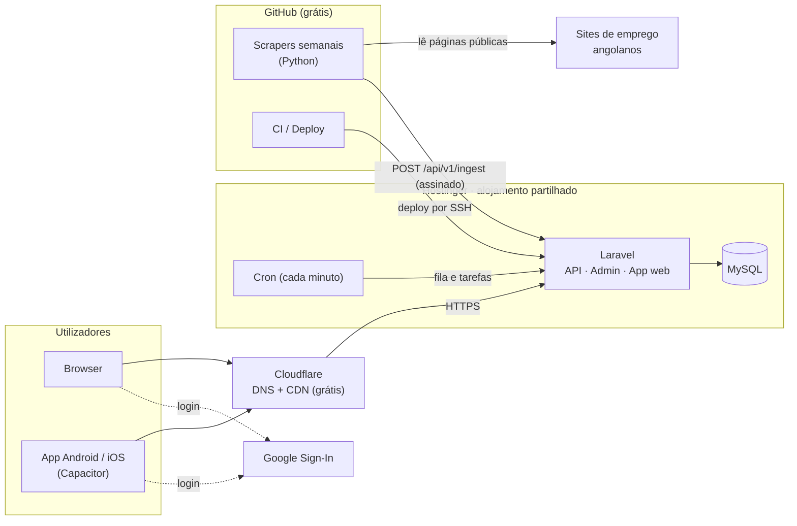
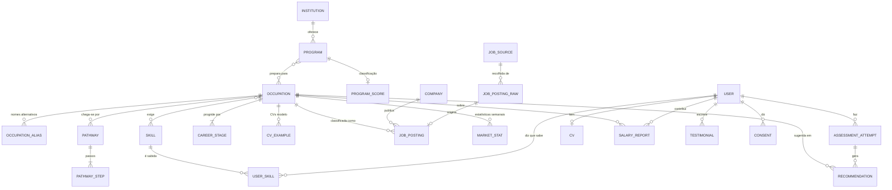
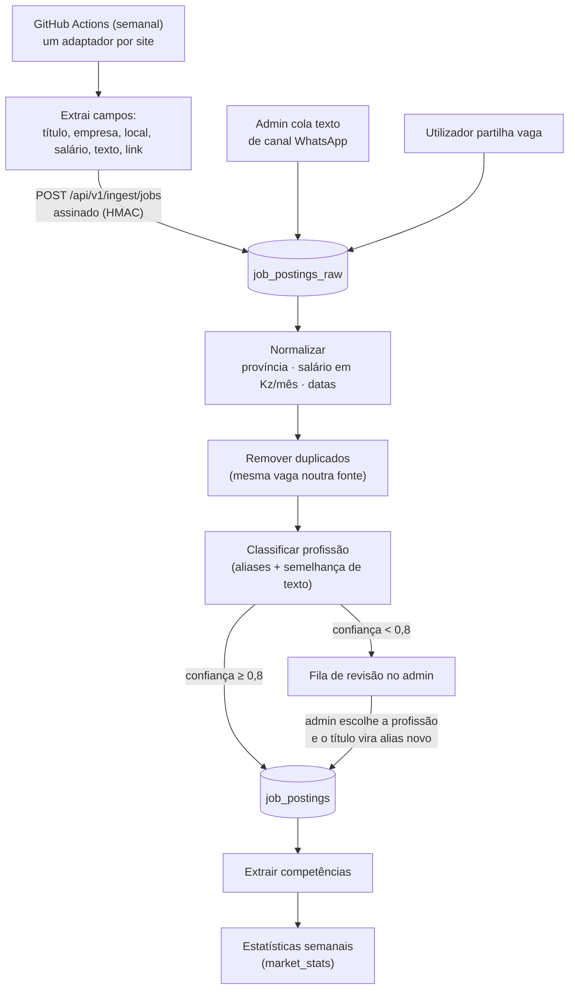

# Kayé — Arquitetura Técnica

Versão 2 · 23 de outubro de 2026 (v1: 19 de outubro) · Âmbito: MVP "Kayé Tech" e o caminho para crescer.

> Os diagramas usam Mermaid. Aparecem desenhados no GitHub, ou no VS Code com a extensão *Markdown Preview Mermaid Support*.

## 0. Resumo num minuto

- **O Kayé orienta, não recruta.** É uma app de orientação vocacional e profissional, não um site de emprego. Ajuda cada jovem a:
  - descobrir as profissões que combinam com ele;
  - perceber o que cada uma faz e exige;
  - planear o caminho até lá: estudos, formação profissional e experiência.

  As vagas recolhidas servem só para medir o que o mercado pede e **nunca são publicadas** ([fontes-de-vagas.md](fontes-de-vagas.md)).
- **Um só servidor.** Laravel (PHP) + MySQL na Hostinger partilhada servem a API, o painel de administração e a app web React.
- **Uma só app.** O mesmo código React corre no browser e no telemóvel; o Capacitor gera as apps Android e iOS.
- **O trabalho pesado sai da Hostinger.** A recolha de vagas corre grátis no GitHub Actions, uma vez por semana, e envia os resultados para a API.
- **Tudo gira em torno da Profissão**, com base na taxonomia europeia ESCO (gratuita, em pt/en/fr).
- **Os números são calculados uma vez por semana** e guardados prontos a ler. Quando alguém abre uma página, o servidor só lê; nunca faz contas pesadas.
- **Crescer é mudar configuração, não código.** Num VPS, o Laravel troca a fila e a cache por Redis só no ficheiro `.env`.

## 1. Restrições e princípios

### Restrições

| Restrição | O que obriga no desenho |
|---|---|
| Alojamento partilhado (sem VPS) | Sem processos sempre ligados, sem Redis, sem browser automático, tempo de execução limitado. Filas guardadas na base de dados e acionadas por cron; scraping fora da Hostinger. |
| Equipa: Eduardo + Claude | Frameworks que já trazem muito feito (Laravel, Filament). Um só repositório e um só deploy. |
| Orçamento perto de zero | Serviços com plano grátis: GitHub Actions, Google Sign-In, Cloudflare, Sentry. |
| Público 14–30 anos em Angola | Android modestos e dados móveis caros: app leve, poucas imagens, funciona com rede fraca. |
| Lei n.º 22/11 + regras Apple/Google | Consentimentos registados, recolher só o necessário, apagar conta dentro da app, nenhum dado individual para terceiros. |
| Três idiomas | Traduções preparadas desde o primeiro dia. |

### Princípios

1. **Cada dado diz de onde vem.** Fonte e data de atualização em todos os registos e em todos os números mostrados.
2. **Ler é barato; calcular é agendado.** Estatísticas pré-calculadas por tarefas semanais.
3. **Guardar o bruto.** Tudo o que se recolhe fica guardado como veio, para reprocessar quando os algoritmos melhorarem.
4. **Recomendação neutra.** Nada pago entra no cálculo das recomendações.
5. **Escalar por configuração.** O código não sabe se corre em alojamento partilhado ou num VPS.
6. **Pronto para outros países.** Instituições, vagas e estatísticas levam `country_code` (por agora sempre `AO`) desde o início. Não custa nada agora e evita uma migração dolorosa depois.

## 2. Visão geral



| Componente | Tecnologia | Responsabilidade |
|---|---|---|
| App cliente | React + TypeScript + Vite + Capacitor | Toda a experiência do utilizador (web, Android, iOS) |
| API | Laravel (PHP 8.3+) | Regras de negócio, autenticação, acesso aos dados |
| Painel admin | Filament (dentro do Laravel) | Curadoria, moderação, revisão de vagas, métricas |
| Páginas públicas | Blade (Laravel) | Fase 2: perfil e cartão partilháveis, páginas de carreira para o Google |
| Base de dados | MySQL / MariaDB | Fonte única da verdade |
| Tarefas | Cron + fila na base de dados | Processar vagas, calcular estatísticas, enviar emails |
| Scrapers | Python no GitHub Actions | Recolher vagas de sites públicos |

### Porquê um só Laravel a servir tudo

Um domínio, um certificado, um deploy. A app web e a API ficam na mesma origem, por isso o browser não tem problemas de CORS. A app do telemóvel continua a precisar de CORS, que o Laravel já configura.

| Caminho | Quem responde |
|---|---|
| `/api/v1/*` | API (JSON) |
| `/admin` | Painel Filament |
| `/u/{nome}` | Página pública do utilizador (Fase 2) |
| tudo o resto | `index.html` da app React (o React trata da navegação) |

## 3. Tecnologias e porquê

### App (frontend)

| Peça | Escolha | Porquê |
|---|---|---|
| Linguagem | TypeScript | Apanha erros antes de chegarem ao utilizador. Sem testadores na equipa, é a primeira rede de segurança. |
| Build | Vite | Rápido e gera pacotes pequenos. |
| Navegação | React Router | Padrão. |
| Pedidos à API | TanStack Query | Cache automática; com persistência, as últimas páginas vistas abrem sem rede. |
| Formulários | React Hook Form + Zod | Onboarding e editor do CV com validação. |
| Estilos | Tailwind CSS | Rápido de escrever, CSS final pequeno. |
| Idiomas | react-i18next | Ficheiros `pt`, `en`, `fr`. |
| Nativo | Capacitor + plugins | Login social (Google; Apple mais tarde), Preferences (guardar a sessão), Filesystem + Share (guardar e partilhar o PDF do CV), notificações push (Fase 2). |

### Servidor (backend)

| Peça | Escolha | Porquê |
|---|---|---|
| Framework | Laravel 13 (exige PHP 8.4+) | Login, migrações, filas, tarefas agendadas, traduções e validação já feitos. Corre em alojamento partilhado. |
| Sessões da API | Laravel Sanctum (tokens) | Funciona igual no browser e no telemóvel. |
| Admin | Filament | Ecrãs de gestão e moderação gerados a partir dos modelos: dias em vez de semanas. |
| Conteúdo traduzível | spatie/laravel-translatable | Guarda `pt`/`en`/`fr` num campo JSON; mostra `pt` quando falta a tradução. |
| PDF do CV | barryvdh/laravel-dompdf | PHP puro, funciona no partilhado. |
| Login Google | google/apiclient | Biblioteca oficial para verificar o ID token. |
| Fila | driver `database` | Não há Redis no partilhado; o cron processa a fila a cada minuto. |
| Cache | driver `database` | Pela mesma razão. |
| Pesquisa | MySQL FULLTEXT, colação `utf8mb4_unicode_ci` | "informatica" encontra "Informática". Meilisearch só quando houver VPS. |

### Recolha de vagas

Python 3 com `httpx` e `selectolax` (ou BeautifulSoup). Playwright só para sites que precisem de JavaScript: o GitHub Actions corre browsers sem problema, ao contrário da Hostinger.

### Observabilidade

- **Erros:** Sentry (plano grátis) na app, na API e nos scrapers, sem dados pessoais.
- **Logs** em JSON com um `request_id` por pedido. O detalhe está em [observabilidade.md](observabilidade.md).
- **Métricas de produto:** tabela própria `events`, sem trackers de terceiros. É mais simples perante a lei, sobretudo com menores, e custa zero.

## 4. Modelo de dados

A base de dados é **relacional (MySQL)**. O Kayé é uma rede de ligações (profissão ↔ competência ↔ curso ↔ instituição ↔ vaga), e as bases relacionais existem para isso. Onde a informação é um documento lido sempre inteiro (o CV, os resultados do teste), usamos uma coluna JSON dentro do MySQL.

Nomes de tabelas e colunas em inglês (convenção do Laravel); tudo o que o utilizador vê está em pt/en/fr. Os campos marcados com `*` são traduzíveis.



### 4.1 Taxonomia (o mapa de profissões)

| Tabela | Campos principais | Notas |
|---|---|---|
| `sectors` | id, slug, name* | Fase 1: só `tecnologia`. |
| `occupations` | id, sector_id, slug, esco_uri, isco_code, name*, summary*, description*, day_to_day*, work_context* (JSON: ambiente, horários, viagens, trabalho em equipa), work_styles (JSON: as características profissionais, por exemplo atenção ao detalhe ou comunicação), riasec (6 valores 0–1), is_published, last_reviewed_at | A entidade central. |
| `career_stages` | occupation_id, position, level (estágio, júnior, pleno, sénior, liderança), title*, typical_years_min, typical_years_max, responsibilities*, what_changes* | O **histórico profissional**: como se progride na profissão e quanto tempo leva cada etapa. |
| `occupation_aliases` | occupation_id, alias, locale | "Programador PHP", "Dev Backend" → Desenvolvedor Backend. É o que permite classificar vagas. |
| `skills` | id, esco_uri, name*, kind (técnica, transversal, ferramenta) | Da ESCO, mais ferramentas tech (React, Laravel, AWS…). |
| `skill_aliases` | skill_id, alias | "ReactJS", "React.js" → React. |
| `occupation_skill` | occupation_id, skill_id, importance (essencial, opcional) | A ESCO já traz esta ligação. |

### 4.2 Formação

| Tabela | Campos principais | Notas |
|---|---|---|
| `institutions` | id, country_code, name, slug, type (universidade, instituto_medio, centro_formacao, online), ownership (pública, privada), province, municipality, address, lat, lng, website, phone, source_url, last_verified_at, claimed_at | `claimed_at` só na Fase 4. |
| `programs` | id, institution_id, name, level (formacao_profissional, medio_tecnico, licenciatura, mestrado, certificacao, curso_livre), duration_months, schedule (diurno, pós-laboral, online), enrollment_fee, tuition_amount, tuition_period (mensal, anual, total), other_costs_estimate, admission_requirements*, has_entrance_exam, description*, source_url, last_verified_at | Valores em Kz. |
| `occupation_program` | occupation_id, program_id, relevance (direta, relacionada) | Que cursos levam a que profissão. |
| `pathways` | id, occupation_id, name*, summary* | Ex.: "Via universitária", "Via técnica rápida". |
| `pathway_steps` | pathway_id, position, kind (formação, certificação, experiência, portfólio), level, description*, typical_months | Um passo aponta para um nível, não para um curso concreto. A app mostra os cursos desse nível que levam à profissão. Os passos cobrem o **percurso académico**, a **formação profissional** e a experiência. |
| `program_scores` | program_id, is_recognized, rating_avg, rating_n, total_cost_aoa, duration_months, score, criteria (JSON), computed_at | Calculada todas as semanas. É a base das "melhores instituições para este curso" (5.7). |

**Custo total do caminho.** Para cada passo de formação, soma-se inscrição + propina × duração + outros custos, para o curso mais barato e para o curso mediano disponíveis na província do utilizador. Mostra-se sempre como faixa ("entre X e Y Kz"), nunca como um número único.

### 4.3 Mercado de trabalho

| Tabela | Campos principais | Notas |
|---|---|---|
| `job_sources` | id, name, kind (site, whatsapp_manual, utilizador, parceiro), base_url, enabled, terms_checked_at, last_run_at | Uma linha por fonte. |
| `job_postings_raw` | id, source_id, external_id, url, payload (JSON tal como veio), content_hash, fetched_at, status (pendente, processada, duplicada, rejeitada) | Único por (source_id, external_id). Nunca se apaga. |
| `companies` | id, name, normalized_name, slug, website, province | |
| `job_postings` | id, country_code, raw_id, source_id, company_id, title_original, occupation_id, match_confidence (0–1), needs_review, province, work_mode (presencial, remoto, híbrido), contract_type, experience_min_years, education_level_required, certifications (JSON), salary_min_aoa, salary_max_aoa, salary_original_text, salary_disclosed, posted_at, expires_at, url, dedupe_key, status (ativa, expirada, oculta) | `occupation_id` pode ficar vazio até alguém rever. **Nunca é mostrada a ninguém**: só entra nas estatísticas. |
| `job_posting_skill` | job_posting_id, skill_id | Competências pedidas na vaga. |
| `salary_reports` | id, country_code, user_id, occupation_id, seniority (júnior, pleno, sénior), monthly_gross_aoa, province, company_size, reported_year, status (pendente, aprovado, rejeitado) | `user_id` nunca é exposto. Só para maiores de 18. |
| `market_stats` | occupation_id, country_code, province (vazio = nacional), week_start, postings_90d, postings_trend_pct, salary_p25, salary_p50, salary_p75, salary_n, salary_basis (vagas, relatos, misto, grupo_semelhante), top_companies (JSON), top_skills (JSON), education_levels (JSON: % por nível pedido), top_certifications (JSON), experience_years_p50, computed_at | Uma linha por profissão por semana: o histórico de tendências sai daqui sem custo extra. |

### 4.4 Utilizadores e comunidade

| Tabela | Campos principais | Notas |
|---|---|---|
| `users` | id, google_sub, apple_sub, email, name, avatar_url, birth_year, province, current_education_level, locale, role (user, moderator, admin), xp, created_at, deleted_at | Ano de nascimento em vez da data completa. |
| `consents` | user_id, kind (termos, privacidade, menor_encarregado_informado, contribuicao_salarial, emails), version, granted_at, revoked_at | Prova de consentimento exigida pela lei. |
| `assessment_questions` | id, version, dimension (R, I, A, S, E, C), text*, position | |
| `assessment_attempts` | id, user_id, version, started_at, completed_at, scores (JSON), code (ex.: "IAC") | |
| `assessment_answers` | attempt_id, question_id, value (1–5) | Guardadas para poder recalcular se a fórmula mudar. |
| `recommendations` | attempt_id, occupation_id, rank, score, fit, market, feasibility, reasons (JSON) | |
| `saved_items` | user_id, item_type, item_id | Carreiras, cursos e instituições guardados. |
| `user_skills` | user_id, skill_id, level (a aprender, sei fazer, domino), updated_at | O que a pessoa diz que sabe. Alimenta o encaixe (5.4). |
| `cvs` | id, user_id, template, locale, data (JSON), updated_at | O CV é um documento: o JSON evita seis tabelas. |
| `cv_examples` | id, occupation_id, seniority (primeiro emprego, júnior, experiente), locale, template, data (JSON, no formato de `cvs`), annotations* (JSON), is_published, reviewed_at | **CVs modelo** de pessoas fictícias, escritos pela equipa. Nunca de pessoas reais. |
| `testimonials` | id, user_id, target_type, target_id, author_role (estudante, ex-aluno, profissional), rating (1–5, só para cursos), body, status, moderated_by, moderated_at | Só aparece depois de aprovado. As notas dos cursos entram em `program_scores`. |
| `error_reports` | id, user_id, target_type, target_id, field, message, status | Botão "Reportar erro". |
| `xp_ledger` | user_id, action, points, ref_type, ref_id, created_at | Único por (user_id, action, ref): ninguém ganha pontos duas vezes pela mesma coisa. |
| `badges`, `user_badges` | | |
| `events` | user_id, name, props (JSON), created_at | Métricas de produto. |

## 5. Fluxos principais

### 5.1 Login com Google

1. A app pede ao Google um *ID token*: na web com o Google Identity Services, no telemóvel com o plugin nativo.
2. A app envia-o para `POST /api/v1/auth/google`.
3. A API confirma que a assinatura é do Google, que o token foi emitido para o Kayé e que não expirou.
4. A API encontra ou cria o utilizador pelo `google_sub` e abre a sessão:
   - **na web**, uma sessão Sanctum em cookie `HttpOnly`, que o JavaScript não consegue ler;
   - **no telemóvel**, um token Sanctum válido 30 dias.
5. No telemóvel, a app guarda o token no armazenamento seguro do sistema e envia-o em cada pedido. Na web, o browser envia o cookie sozinho. Ver [ADR-0003](decisoes/0003-sessao-web-em-cookie.md).

**Primeiro acesso → onboarding.** O utilizador escolhe o idioma, indica o ano de nascimento, a província e a escolaridade atual, e aceita os termos e a política de privacidade. Quem tem menos de 18 anos vê um ecrã extra (confirma que o encarregado de educação tem conhecimento) e fica sem perfil público.

**iOS (Fase 2).** A Apple obriga a oferecer "Iniciar sessão com a Apple" sempre que há login social (regra 4.8). O fluxo é o mesmo, com `apple_sub`.

**Sem conta** pode-se explorar carreiras, cursos e instituições. **Com conta** faz-se o teste vocacional e o CV, guarda-se e contribui-se.

### 5.2 Recolha e tratamento de vagas



**O sistema aprende com as correções.** Quando o admin classifica uma vaga à mão, o título original passa a ser um alias dessa profissão. Com o tempo, há cada vez menos vagas para rever.

**Regras de recolha**
- Respeitar o `robots.txt` e os termos de cada site. Um pedido a cada 3–5 segundos, com um User-Agent identificado e um contacto.
- Guardar os factos que interessam às estatísticas: profissão, competências, formação pedida, anos de experiência, certificações, salário, província e data. **As vagas nunca são mostradas:** só entram em números agregados, com as fontes citadas. Os termos de cada fonte e as decisões estão em [fontes-de-vagas.md](fontes-de-vagas.md).
- **WhatsApp nunca é automatizado:** violaria os termos do WhatsApp e exporia dados de pessoas. O admin cola o texto de canais e páginas públicas, o parser pré-preenche o formulário e o admin confirma. Os números de telefone pessoais são removidos.
- **Salário.** O parser entende "150.000 Kz", "AOA 150 000,00", "150 mil", "USD 500" (convertido à taxa do BNA do dia) e "a combinar" (não divulgado). O texto original fica guardado.
- **Duplicados.** Conta como a mesma vaga quando coincidem empresa, profissão, província e semana, ou quando o conteúdo é igual.
- **Começar cedo.** O histórico só se ganha com tempo, por isso o scraper deve ser das primeiras coisas a ligar. A recolha guarda o bruto mesmo antes de as profissões estarem prontas.

### 5.3 Estatísticas e salário estimado

Há uma tarefa semanal (domingo de madrugada, depois dos scrapers) que calcula, para cada profissão e província:

- **Procura:** vagas nos últimos 90 dias e variação face aos 90 dias anteriores.
- **Salário:** junta os salários divulgados nas vagas com os relatos aprovados dos utilizadores.
  - **Com 5 ou mais valores:** mostra a faixa onde está a maioria (p25–p75) e a mediana, com "baseado em N vagas e M relatos".
  - **Com menos de 5:** sobe um nível na taxonomia e usa o grupo ISCO (ex.: todos os "Desenvolvedores de software"), com a etiqueta "estimado a partir de profissões semelhantes".
  - **Se ainda houver menos de 5:** mostra "Ainda não temos dados suficientes" e o botão "Contribui com o teu salário".
- **Empresas que mais contratam** e **competências mais pedidas**.
- **O que os empregadores pedem.** Mostra a percentagem das vagas que pede cada competência, cada nível de formação e cada certificação, e os anos de experiência típicos (a mediana). Só aparece com 10 ou mais vagas da profissão. Por exemplo: "Em 64 vagas de Analista de Dados: 78% pedem SQL, 61% pedem licenciatura, 2 anos de experiência".

É esta a "probabilidade" honesta: um número com a incerteza declarada, nunca um número inventado.

**Privacidade dos relatos de salário.** Só aparecem agregados, e só quando há 5 ou mais pessoas, para que ninguém seja identificável.

### 5.4 Teste vocacional e recomendações

**Teste.** Modelo RIASEC (Holland), com 6 dimensões: Realista, Investigativo, Artístico, Social, Empreendedor e Convencional. São 42 afirmações (7 por dimensão) numa escala de 1 a 5, cerca de 8 minutos, com o progresso guardado.

**Perfil das profissões.** Cada profissão tem também 6 valores RIASEC, definidos na curadoria com a base O*NET (pública, licença aberta) como referência.

**Fórmula:**

```
pontuação = 0,60 × compatibilidade   perfil do utilizador vs perfil da profissão
          + 0,25 × mercado           procura e salário em Angola (pesados pela confiança dos dados)
          + 0,15 × viabilidade       formação na província, custo, escolaridade atual
```

- Os pesos ficam em configuração e ajustam-se sem mexer no código.
- A compatibilidade mede a semelhança entre os dois perfis (cosseno entre vetores centrados).
- Cada recomendação traz 2–3 razões em linguagem simples: "Combina com o teu lado Investigativo", "42 vagas em Luanda nos últimos 3 meses", "Há formação em Luanda a partir de 25.000 Kz/mês".

**Regras**
- A compatibilidade manda: o mercado nunca empurra uma profissão que não combina contigo.
- Nada pago entra na fórmula.
- Os resultados ficam guardados com a versão do teste, para se poderem recalcular.

**Encaixe com uma profissão.** Em cada página de carreira, a pessoa vê o seu encaixe em três partes, nunca reduzidas a um número mágico:

| Parte | Como se mede | O que mostra |
|---|---|---|
| Interesses | Perfil RIASEC do teste vs. perfil da profissão | "Combina muito", "em parte" ou "pouco", e porquê |
| Formação | Escolaridade atual vs. o primeiro passo de cada caminho | Quantos passos faltam e quanto tempo levam |
| Competências | As competências que a pessoa marcou (`user_skills`) vs. as essenciais da profissão | "Já tens 4 de 12", e a lista das que faltam |

O que falta passa a ser os próximos passos sugeridos e, na Fase 2, "O meu plano". Sem o teste, a parte dos interesses diz "Faz o teste para saber".

**Perfis fora da tecnologia.** O teste mede todas as áreas. Se o perfil apontar fortemente para outra área (ex.: Saúde), dizemos isso com honestidade ("A tua área forte é X, que chega ao Kayé em breve") e mostramos as profissões tech que combinam com esse perfil. A tecnologia tem lugar para todos os perfis:

| Perfil forte | Profissões tech que combinam |
|---|---|
| Social | Formador de TIC, Técnico de Suporte |
| Artístico | Designer UI/UX |
| Empreendedor | Product Manager, Comercial de TI |
| Convencional | Administrador de Base de Dados, QA |

**Porque não "pessoas como tu também gostaram de…".** Esse método precisa de milhares de utilizadores com histórico. A fórmula acima funciona logo com o primeiro utilizador e consegue explicar-se. Mais tarde (Fase 3+), os pesos podem ser afinados com o que as pessoas guardam e seguem.

### 5.5 CV

- **Cada modelo existe uma só vez, no servidor** (Blade). O mesmo modelo gera a pré-visualização (HTML) e o PDF (dompdf), por isso o que se vê é o que se descarrega.
- **O editor é feito em React**, por secções. Guarda o JSON automaticamente, com um pequeno atraso para não enviar a cada tecla.
- **Pré-visualização:** `GET /api/v1/cv/preview?template=x` devolve HTML com a marca d'água "Pré-visualização", mostrado dentro da app.
- **Download:** `POST /api/v1/cv/export` devolve o PDF.
  - **Hoje é grátis para todos.**
  - A verificação de permissão (`cv.export`) já existe no servidor. Quando houver assinatura, basta mudar a regra, sem mudar a app.
  - Gerar o PDF no telemóvel seria mais simples, mas qualquer pessoa conseguiria contornar o pagamento no futuro.
- **Limitação:** o dompdf só entende CSS simples (sem flexbox nem grid). Os modelos são desenhados com tabelas e blocos, o que chega bem para CVs.
- **CVs modelo por profissão.** Cada profissão tem CVs modelo de pessoas fictícias, por nível (primeiro emprego, júnior, experiente). Têm notas que explicam porque cada parte funciona, por exemplo: "o resumo diz o que a pessoa faz e para onde quer ir".
  - São escritos pela equipa a partir do que as vagas pedem. **Nunca se usam CVs de pessoas reais.**
  - Usam o mesmo formato de dados e os mesmos modelos visuais do editor. "Começar o meu CV a partir deste modelo" copia a estrutura, não os dados.

### 5.6 Qualidade dos dados e moderação (3 camadas)

| Camada | Como funciona | Quando |
|---|---|---|
| Equipa | Tudo é editável no admin. Cada registo tem `source_url` e `last_verified_at`, e o admin lista os registos com mais de 6 meses sem verificação. | Fase 0 |
| Utilizadores | "Reportar erro" em qualquer dado, "Partilhar vaga" e "Partilhar salário" (anónimo, 18+). Tudo passa por uma fila de moderação. | Fase 1 |
| Instituições | Reclamam a sua página e atualizam cursos e preços, com aprovação. | Fase 4 |

A gamificação só dá pontos por contribuições **aprovadas**, o que desencoraja lixo.

### 5.7 As melhores instituições para cada curso

"Melhor" depende do que a pessoa precisa. Por isso a classificação é transparente e a pessoa pode reordená-la.

- **Só entram cursos com reconhecimento oficial confirmado:** MESCTI para o ensino superior; MED e INEFOP para o ensino técnico e a formação profissional. Os outros aparecem à parte, marcados "reconhecimento por confirmar".
- **Pontuação Kayé**, calculada todas as semanas em `program_scores`, com os pesos publicados na própria página:

| Critério | Peso | De onde vem |
|---|---|---|
| Avaliação de alunos e ex-alunos | 40% | Testemunhos moderados com nota de 1 a 5. Só conta com 5 ou mais avaliações |
| Custo total do curso | 25% | Inscrição, propinas e outros custos, recolhidos e verificados pela equipa |
| Ligação ao mercado | 20% | Fase 2: a percentagem de quem fez o curso e diz trabalhar na área (agregado, 5 ou mais pessoas). Até lá, este critério fica de fora e os outros pesos sobem na mesma proporção |
| Duração e horários | 15% | Os horários pós-laboral e online valem mais para quem já trabalha |

- A pessoa pode ordenar por pontuação, preço, proximidade (província) ou avaliação.
- Com dados insuficientes, diz-se isso. Nunca se inventa uma posição.
- **Nada pago entra na pontuação.** O conteúdo patrocinado aparece sempre marcado e à parte.
- Apresentar como "mais bem classificadas segundo os critérios do Kayé", nunca como verdade absoluta. Validar a forma com um advogado.

## 6. API v1

- Prefixo `/api/v1`, respostas em JSON.
- Autenticação com `Authorization: Bearer`; idioma por `Accept-Language`; paginação com `?page=`.
- As leituras públicas respondem com `Cache-Control` e `ETag`, para que a CDN e a app guardem cópia.

| Método | Caminho | Para quê | Conta |
|---|---|---|---|
| POST | `/auth/google` | Trocar o ID token Google por um token Kayé | — |
| POST | `/auth/logout` | Terminar sessão | sim |
| GET, PATCH | `/me` | Perfil, preferências, onboarding | sim |
| POST | `/me/consents` | Registar consentimentos | sim |
| GET | `/me/export` | Descarregar os meus dados | sim |
| DELETE | `/me` | Apagar a conta | sim |
| GET | `/assessment` | Perguntas da versão atual | sim |
| POST | `/assessment/attempts` | Começar o teste | sim |
| PUT | `/assessment/attempts/{id}/answers` | Guardar respostas (pode ser parcial) | sim |
| POST | `/assessment/attempts/{id}/complete` | Calcular perfil e recomendações | sim |
| GET | `/recommendations` | Últimas recomendações | sim |
| GET | `/occupations` | Lista, pesquisa e rankings (`?sort=demand` ou `salary`) | — |
| GET | `/occupations/{slug}` | Página de carreira completa | — |
| GET | `/occupations/{slug}/pathways` | Caminhos e custo estimado (`?province=`) | — |
| GET | `/occupations/{slug}/stages` | Histórico profissional: etapas da carreira | — |
| GET | `/occupations/{slug}/market` | O que os empregadores pedem, procura e salários (só agregados) | — |
| GET | `/occupations/{slug}/cv-examples` | CVs modelo da profissão | — |
| GET | `/occupations/{slug}/fit` | O meu encaixe com a profissão | sim |
| GET, PUT | `/me/skills` | As competências que sei | sim |
| GET | `/institutions`, `/institutions/{slug}` | Instituições | — |
| GET | `/programs` | Cursos (`?occupation=&level=&province=`) | — |
| GET | `/programs/ranking` | As melhores instituições para os cursos de uma profissão (`?occupation=&province=&sort=`) | — |
| GET | `/programs/compare?ids=` | Comparar até 3 cursos | — |
| GET, PUT | `/cv` | Dados do CV | sim |
| GET | `/cv/preview` | Pré-visualização em HTML | sim |
| POST | `/cv/export` | PDF | sim |
| POST | `/contributions/jobs` | Partilhar uma vaga (entra só nas estatísticas) | sim |
| POST | `/contributions/salaries` | Partilhar salário (anónimo) | sim |
| POST | `/reports` | Reportar um erro | sim |
| POST | `/testimonials` | Escrever um testemunho | sim |
| GET | `/me/progress` | XP, badges, progresso | sim |
| POST | `/events` | Eventos de produto (em lote) | opcional |
| POST | `/ingest/jobs` | Entrada dos scrapers (assinatura HMAC) | máquina |

## 7. App (frontend)

### Navegação

- **Computador:** uma barra lateral preta flutuante, que se minimiza só com ícones. Tem dois grupos e, em baixo, Suporte e Configurações.
- **Telemóvel:** uma barra de baixo com os 5 destinos mais usados. Na barra de cima ficam o sino das notificações e o menu (hamburger), que tem o resto.

| Grupo | Secção | Conteúdo | Telemóvel |
|---|---|---|---|
| Explorar | Início | Teste vocacional, recomendações, progresso, próxima ação | Barra de baixo |
| | Pesquisa | Carreiras, cursos, academias e empresas num só sítio | Barra de baixo |
| | Carreiras | Todas as profissões e a página de cada uma (ver abaixo) | Barra de baixo |
| | Cursos | O que estudar: cursos classificados por carreira, comparar, custos | Barra de baixo |
| | Academias | Universidades e centros de formação profissional. Publicam no Kayé cursos novos e promoções | Menu |
| | Empresas | As empresas líderes de cada setor | Menu |
| | Mercado | Áreas em alta, procura vs oferta de cada curso (ex.: Odoo é muito pedido e nenhuma academia conhecida o ensina), anúncios de recrutamento com ligação à fonte | Menu |
| | Novidades | Notícias sobre trabalho, ensino e dados; o que as academias publicam | Menu |
| Para ti | CV | Editor, modelos visuais e CVs modelo por área | Barra de baixo |
| | Notificações | Uma Novidade torna-se Notificação quando é sobre a pessoa (carreira guardada, província) | Sino |
| | Perfil | Conta, resultado do teste, competências, guardados | Menu |
| Em baixo | Suporte, Configurações | Ajuda; idioma, privacidade e dados | Menu |

**Recrutamento no Mercado:** só título, fonte, data e ligação para o original, e só de fontes que o permitem ([fontes-de-vagas.md](fontes-de-vagas.md)). Quando a fonte não o permite, entra só como dado agregado. O Kayé continua a não ser um site de emprego.

### Página de uma carreira

1. **O que faz:** resumo, dia a dia e contexto de trabalho.
2. **Características profissionais:** perfil RIASEC e estilos de trabalho.
3. **O que é preciso saber:** competências essenciais e o que os empregadores pedem em Angola.
4. **Como lá chegar:**
   - percurso académico;
   - formação profissional;
   - histórico profissional (etapas da carreira);
   - custo total e duração.
5. **Onde estudar:** as melhores instituições para os cursos desse caminho.
6. **Mercado:** procura, tendência, salários com fonte e empresas que contratam.
7. **CVs modelo** para esta profissão.
8. **O meu encaixe:** interesses, formação e competências, e o que falta.
9. **Testemunhos** de quem estuda ou trabalha na área.

### Organização do código

```
apps/web/src/
  app/          router, providers, layout
  features/     home, onboarding, assessment, careers, training, cv, profile
                (mais tarde: contributions)
  components/   ui/ (peças base) e peças do produto partilhadas
  data/         tipos (contrato com a API), source.ts (a única porta), queries
  domain/       regras em funções puras: RIASEC, encaixe, recomendações, ranking
  state/        o que a pessoa fez (hoje no aparelho; depois na API)
  lib/          cliente da API, i18n, ajudas
  locales/      pt.ts, en.ts, fr.ts
```

Detalhe em [organizacao-do-codigo.md](organizacao-do-codigo.md#app-appsweb). O aspeto visual está em [design.md](design.md). Enquanto a API não tem conteúdos, a app usa dados de demonstração ([ADR 0005](decisoes/0005-frontend-primeiro-com-dados-de-demonstracao.md)).

### Pensado para Angola

- Pacote inicial abaixo de ~200 KB comprimido; cada ecrã só carrega o seu código quando é aberto.
- Ícones em SVG; imagens em WebP e só quando acrescentam informação.
- As últimas carreiras vistas abrem sem rede (cache persistente).
- Sem animações pesadas: a app tem de correr bem num Android de gama baixa.

## 8. Segurança e privacidade

> O detalhe está em [seguranca.md](seguranca.md): modelo de ameaças, cabeçalhos, CSP, segredos, cadeia de fornecimento e resposta a incidentes. Esta secção resume as regras.

### Segurança

- **HTTPS em tudo:** certificado grátis da Hostinger + Cloudflare.
- **Tokens:** o token do Google é verificado no servidor; os tokens Kayé expiram e são revogados no logout.
- **Admin:** login Google + lista de emails autorizados + papel `admin`.
- **Limites de pedidos:** login 10/min; contribuições 20/dia; API 60/min por utilizador.
- **Input e output:**
  - todo o input é validado no servidor;
  - as consultas passam pelo Eloquent, o que protege de SQL injection;
  - o React e o Blade escapam o output, o que protege de XSS;
  - os testemunhos nunca são mostrados como HTML.
- **`/ingest/jobs`:** assinatura HMAC com carimbo de tempo; pedidos com mais de 5 minutos são recusados. O segredo só existe nos GitHub Secrets e no `.env` do servidor.
- **Segredos:** só no `.env` (fora do Git) e nos GitHub Secrets.
- **Cópias de segurança:** as da Hostinger, mais uma cópia semanal cifrada guardada fora da Hostinger.

### Privacidade (Lei n.º 22/11)

- **Recolher só o necessário:** ano de nascimento (não a data), província (não a morada), telefone opcional.
- **Consentimentos** guardados com versão e data.
- **Menores (14–17):** linguagem adaptada, confirmação de que o encarregado de educação tem conhecimento, perfil público desligado e sem contribuições de salário.
- **Direitos do utilizador:** exportar os dados e apagar a conta dentro da app (também exigido pela Apple e pela Google).
- **Nenhum dado individual** sai para instituições ou anunciantes: só estatísticas agregadas de 5 ou mais pessoas.
- **Sem trackers de publicidade.**
- **Pendente antes do lançamento público.** Validar com um advogado:
  1. se é preciso notificar a APD (Agência de Protecção de Dados);
  2. as regras para guardar dados em servidores fora de Angola (a Hostinger não tem servidores em Angola);
  3. os termos de cada site de vagas de onde recolhemos dados.

## 9. Infraestrutura e deploy

> Os containers, a pipeline de CI, o pacote de release, o deploy e as variáveis de ambiente estão em [infraestrutura.md](infraestrutura.md).

### Repositório (um só)

```
kaye/
  apps/
    api/         Laravel: API, admin, páginas públicas, serve a app web
    web/         React + Vite + Capacitor (android/, ios/)
  scrapers/      Python: um adaptador por site
  docs/          arquitetura, roadmap, decisões
  .github/workflows/
    ci.yml       testes e verificação de tipos em cada push
    deploy.yml   build e envio para a Hostinger
    scrape.yml   recolha semanal de vagas
```

> **Atenção (Windows):** o código vive em `C:\Projects\kaye`, sem acentos, porque o Gradle (o build do Android) costuma falhar com caracteres não-ASCII no caminho.

### Ambientes

| Ambiente | Onde | Para quê |
|---|---|---|
| Local | O teu PC: PHP em `C:\php` + MariaDB do XAMPP | Desenvolvimento |
| Staging | Subdomínio `staging.` na Hostinger, com base de dados separada | Testar antes de publicar |
| Produção | Domínio principal | Utilizadores |

### Deploy

1. Um push para `main` faz o GitHub Actions correr os testes.
2. A app React é compilada e copiada para `apps/api/public/spa`.
3. Tudo é enviado por SSH para a Hostinger, onde correm `php artisan migrate --force`, `config:cache` e `route:cache`.

Falta confirmar que o plano da Hostinger inclui acesso SSH. Se não incluir, usamos o deploy por Git do hPanel. Também é preciso escolher PHP 8.4 ou mais recente no hPanel: o `composer.json` fixa a plataforma em 8.4, por isso nenhum pacote vai exigir mais do que isso.

### Tarefas agendadas

Basta uma linha de cron no hPanel: `* * * * * php artisan schedule:run`.

| Quando (hora de Angola) | Tarefa |
|---|---|
| A cada minuto | Processar a fila (vagas, emails) |
| Diário, 02:00 | Expirar vagas antigas, limpar tokens velhos |
| Sábado, 22:00 | Scrapers no GitHub Actions |
| Domingo, 03:00 | Recalcular `market_stats` |
| Semanal | Cópia de segurança cifrada |

### Custos previstos

| Item | Custo |
|---|---|
| Hostinger | Já pago |
| Domínio | Renovação anual |
| GitHub, Cloudflare, Sentry, Google Sign-In | Grátis |
| Conta de programador Google Play | 25 USD, uma vez |
| Apple Developer (quando houver iOS) | 99 USD por ano |

**Data center.** Antes de escolher, medir a latência a partir de Luanda para as opções da Hostinger; Europa e Brasil são as candidatas mais prováveis.

## 10. Como crescer

| Sinal | O que fazer |
|---|---|
| A Hostinger avisa limites de CPU ou de processos, ou a API fica lenta (> 800 ms) | Passar o Laravel para um VPS, com fila e cache em Redis e workers sempre ligados. Só muda o `.env`. |
| A pesquisa fica lenta ou fraca | Meilisearch (via Laravel Scout) no VPS. |
| Dezenas de milhares de utilizadores | Base de dados gerida e separada, réplicas de leitura, mais cache na CDN. |
| Novo setor (ex.: Finanças) | Nada muda na arquitetura: nova linha em `sectors` + curadoria. |
| Novo país | O `country_code` já existe; acrescentar a moeda e as fontes do país. |

## 11. Decisões registadas

| # | Decisão | Porquê | Alternativa rejeitada |
|---|---|---|---|
| 1 | MySQL relacional | Os dados são ligações; existe na Hostinger | MongoDB (ligações difíceis; não existe no partilhado) |
| 2 | Laravel | Muito já feito; corre no partilhado; escala por configuração | PHP sem framework (reinventar login, filas…); Node (exige VPS) |
| 3 | Um Laravel serve tudo | Um deploy, um domínio, sem CORS na web | API e app em servidores separados |
| 4 | Filament para o admin | Gestão e moderação em dias | Admin feito à mão em React |
| 5 | Scrapers no GitHub Actions | Grátis; sem os limites do partilhado; corre browsers | Cron PHP na Hostinger |
| 6 | Taxonomia ESCO | Grátis, em pt/en/fr, com competências já ligadas | Criar a lista do zero |
| 7 | RIASEC + fórmula explicável | Funciona sem utilizadores; transparente | "Pessoas como tu" (precisa de milhares de utilizadores) |
| 8 | Estatísticas semanais pré-calculadas | Leituras baratas; histórico grátis | Calcular a cada pedido |
| 9 | PDF do CV no servidor | Um só modelo; o pagamento futuro não se contorna | PDF gerado no telemóvel |
| 10 | WhatsApp só manual | Termos do WhatsApp; dados pessoais | Bots ou automação |
| 11 | Métricas em tabela própria | Privacidade, menores, custo zero | Trackers de terceiros |
| 12 | Login Google (+ Apple no iOS) | Sem senhas; regra 4.8 da Apple | Email e senha |
| 13 | Vagas só como dados agregados, nunca publicadas | O Kayé orienta, não recruta; muito menos risco com os termos das fontes | Quadro de vagas com pesquisa e alertas |
| 14 | Classificação das instituições com critérios e pesos públicos | "Melhor" depende de cada pessoa; transparência e nada pago | Ranking único e fechado |
| 15 | CVs modelo fictícios, escritos pela equipa | Privacidade; qualidade controlada | CVs reais de utilizadores |
