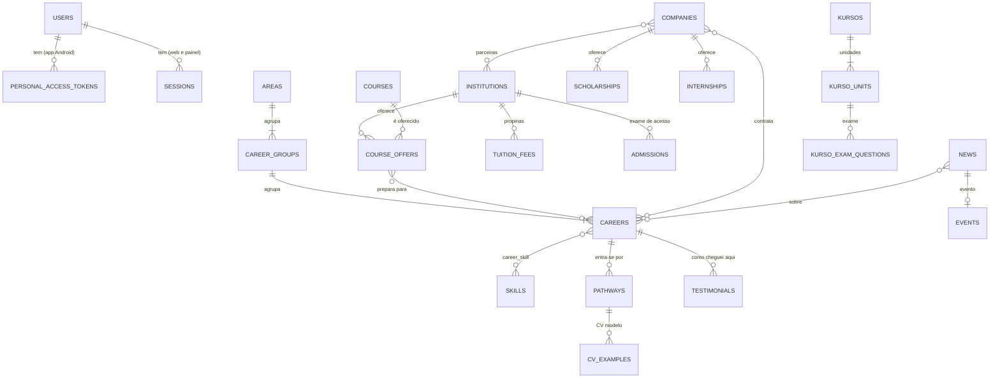
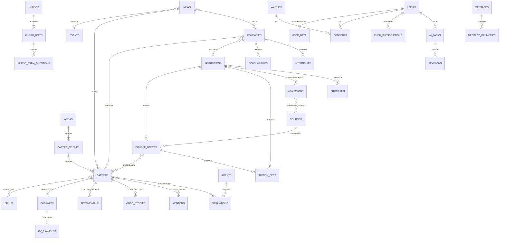

# Base de dados

MySQL/MariaDB, relacional. Este documento descreve **o que existe hoje**, as regras para mudar e o [modelo completo](#modelo-completo-adr-0019) que o backend vai construir (ADR 0019), que é o contrato das migrações e do importador. A visão de longo prazo (vagas, estatísticas semanais, XP) continua em [arquitetura.md, secção 4](arquitetura.md#4-modelo-de-dados).

> O teste `DocumentationTest` falha se uma tabela da base de dados não aparecer aqui entre acentos graves (por exemplo `users`). Documenta cada tabela nova no mesmo commit da migração.

## Convenções

| Regra | Porquê |
|---|---|
| Conjunto de caracteres `utf8mb4`, colação `utf8mb4_unicode_ci` | Acentos e emojis; a pesquisa trata "informatica" e "Informática" como iguais |
| Tabelas e colunas em inglês, no plural e em `snake_case` | Convenção do Laravel |
| Chave primária `id` (inteiro grande sem sinal), salvo nas tabelas do framework | Simples e rápido |
| Datas em UTC (`timestamp`); a app mostra-as na hora de Angola | Sem confusões com fusos horários |
| `created_at` e `updated_at` em todas as tabelas de negócio | Saber quando mudou |
| `deleted_at` (*soft delete*) só onde for preciso recuperar | Apagar a conta remove os dados pessoais a sério (ver [seguranca.md](seguranca.md#dados-pessoais-e-menores)) |
| Valores fixos guardados como texto curto e convertidos para enum no PHP | `locale` → `App\Enums\Locale` |
| `country_code` (sempre `AO` por agora) em instituições, vagas e estatísticas | Preparado para outros países |
| Todos os dados recolhidos têm `source_url` e `last_verified_at` | Transparência |

## Migrações

- **Uma migração nunca se edita depois de ir para produção.** Para mudar, cria-se uma nova.
- **As alterações são compatíveis com a versão anterior do código.** Durante um deploy, o código antigo e o novo convivem por instantes. Para mudar o nome de uma coluna, primeiro acrescenta-se a nova, depois migram-se os dados e só no deploy seguinte se apaga a antiga.
- O `down()` funciona sempre, para se poder voltar atrás em desenvolvimento.
- Em produção, as migrações correm no deploy (`php artisan migrate --force`), depois da cópia de segurança.

## Bases de dados

| Nome | Onde | Para quê |
|---|---|---|
| `kaye` | O teu PC (MariaDB do XAMPP) e o container local | Desenvolvimento |
| `kaye_test` | O teu PC e o CI | Testes PHPUnit e E2E; é apagada e recriada pelos testes |
| Produção | Hostinger | Utilizadores reais; só o deploy lhe toca |

## Tabelas atuais

### Do Kayé

#### `users`

Uma pessoa com conta. O login é feito só com o Google (e, no iOS, com a Apple).

| Coluna | Tipo | Notas |
|---|---|---|
| `id` | bigint | |
| `google_sub` | varchar, único, pode ser vazio | Identificador da conta Google |
| `apple_sub` | varchar, único, pode ser vazio | Identificador Apple (Fase 2, iOS) |
| `email` | varchar, único | Vem do Google |
| `name` | varchar | |
| `avatar_url` | varchar(2048) | Fotografia do Google |
| `birth_year` | smallint | **Só o ano**, não a data (Lei n.º 22/11: recolher o mínimo). Define se é menor |
| `province` | varchar(64) | Província, nunca a morada |
| `current_education_level` | varchar(32) | |
| `locale` | varchar(5), por omissão `pt` | `pt`, `en` ou `fr` (`App\Enums\Locale`) |
| `app_authentication_secret`, `app_authentication_recovery_codes` | text, podem ser vazios, **cifradas** | O segundo fator (TOTP) do painel e os códigos de recuperação. Nunca saem no JSON do modelo |
| `xp` | int | Pontos da gamificação |
| `last_login_at` | timestamp, pode ser vazio | O último login com o Google |
| `password` | varchar, pode ser vazio | **Só para o admin local**, até o painel passar para o login Google. Os utilizadores nunca têm senha |
| `remember_token` | varchar | Sessão do painel |
| `created_at`, `updated_at`, `deleted_at` | timestamp | |

Os papéis da equipa (`admin`, `editor`, `reviewer`) já não estão numa coluna: vivem em `roles` e `model_has_roles` (`spatie/laravel-permission`, [ADR 0026](decisoes/0026-papeis-2fa-copias-e-saude.md)), com as permissões de `App\Enums\StaffRole`. A migração passou `admin` a `admin` e `moderator` a `reviewer`.

### Pessoas (login, ADR 0019)

Com o login Google já existem `user_data` (o `UserData` da app, com versão) e `consents` (a prova de cada consentimento), com as colunas descritas no [modelo completo](#pessoas). Desde a comunicação (prompt 6) `consents` também guarda os da lista de espera (`waitlist_id`), a origem e o IP truncado; a migração copiou para lá os consentimentos de quem já estava na lista. Apagar a conta apaga as duas (`cascadeOnDelete`), e a pessoa de vez.

### Avisos (prompt 6)

`push_subscriptions`, `messages` e `message_deliveries` existem, com as colunas descritas no [modelo completo](#messages-e-message_deliveries). As regras estão em [seguranca.md](seguranca.md#avisos-email-e-web-push).

| Peça | Onde | O que faz |
|---|---|---|
| Consentimentos | `App\Support\Consents` | Dar, retirar e verificar; o IP truncado; os da lista de espera (`forWaitlist`) |
| Links assinados | `App\Support\NoticeLinks`, `App\Http\Controllers\NoticeLinkController` | Confirmação dupla e "deixar de receber" |
| Emails | `App\Mail\*` (base `NoticeMail`), `resources/views/mail`, tema `mail/kaye.css`, textos em `lang/<língua>/notices.php` | Confirmação, boas-vindas, prazo a chegar, novidades, aviso, resposta a crítica |
| Push | `App\Notifications\PushNotice`, `PushSubscriptionController` | Web Push com VAPID (`laravel-notification-channels/webpush`) |
| Público e envio | `App\Messaging\Audience`, `Sender`, `App\Jobs\SendDelivery` | Quem recebe; lotes dentro do limite por hora (`kaye:send-messages`, cada minuto); um envio por entrega |
| Lembretes | `App\Messaging\DeadlineReminders` | Os prazos guardados (`remindedDeadlines`) 3 dias antes (`kaye:deadline-reminders`, 08:00) |
| Painel | `MessageResource`, ação "Responder" nas críticas | Escrever, enviar e ver o relatório das entregas |

| Peça | Onde | O que faz |
|---|---|---|
| Documento | `App\Models\UserData::document()`, `setDocument()` | Guarda e lê o JSON como objetos, para `{}` continuar a ser um registo (e não uma lista) quando volta à app |
| Fusão | `App\Support\UserDataMerger` | Junta a cópia do aparelho com a do servidor sem perder nada ([arquitetura.md, 5.1](arquitetura.md#51-login-com-google)) |
| Contas | `App\Support\Accounts` | Login pelo Google, perfil copiado de `user_data` para `users`, exportação e apagamento |

### Escritas sem conta (ADR 0019)

`waitlist`, `feedback`, `interviews` e `public_cards` já existem, com as colunas descritas no [modelo completo](#pessoas), e recebem as escritas que eram das funções do Vercel (as mesmas rotas e respostas, [arquitetura.md, secção 6](arquitetura.md#6-api-v1)). `php artisan kaye:migrate-redis` copia uma vez o que estava no Upstash Redis (ver o README).

| Peça | Onde | O que faz |
|---|---|---|
| Leitura do pedido | `App\Support\Submission` | Corpo JSON com tamanho máximo, campo-isco `website`, respostas `no-store` e `noindex` |
| Contactos | `App\Support\Contact` | Os mesmos padrões de email e telefone da app; `normalisePhone` põe +244 num número angolano |
| CSV | `App\Support\ListExport` | A lista de espera e as críticas em CSV (rota com token e painel) |
| Migração | `App\Console\Commands\MigrateRedis` | Lê o Upstash, grava sem duplicar, conta antes e depois |

### Catálogo (ADR 0019)

As tabelas de conteúdo do [modelo completo](#modelo-completo-adr-0019) já existem, com as colunas descritas lá: `areas`, `career_groups`, `careers`, `skills`, `career_skill`, `pathways`, `cv_examples`, `testimonials`, `video_stories`, `mentors`, `career_mentor`, `agents`, `simulations`, `institutions`, `courses`, `course_offers`, `career_course_offer`, `tuition_fees`, `admissions`, `admission_course`, `programs`, `career_program`, `free_courses`, `career_free_course`, `companies`, `career_company`, `company_institution`, `scholarships`, `internships`, `support_programs`, `news`, `career_news`, `company_news`, `area_news`, `institution_news`, `events`, `figures`, `career_figure`, `assessment_questions`, `access_exam_questions`, `interview_questions`, `kursos`, `kurso_units`, `kurso_exam_questions` e `datasets`. As notícias recolhidas, os factos das vagas e os comentários têm tabelas próprias (`area_news`, `institution_news`, `job_postings`, `comments`, `comment_reports`; ver Novidades, Mercado e Comentários). O histórico de cada alteração fica em `activity_log` (`spatie/laravel-activitylog`).

No código:

| Peça | Onde | O que faz |
|---|---|---|
| Colunas comuns | `App\Support\ContentSchema::columns()` | `slug`, `status`, `source_url`, `source_checked_at`, `estimated`, `position`, datas e *soft delete*, iguais em todas as migrações. `ContentSchema::pivot()` cria as tabelas de ligação |
| Estado e histórico | `App\Models\Concerns\HasContentStatus` | O `status` como `App\Enums\ContentStatus`, o *soft delete*, o histórico e o *scope* `published()` (o único que a API vai usar) |
| Traduções | `Spatie\Translatable\HasTranslations` | A lista `$translatable` de cada modelo são as colunas marcadas com \* abaixo |
| Relações repetidas | `BelongsToCareer`, `BelongsToInstitution`, `BelongsToCourse`, `BelongsToCompany`, `BelongsToKurso`, `LinksToCareers` (em `App\Models\Concerns`) | Uma só definição para as relações que vários modelos têm |

O que a implementação ajustou ao contrato abaixo:

- O `slug` é `varchar(191)`, não 120: os das ofertas (`<instituição>--<curso>--<nível>`) chegam a 141 caracteres.
- `logo`, `banner`, `photo` e `thumbnail` são `text`: a exportação traz os logótipos pequenos embutidos (`data:image/svg+xml,…`), maiores do que um `varchar`.
- Em `careers`, as colunas do guia (`description`, `day_to_day`, `work_context`, `work_styles`, `stages`, `market`, `cv_guide`, `self_employment`) podem ser vazias: uma carreira com `detailed = false` não tem guia. Hoje as 256 têm.
- `free_courses.hours` é `decimal(6,2)` (há cursos de 12,75 horas).
- Em `kursos`, `audience`, `level`, `lang`, `tone`, `goals` e `credits` podem ser vazios: os anunciados "Em breve" só têm título, texto e ícone.
- `tuition_fees`: a exportação repete a propina média (`basis = average`) em cada licenciatura sem propina própria; guarda-se **uma** linha por instituição, sem oferta. O importador recusa uma instituição cujas médias não sejam iguais.

### Importação (`kaye:import`)

`php artisan kaye:import` lê `database/data` (o caminho está em `config/kaye.php`, `data_path`) e escreve o catálogo. O `DatabaseSeeder` chama-o, por isso `php artisan migrate --seed` deixa a base de dados cheia.

1. **Valida o `manifest.json` primeiro.** Cada ficheiro de cada língua tem de ter o SHA-256 e o número de registos do manifest; se um falhar, não se importa nada e o comando diz quais.
2. **Um recurso de cada vez, cada um numa transação.** A ordem é a das ligações (áreas → grupos → competências → carreiras → caminhos → instituições → cursos → ofertas → propinas → empresas → …; a lista está em `App\Import\Catalog`). Um recurso com problemas é desfeito por inteiro; os anteriores ficam.
3. **Por `slug`** (por `career_id` + `slug` nos caminhos, `kurso_id` + `slug` nas unidades e perguntas dos Kursos, `news_id` nos eventos). O que é novo cria-se, o que mudou atualiza-se, o que é igual fica como está: **correr duas vezes não muda nada** (nem o `updated_at` nem o histórico).
4. **As três línguas vão para o mesmo registo.** Uma língua que só repete o português não se guarda: a app cai para o português, e a tradução (prompt 8) preenche-a.
5. **As ligações vão por slug** e as tabelas de ligação sincronizam-se. Um slug que não existe falha com a lista de todos os casos (`career-groups medicina: areas 'medicine' does not exist`); um slug repetido também falha.
6. **O `status` só se escreve ao criar:** `published`, ou `draft` nos dados de exemplo (`example`). Depois, publicar é decisão do painel e o importador não lhe toca.
7. **Nunca apaga.** Um registo que saiu da exportação fica na base de dados; um apagado no painel (*soft delete*) não volta a ser criado.
8. No fim, imprime uma tabela recurso → lidos, criados, atualizados, erros. `--only=careers,pathways` importa só esses.

`career-traits` não se importa: a API calcula-o a partir das carreiras.

### Do Laravel (infraestrutura)

| Tabela | Para quê | Dados pessoais |
|---|---|---|
| `sessions` | Sessões do painel (e, com o login, da app web) | Sim: IP e browser. Apagadas quando a sessão expira (120 min) |
| `personal_access_tokens` | Tokens da API para a app Android. Guardados como *hash* SHA-256, expiram em 30 dias e são limpos todos os dias às 02:00 | Não |
| `cache`, `cache_locks` | Cache e bloqueios (inclui os contadores do limite de pedidos) | Não |
| `jobs`, `job_batches`, `failed_jobs` | Fila de tarefas, processada pelo cron | Pode haver, nos dados da tarefa: não pôr dados pessoais nas tarefas |
| `migrations` | Que migrações já correram | Não |

A tabela `password_reset_tokens`, que vem com o Laravel, foi retirada: não há senhas para recuperar.

## Diagrama atual

As restantes tabelas do catálogo (`video_stories`, `mentors`, `agents`, `simulations`, `programs`, `free_courses`, `support_programs`, `figures`, as perguntas e `datasets`) e as ligações delas estão no [diagrama do modelo completo](#diagrama-do-modelo-completo).

## Modelo completo (ADR 0019)

O que o backend vai criar, a partir dos tipos de `apps/web/src/data/types.ts`. **Uma tabela por tipo com identidade própria** (tem `id` e aparece sozinho ou é ligado de outro lado); **o que é lista aninhada sem identidade fica numa coluna JSON** (os passos de um caminho, as etapas de uma carreira, as fontes). A API devolve exatamente a forma de `types.ts`: o `id` do frontend é o `slug` da tabela, e as ligações saem como slugs.

### Regras comuns

**Colunas de todas as tabelas de conteúdo** (não se repetem nas tabelas abaixo):

| Coluna | Tipo | Notas |
|---|---|---|
| `id` | bigint | Só interno; nunca sai na API |
| `slug` | varchar(191), único | O `id` de `types.ts` (`enfermeiro`, `uan`…). É a chave do `kaye:import` |
| `status` | varchar(10), indexado, por omissão `draft` | `draft`, `review`, `published` (`App\Enums\ContentStatus`). A API só mostra `published` |
| `source_url` | varchar(2048), pode ser vazio | A fonte principal. Obrigatória para a IA escrever (ADR 0019) |
| `source_checked_at` | date, pode ser vazio | O `checkedAt` do frontend: quando a equipa confirmou os factos |
| `estimated` | boolean, por omissão `false` | Estimativa da equipa (o `estimated` do frontend; ver `data-to-collect-later`) |
| `position` | smallint, por omissão `0` | A ordem em que a app mostra a lista (o `position` da exportação) |
| `created_at`, `updated_at`, `deleted_at` | timestamp | *Soft delete*: o conteúdo apagado recupera-se no painel |

**Traduções.** As colunas marcadas com **\*** são traduzíveis: JSON `{"pt": "…", "en": "…", "fr": "…"}` com `spatie/laravel-translatable`. A língua vem do `Accept-Language`; uma língua em falta devolve o português. Uma coluna JSON marcada com \* (uma lista de textos) guarda a lista inteira por língua. Quase todo o conteúdo existe hoje só em português: a IA pode propor as traduções en e fr (um pedido como "traduz os resumos das empresas" em "Pesquisar com IA", ou pelo MCP), e cada tradução entra em `revisions` até ser aprovada ([ia.md](ia.md)).

**Dados de exemplo.** O que foi inventado para a demonstração (as instituições com `example`, os `programs` delas, as novidades e os testemunhos com `example`) é importado com `status = draft`: fica na base de dados, **invisível em produção**, até haver dados reais que o substituam.

**Listas de textos e fontes.** `sources` é sempre JSON `[{label, url}]` (o `SourceLink[]`); uma `source` única é JSON `{label, url}`. As fotografias (`Photo`) são JSON `{thumb, small, large, alt*, credit}`.

**Tabelas de ligação** (`career_skill`, …) têm só as duas chaves estrangeiras (com `cascadeOnDelete`), a chave primária composta e `position`, a ordem da lista no frontend (as carreiras de uma oferta, as empresas de uma notícia…), que a API devolve assim. Não têm as colunas comuns. Mudam sem eventos dos modelos: quem as muda limpa a cache da API pública (`App\Support\PublicContent::flush()`; o `kaye:import` fá-lo no fim).

**Exportação do frontend.** `npm run export:data` (em `apps/web`, `scripts/export-data.ts`) grava em `apps/api/database/data/<recurso>.<locale>.json` o que as funções de `source.ts` e os módulos lidos diretamente devolvem, ordenado por `slug` (o `id` quando não há), com 2 espaços, e o `manifest.json` (por recurso e língua: ficheiro, registos, SHA-256). As áreas e os grupos não têm módulo próprio: `areas` e `career-groups` saem de `MARKET_AREAS`, `CAREER_GROUPS` e `GROUP_AREAS`, com os nomes das traduções da app (`market.area_*`, `groups.*`), que já existem nas três línguas. Cada registo leva `position`, a ordem da app. Os pormenores que devolvem o próprio item da lista (`getAcademy`, `getCourse`, `getCompany`) não têm ficheiro; `career-details` tem o `Career` completo de cada carreira curada. `src/data/export.test.ts` falha se os ficheiros ou o manifest não corresponderem aos dados: depois de mudar conteúdo, volta a exportar.

**Nomes que mudam do frontend para a base de dados.** Além de camelCase → snake_case: o `areas` das ofertas e das empresas é a coluna `groups`; o `year` das admissões é `academic_year`, o `registration.start`/`end` é `registration_start`/`registration_end` e o `fee` é `fee_aoa`; o `starts`/`ends` dos eventos é `starts_on`/`ends_on`; o `fee` de uma oferta é uma linha de `tuition_fees`; o `unit` de uma pergunta de exame dos Kursos é `kurso_unit_id`; o `lessons` de uma unidade é o `outline`.

**Índices.** Além dos indicados: `status` e `deleted_at` em todas, e um índice em cada chave estrangeira.

### Catálogo: áreas e carreiras

#### `areas`

As 13 áreas do Mercado (`MarketArea`).

| Coluna | Tipo | Notas |
|---|---|---|
| `name`\* | json | "Saúde" |

#### `career_groups`

Os grupos de carreiras (`CareerGroup`, `GROUP_AREAS`).

| Coluna | Tipo | Notas |
|---|---|---|
| `area_id` | fk → `areas` | |
| `name`\* | json | |

#### `careers`

Uma profissão: o resumo (`CareerSummary`) e, quando curada, o guia completo (`Career`). Os **guias** das profissões são estas linhas, não uma tabela à parte.

| Coluna | Tipo | Notas |
|---|---|---|
| `career_group_id` | fk → `career_groups` | O `group` |
| `name`\*, `summary`\*, `description`\* | json | |
| `riasec` | json | `{R, I, A, S, E, C}` de 0 a 1 |
| `demand` | varchar(5), indexado | `alta`, `media`, `baixa` |
| `salary_median` | int, pode ser vazio | Kz por mês |
| `salary_kind` | varchar(10), pode ser vazio | `entrada` nas carreiras do Estado |
| `detailed` | boolean | `false` enquanto o guia não está curado |
| `image` | json, pode ser vazio | `Photo` |
| `day_to_day`\*, `work_context`\*, `work_styles`\* | json | Listas do guia |
| `employer_asks` | json, pode ser vazio | `EmployerAsks` (agregados das vagas) |
| `stages`\* | json | `CareerStage[]`: etapas, anos, responsabilidades |
| `market`\* | json | `Market` (procura, salários, nota com fonte) |
| `cv_guide`\* | json | `CvGuide` |
| `self_employment`\* | json, pode ser vazio | `SelfEmployment`; os `programIds` são slugs de `support_programs` |

Relações: `skills` (por `career_skill`), `pathways`, `cv_examples`, `testimonials`, `video_stories`, `programs`, `course_offers`, `companies`, `free_courses`, `news`, `figures`, `mentors`. As `CareerTraits` (`?fields=traits`) calculam-se a partir destas, não se guardam.

#### `skills` e `career_skill`

| Tabela | Colunas | Notas |
|---|---|---|
| `skills` | `name`\* | O `Skill` sem a importância |
| `career_skill` | `career_id`, `skill_id`, `importance` (`essencial`, `opcional`), `position`, `name` (json, pode ser vazio) | A importância é de cada carreira. `name` é o nome que a carreira dá à competência (`{"pt": "SQL básico"}`), só quando não é o da competência |

#### `pathways`

Um caminho para entrar numa carreira (`Pathway`).

| Coluna | Tipo | Notas |
|---|---|---|
| `career_id` | fk → `careers` | |
| `slug` | | **Exceção:** único por (`career_id`, `slug`), porque os ids dos caminhos repetem-se entre carreiras |
| `name`\*, `summary`\* | json | |
| `steps`\* | json | `PathwayStep[]` (tipo, necessidade, meses, nível, autodidata, certificado) |
| `total_cost_min`, `total_cost_max` | int, podem ser vazios | Kz |
| `position` | smallint | |

#### `cv_examples`

CVs modelo de pessoas fictícias (`CvExample`).

| Coluna | Tipo | Notas |
|---|---|---|
| `career_id` | fk → `careers` | |
| `pathway_id` | fk → `pathways` | O caminho que mostra |
| `seniority` | varchar(16) | `primeiro_emprego`, `junior`, `experiente` |
| `template` | varchar(16) | `CvTemplate` |
| `why`\* | json | |
| `cv`\* | json | `CvData` |
| `notes`\* | json | Porque funciona cada parte |

#### `testimonials`

"Como cheguei aqui" (`Testimonial`): editoriais, com fonte quando têm nome; os de exemplo nunca são de pessoas reais.

| Coluna | Tipo | Notas |
|---|---|---|
| `career_id` | fk → `careers` | |
| `company_id` | fk → `companies`, pode ser vazio | |
| `name` | varchar, pode ser vazio | Só com `source` |
| `role`\*, `path`\*, `tip`\* | json | `path` ≤ 350 caracteres, `tip` ≤ 140 |
| `place` | varchar, pode ser vazio | |
| `years` | smallint, pode ser vazio | |
| `source` | json, pode ser vazio | |
| `example` | boolean | |

#### `video_stories`

"O meu dia como…" (`VideoStory`, [videos.md](videos.md)). Só com consentimento escrito, nunca de menores.

| Coluna | Tipo | Notas |
|---|---|---|
| `career_id` | fk → `careers` | |
| `name`, `role`, `company` | varchar | `company` pode ser vazio |
| `title`\* | json | |
| `url` | varchar(2048) | |
| `platform` | varchar(10) | `youtube`, `tiktok`, `instagram` |
| `duration_seconds` | smallint | |
| `thumbnail` | varchar, pode ser vazio | Ficheiro local |
| `consent_at`, `recorded_at` | date | `consent_at` obrigatório |

#### `mentors` e `career_mentor`

Voluntários aprovados (`Mentor`, [mentores.md](mentores.md)).

| Coluna | Tipo | Notas |
|---|---|---|
| `name`, `role`, `company` | varchar | |
| `bio`\* | json | ≤ 280 caracteres |
| `languages` | json | Códigos ISO |
| `photo` | varchar, pode ser vazio | |
| `consent_at` | date | |
| `availability` | varchar(10) | `grupo`, `individual` (os menores só veem `grupo`) |

`career_mentor`: `career_id`, `mentor_id`.

#### `agents`

Os agentes Kayé: técnicos de recursos humanos e profissionais aprovados pelo Kayé, que escrevem as simulações ([mentores.md](mentores.md#agentes-kayé)). Só se guarda o que o agente autoriza.

| Coluna | Tipo | Notas |
|---|---|---|
| `name`, `role` | varchar | Nome e função |
| `area` | varchar(20) | Uma das 13 áreas do Mercado (`health`, `business`…) |
| `verified_by` | varchar | Quem, no Kayé, verificou a pessoa e o texto |
| `verified_at` | date | Data dessa verificação |
| `company` | varchar, pode ser vazio | Só se o agente autorizou |
| `photo` | varchar, pode ser vazio | Só com consentimento |
| `consent_at` | date | |

#### `simulations`

Um dia de trabalho de uma carreira, para viver antes de escolher ([mentores.md](mentores.md#simulações-de-trabalho)).

| Coluna | Tipo | Notas |
|---|---|---|
| `career_id` | FK `careers` | Uma carreira com procura |
| `agent_id` | FK `agents`, pode ser vazio | Sem agente, a página mostra "Equipa Kayé" |
| `title`\*, `intro`\* | json | |
| `minutes` | smallint | Tempo de leitura e decisões |
| `moments`\* | json | A lista inteira por língua: 5 a 8 momentos `{id, time, title, text, decision?}`; cada decisão tem 2 a 4 opções `{id, text, result, why}` |
| `asks`\* | json | O que a profissão pede |
| `next_steps`\* | json | O passo seguinte: `{kind: course|academy|internship, text}` (na API: `next`) |
| `example` | boolean | Escrita pelo Kayé, à espera de revisão por um profissional: a app mostra a marca "Exemplo". **Importa-se como publicada** (ao contrário dos outros exemplos, que ficam em rascunho), porque a marca é visível |
| `languages` | json | As línguas em que o texto existe (`["pt"]`); nas outras a app mostra o português, com o aviso de tradução em curso |

Os comentários às simulações usam a tabela `comments` (`subject_type = simulation`, `subject_id` = `slug`).

### Formação

#### `institutions`

As instituições reais (`Academy`) e as fictícias "Exemplo" dos `programs` (`Institution`), separadas por `example`.

| Coluna | Tipo | Notas |
|---|---|---|
| `name` | varchar | |
| `type` | varchar(20), indexado | `universidade`, `instituto_superior`, `instituto_medio`, `centro_formacao`, `online` |
| `ownership` | varchar(8), pode ser vazio, indexado | `publica`, `privada`; vazio = por confirmar |
| `province` | varchar(64), indexado | |
| `place` | varchar | |
| `summary`\* | json | |
| `min_age` | tinyint, pode ser vazio | |
| `logo`, `banner` | varchar, podem ser vazios | |
| `website`, `phone`, `email`, `address`, `maps_url` | varchar, podem ser vazios | Só contactos que a instituição publicou |
| `social` | json, pode ser vazio | `{facebook, instagram, linkedin}` |
| `founded` | json, pode ser vazio | `{year, source}` |
| `recognized_by` | json, pode ser vazio | `{name, source}` |
| `sources` | json | |
| `example` | boolean, por omissão `false` | `true` só nas instituições fictícias dos `programs` |

#### `courses`

Um curso em geral ("Enfermagem Geral"), oferecido por várias instituições (`Course`). O `CatalogCourse` da API junta-lhe as ofertas; `levels`, `areas`, `careers`, `students` e `graduates` calculam-se a partir delas.

| Coluna | Tipo | Notas |
|---|---|---|
| `name`\* | json | |

#### `course_offers` e `career_course_offer`

Um curso numa instituição (`AcademyOffer`).

| Coluna | Tipo | Notas |
|---|---|---|
| `institution_id` | fk → `institutions` | |
| `course_id` | fk → `courses` | |
| `slug` | | Gerado: `<instituição>--<curso>--<nível>` |
| `name`\* | json | O nome na instituição |
| `course_name`\* | json, pode ser vazio | O nome que a instituição dá ao **curso** (`AcademyOffer.course.name`), só quando não é o do curso ("Técnico de Informática" em `tecnico-informatica`); vazio = o nome do curso |
| `level` | varchar(24), indexado | `formacao_profissional`, `medio_tecnico`, `licenciatura`, `certificacao`, `mestrado`, `especialidade` |
| `faculty` | varchar, pode ser vazio | |
| `recognition` | json, pode ser vazio | O decreto que o criou |
| `groups` | json | `CareerGroup[]` |
| `students`, `graduates` | int, podem ser vazios | Do anuário |
| `year` | varchar(9), pode ser vazio | "2023/24" |
| `curriculum`\* | json, pode ser vazio | `Curriculum`: períodos, disciplinas, fonte |
| `duration_months` | smallint, pode ser vazio | A duração estimada (`AcademyOffer.durationMonths`) |
| `schedule` | json, pode ser vazio | Os horários (`diurno`, `pos_laboral`…), estimados |
| `estimated` | bool | Comum a todas as tabelas de conteúdo; a API só o devolve quando é verdadeiro |
| `position` | smallint | Ordem dentro da instituição |

Índice único (`institution_id`, `course_id`, `level`). `career_course_offer`: `career_id`, `course_offer_id`.

#### `tuition_fees`

As **propinas** publicadas (`PublishedFee`). Sem linha, a app estima (`domain/fees.ts`).

| Coluna | Tipo | Notas |
|---|---|---|
| `institution_id` | fk → `institutions` | |
| `course_offer_id` | fk → `course_offers`, pode ser vazio | Vazio com `basis = average`: a média das licenciaturas da instituição |
| `monthly_aoa` | int | |
| `basis` | varchar(8) | `course`, `average` |
| `academic_year` | varchar(9) | |
| `source` | json | |

Índice único (`institution_id`, `course_offer_id`, `academic_year`).

#### `admissions` e `admission_course`

Acesso ao ensino superior (`Admission`): o exame de uma instituição ou o calendário nacional do MESCTI.

| Coluna | Tipo | Notas |
|---|---|---|
| `institution_id` | fk → `institutions`, pode ser vazio | Vazio = calendário nacional |
| `academic_year` | varchar(9) | "2026/27" |
| `registration_start`, `registration_end` | date, podem ser vazios | `registration_end` indexado (prazos) |
| `exam_dates` | json | Datas ISO |
| `subjects`\*, `requirements`\* | json | |
| `vacancies` | int, pode ser vazio | |
| `min_grade`, `min_grade_year` | decimal(4,2), varchar(9), podem ser vazios | 0–20, só com fonte |
| `fee_aoa` | int, pode ser vazio | |
| `url` | varchar(2048) | |
| `sources` | json | |

`admission_course`: `admission_id`, `course_id`. Sem linhas = todos os cursos da instituição.

#### `programs` e `career_program`

As ofertas com preço, duração e nota (`Program`). Hoje só existem para instituições fictícias "Exemplo".

| Coluna | Tipo | Notas |
|---|---|---|
| `institution_id` | fk → `institutions` | |
| `course_id` | fk → `courses` | |
| `name` | varchar | |
| `level` | varchar(24) | |
| `duration_months` | smallint | |
| `schedule` | json | `diurno`, `pos_laboral`, `online` |
| `total_cost` | int, pode ser vazio | Kz, o curso inteiro |
| `recognized` | boolean | |
| `rating_average`, `rating_count` | decimal(3,2), int, podem ser vazios | |
| `image` | json, pode ser vazio | |

`career_program`: `career_id`, `program_id`.

#### `free_courses` e `career_free_course`

Cursos online gratuitos (`FreeCourse`).

| Coluna | Tipo | Notas |
|---|---|---|
| `name`, `provider` | varchar | |
| `languages`, `areas` | json | |
| `hours` | smallint, pode ser vazio | |
| `certificate` | varchar(8), pode ser vazio | `gratis`, `pago`, `nenhum` |
| `credential` | varchar, pode ser vazio | |
| `price_usd` | decimal(8,2), pode ser vazio | |
| `level` | varchar(12) | `iniciante`, `intermedio`, `avancado` |
| `url` | varchar(2048) | |
| `sources` | json | |

`career_free_course`: `career_id`, `free_course_id`.

### Oportunidades e empresas

#### `companies`, `career_company` e `company_institution`

Empresas reais, só com o que as fontes confirmam (`Company`).

| Coluna | Tipo | Notas |
|---|---|---|
| `name` | varchar | |
| `sector` | varchar(20), indexado | `CompanySector` |
| `province` | varchar(64), indexado | |
| `place` | varchar | |
| `summary`\* | json | |
| `logo`, `banner`, `website` | varchar, podem ser vazios | |
| `logo_on_dark` | boolean | |
| `careers_sourced` | boolean | Uma fonte pública diz para que carreiras contrata |
| `groups` | json | `CareerGroup[]` |
| `programs`\* | json | `CompanyProgram[]`: programas para jovens, com fonte |
| `activities`\* | json, pode ser vazio | |
| `activities_source`, `founded`, `employees` | json, podem ser vazios | Com fonte |
| `socials` | json, pode ser vazio | |
| `roles`\* | json, pode ser vazio | `CompanyRole[]` |
| `people` | json, pode ser vazio | `CompanyPerson[]`: só cargos públicos com fonte, nunca menores |
| `insights` | json, pode ser vazio | `CompanyInsight[]`: como entrar e outras notas; iguais em todas as línguas |
| `quotes` | json, pode ser vazio | `CompanyQuote[]`: citações públicas com fonte |
| `headquarters` | json, pode ser vazio | `CompanyFact`: a sede, com onde está dito |
| `sources` | json | |

`career_company`: `career_id`, `company_id`, `position`. `company_institution` (os `partners`): `company_id`, `institution_id`.

#### `scholarships`

Bolsas reais (`Scholarship`).

| Coluna | Tipo | Notas |
|---|---|---|
| `name`\* | json | |
| `provider` | varchar | |
| `company_id` | fk → `companies`, pode ser vazio | |
| `kind` | varchar(20), indexado | `estado`, `empresa`, `fundacao`, `governo_estrangeiro`, `universidade` |
| `destination` | varchar(8) | `angola`, `exterior` |
| `levels`, `areas`, `covers` | json | `areas` vazia = qualquer área |
| `min_age`, `max_age` | tinyint, podem ser vazios | |
| `requirements`\* | json | |
| `deadline` | date, pode ser vazio, indexado | Só quando publicado para 2026/27 |
| `recurring` | boolean | |
| `url` | varchar(2048) | |
| `sources` | json | |

#### `internships`

Estágios e trainees reais (`Internship`).

| Coluna | Tipo | Notas |
|---|---|---|
| `name`\* | json | |
| `provider` | varchar | |
| `company_id` | fk → `companies`, pode ser vazio | |
| `kind` | varchar(24), indexado | `trainee`, `estagio_profissional`, `estagio_curricular`, `programa_publico` |
| `areas`, `audience` | json | |
| `min_age`, `max_age` | tinyint, podem ser vazios | |
| `paid` | boolean, pode ser vazio | Vazio = nenhuma fonte diz |
| `duration_months` | smallint, pode ser vazio | |
| `province` | varchar(64), pode ser vazio | |
| `requirements`\* | json | |
| `deadline` | date, pode ser vazio, indexado | |
| `recurring` | boolean | |
| `url` | varchar(2048) | |
| `sources` | json | |

#### `support_programs`

Programas para começar por conta própria (`SupportProgram`).

| Coluna | Tipo | Notas |
|---|---|---|
| `name`\*, `audience`\* | json | |
| `provider` | varchar | |
| `kind` | varchar(12) | `credito`, `kit`, `formacao`, `registo`, `incubadora` |
| `min_age` | tinyint, pode ser vazio | |
| `url` | varchar(2048) | |
| `sources` | json | |

### Novidades

#### `news`, `career_news` e `company_news`

Novidades (`NewsItem`).

| Coluna | Tipo | Notas |
|---|---|---|
| `date` | date, indexado | Mais recentes primeiro |
| `kind` | varchar(10), indexado | `kaye`, `eventos`, `cursos`, `empresas`, `analise` |
| `title`\*, `summary`\* | json | |
| `body`\* | json, pode ser vazio | Parágrafos |
| `image` | json, pode ser vazio | Ilustrativa, nunca retrato |
| `to` | varchar, pode ser vazio | Página da app |
| `source` | json, pode ser vazio | |
| `example` | boolean | |

`career_news`: `career_id`, `news_id`. `company_news`: `company_id`, `news_id`.

As notícias recolhidas dos feeds ([fontes-de-noticias.md](fontes-de-noticias.md)) usam as mesmas colunas, mais `url_hash` (char(64), único: sha-256 da ligação normalizada) e `title_hash` (char(64), indexado: sha-256 do título normalizado), que evitam duplicados, e `summary_attempts` (tinyint, 0 por defeito: quantas vezes se tentou o resumo por IA; ver [ADR 0023](decisoes/0023-resumo-das-noticias-por-ia.md)). `area_news`: `area_id`, `news_id`. `institution_news`: `institution_id`, `news_id` (as ligações que o filtro das Novidades usa).

#### `events`

Os **eventos** de uma novidade do tipo `eventos` (`NewsEvent`): uma linha por novidade, para os prazos e o calendário poderem filtrar pela data.

| Coluna | Tipo | Notas |
|---|---|---|
| `news_id` | fk → `news`, único | O evento não tem `slug` próprio: é o da novidade |
| `starts_on`, `ends_on` | date, `ends_on` pode ser vazio | `starts_on` indexado |
| `time` | varchar(32), pode ser vazio | Como o organizador publica |
| `venue`, `city` | varchar | |
| `formats` | json | `conferencia`, `palestra`… |
| `free` | boolean | |
| `price`, `organizer` | varchar, podem ser vazios | |
| `register` | json, pode ser vazio | `{label, url}` |
| `unconfirmed` | boolean | |

#### `figures` e `career_figure`

Figuras da semana (`Figure`): pessoas reais, com o cargo confirmado numa fonte.

| Coluna | Tipo | Notas |
|---|---|---|
| `name` | varchar | |
| `role`\*, `why`\* | json | |
| `follow` | json | `{label, url}`: o perfil público delas |
| `source` | json | |
| `photo` | varchar, pode ser vazio | Só com licença livre |

`career_figure`: `career_id`, `figure_id`.

### Testes, exames e Kursos

#### `assessment_questions`

As 42 perguntas do teste vocacional (`AssessmentQuestion`, ADR 0017): 30 frases (5 por dimensão) e 12 situações com 6 cartões, um por dimensão.

| Coluna | Tipo | Notas |
|---|---|---|
| `slug` | | Frases `R1`…`C5`, situações `X1`…`X12` |
| `kind` | varchar(12) | `statement` (frase, resposta de 1 a 5) ou `situation` (situação, escolhe-se um cartão) |
| `context` | varchar(16), pode ser vazio | Só nas situações: onde acontece (`school`, `market`, `transport`…) |
| `dimension` | char(1), pode ser vazio | `R`, `I`, `A`, `S`, `E`, `C`; só nas frases |
| `text`\* | json | |
| `options`\* | json, pode ser vazio | Só nas situações: lista de `{dimension, icon, text}` |

#### `access_exam_questions`

O banco de perguntas originais dos exames de acesso (`data/demo/accessExams.ts`). Só em português: os exames são em português.

| Coluna | Tipo | Notas |
|---|---|---|
| `subject` | varchar(24), indexado | `EXAM_SUBJECTS` |
| `topic` | varchar(48), indexado | `EXAM_TOPICS` da disciplina |
| `level` | varchar(6), indexado | `easy`, `medium`, `hard` |
| `passage` | text, pode ser vazio | O texto original sobre o qual é a pergunta (interpretação) |
| `text` | text | O enunciado |
| `options` | json | As 4 opções, a certa onde `answer` indica |
| `answer` | tinyint | Índice em `options` (0–3) |
| `explanation` | text | |

#### `interview_questions`

As perguntas do treino de entrevistas (`data/demo/interviews.ts`).

| Coluna | Tipo | Notas |
|---|---|---|
| `area` | varchar(16), pode ser vazio, indexado | Vazio = todas as áreas |
| `career_id` | fk → `careers`, pode ser vazio | |
| `text`\* | json | A pergunta |
| `goal`\* | json | O que o recrutador quer saber |
| `model`\* | json | Uma resposta modelo curta para um primeiro emprego |
| `mistakes`\* | json | Os erros habituais |

O psicotécnico não tem tabela: as perguntas são geradas no aparelho (`domain/psychotech.ts`) a partir das listas de analogias, sinónimos e palavras inventadas, que ficam em `datasets` (`psychotech`). A competência quantitativa (geometria, percentagens, proporções, médias e probabilidades) não usa listas: `domain/psychotechMath.ts` calcula cada resposta a partir dos números da semente, e a simulação completa tem 24 perguntas (4 de cada uma das 6 competências) em 18 minutos.

#### `kursos`

Os Kursos (`Course` de `data/kursos/types.ts`, ADR 0016) e os anunciados "Em breve" (`AnnouncedCourse`).

| Coluna | Tipo | Notas |
|---|---|---|
| `title`\*, `subtitle`\*, `audience`\* | json | Num anunciado, `subtitle` é o `body` |
| `level` | varchar(32) | "A1 (QECR)", "Iniciante" |
| `lang` | varchar(8) | Língua dos exemplos e exercícios |
| `icon`, `tone` | varchar(12) | |
| `goals`\* | json | |
| `credits` | json | Licenças das fontes |
| `announced` | boolean | `true` = "Em breve" |

#### `kurso_units`

| Coluna | Tipo | Notas |
|---|---|---|
| `kurso_id` | fk → `kursos` | |
| `slug` | | **Exceção:** único por (`kurso_id`, `slug`) |
| `number` | smallint | |
| `title`, `summary` | varchar, text | Os Kursos são em português (ADR 0016) |
| `outline` | json, pode ser vazio | As lições sem o conteúdo, para o roteiro |
| `content` | json, pode ser vazio | `UnitContent` (lições, blocos, revisão). Vazio = "Em breve". Só se devolve quando se abre a unidade |

#### `kurso_exam_questions`

| Coluna | Tipo | Notas |
|---|---|---|
| `kurso_id` | fk → `kursos` | |
| `kurso_unit_id` | fk → `kurso_units` | |
| `slug` | | **Exceção:** único por (`kurso_id`, `slug`) |
| `kind` | varchar(6) | `choice`, `gap` |
| `prompt` | text | |
| `options` | json, pode ser vazio | Escolha múltipla |
| `answer` | tinyint, pode ser vazio | Índice em `options` |
| `answers` | json, pode ser vazio | Respostas aceites numa lacuna |

### Mercado

#### `job_postings`

Os factos de cada vaga enviados pelos scrapers a `POST /ingest/jobs` (`JobPosting`): nunca o texto do anúncio, nunca mostrados como vaga; só alimentam as contagens do Mercado: as vagas da semana (`GET /market/week`, contadas na hora) e, pelos scrapers, os totais dos 12 meses.

| Coluna | Tipo | Notas |
|---|---|---|
| `external_id` | varchar(191), único | `fonte:id`, como em `postings.jsonl`; reenviar atualiza |
| `source` | varchar(40), indexado | |
| `date` | date, indexado | |
| `url`, `title` | varchar(2048), varchar(500) | |
| `kind`, `company`, `province`, `sector`, `career` | varchar, pode ser vazio | |
| `openings` | smallint, pode ser vazio | |
| `created_at`, `updated_at` | timestamp | |

#### `datasets`

Os números agregados do Mercado, um documento por recurso, tal como os scrapers os produzem (`JobMarket`, `EducationStats`, `EmploymentStats`): são lidos sempre inteiros. Também as listas fixas que não pedem tabela: as listas do psicotécnico (`{analogies, synonyms, nonsenseWords}`) e as 21 províncias (`PROVINCES`, que validam o perfil).

| Coluna | Tipo | Notas |
|---|---|---|
| `slug` | | `jobs`, `education`, `employment`, `psychotech`, `provinces` |
| `data` | json | O documento inteiro |
| `computed_at` | timestamp | Quando os scrapers o geraram |

### Pessoas

Nenhuma destas tabelas sai na API pública nem vai para a IA, o Sentry ou as instituições. Não têm as colunas comuns do conteúdo.

#### `users` (o que muda)

A tabela já existe ([acima](#users)). Acrescenta-se `last_login_at` (timestamp). **Só o ano de nascimento, nunca a data.** Menor = `ano atual − birth_year < 18`, calculado, nunca guardado. O papel do painel passa para `spatie/laravel-permission` (`admin`, `editor`, `revisor`); a coluna `role` fica até essa migração estar em produção. Os três papéis criam-se já; por agora só o Eduardo entra no painel, como `admin`.

#### `user_data`

O estado da pessoa na app (`UserData` de `state/userStore.ts`): plano, guardados, respostas e resultados dos testes, CVs, Kursos, valências, subscrições das Novidades e, da home «Para ti», os campos opcionais `activity` (dias com uma ação útil, no máximo 60), `daily` (a resposta ao desafio de cada dia, no máximo 60), `dismissed` (cartões do feed ocultados, no máximo 200), `newsSeenAt` (a última vez que viu as novidades da home) e `plusTrials` (as experiências grátis do Kayé Plus já usadas). Como são opcionais, não sobe a `version` do `UserData`; na fusão, as listas juntam-se e `newsSeenAt` fica com a data maior (`UserDataMerger`).

| Coluna | Tipo | Notas |
|---|---|---|
| `user_id` | fk → `users`, único, `cascadeOnDelete` | |
| `data` | json | O `UserData`, **sem** `photo` e `cover`, que ficam no aparelho |
| `version` | int unsigned | Sobe a cada escrita; uma escrita com versão antiga recebe 409 e a app funde |
| `schema_version` | smallint | O `version` do `UserData` (hoje 1) |
| `created_at`, `updated_at` | timestamp | |

#### `consents`

Prova de cada consentimento (Lei n.º 22/11).

| Coluna | Tipo | Notas |
|---|---|---|
| `user_id` | fk → `users`, pode ser vazio | Vazio para quem está só na lista de espera |
| `waitlist_id` | fk → `waitlist`, pode ser vazio, `cascadeOnDelete` | |
| `kind` | varchar(24) | `terms`, `privacy`, `guardian_informed`, `email_service`, `email_marketing`, `push_service`, `push_marketing`, `whatsapp_marketing`, `community_count` (contar a pessoa nos números da comunidade de uma área) (o antigo `push` passou a `push_service`) |
| `version` | varchar(16) | Versão do texto aceite |
| `source` | varchar(16), pode ser vazio | Onde foi dado: `app`, `landing`, `onboarding` |
| `ip_prefix` | varchar(45), pode ser vazio | O IP truncado: IPv4 sem o último byte, IPv6 com 48 bits |
| `granted_at` | timestamp | |
| `confirmed_at` | timestamp, pode ser vazio | Confirmação dupla do email da lista de espera |
| `revoked_at` | timestamp, pode ser vazio | |

Índices (`user_id`, `kind`) e (`waitlist_id`, `kind`). Um menor não consegue ter `*_marketing` (validado no servidor), nem quem não tem ano de nascimento; quando o ano mostra que a pessoa é menor, os de marketing são retirados.

#### `waitlist`

A lista de espera, migrada do Upstash.

| Coluna | Tipo | Notas |
|---|---|---|
| `name` | varchar | |
| `email` | text, pode ser vazio, **cifrado** com a `APP_KEY` | |
| `email_hash` | char(64), pode ser vazio, único | HMAC-SHA256 do email em minúsculas, com a `APP_KEY`: encontra duplicados e é por onde o painel procura (`BlindIndex`) |
| `whatsapp` | text, pode ser vazio, **cifrado** | E.164 |
| `whatsapp_hash` | char(64), pode ser vazio, único | Como `email_hash` |
| `source` | varchar(12) | `landing`, `onboarding`, `plus` (quem quer ser avisado quando o Kayé Plus abrir) |
| `locale` | varchar(5) | O `lang` da app |
| `consent_at` | timestamp | |
| `confirmed_at`, `unsubscribed_at` | timestamp, podem ser vazios | |
| `created_at`, `updated_at` | timestamp | |

Pelo menos um de `email` ou `whatsapp`.

#### `feedback`

Críticas, ideias e erros (`Feedback`).

| Coluna | Tipo | Notas |
|---|---|---|
| `user_id` | fk → `users`, pode ser vazio | |
| `kind` | varchar(10) | `critique`, `idea`, `bug` |
| `message` | text | |
| `page` | varchar(10) | `landing`, `support` |
| `locale` | varchar(5) | O `lang` da app |
| `status` | varchar(10) | `new`, `read`, `done` |
| `created_at`, `updated_at` | timestamp | |

#### `kurso_completions` e `kurso_question_stats`

Os Kursos na conta ([ADR 0025](decisoes/0025-kursos-diarios-e-fim-do-tudo-gratis.md)). `users.plus_until` (timestamp, pode ser vazio) diz até quando o Plus está ativo; a permissão `kursos.unlimited` (Gate) é Plus ativo **e** maior de 18 anos.

`kurso_completions` (apagada com a conta): `user_id` (fk), `course` (slug do Kurso), `topic` (slug da unidade, ou `exam`), `completed_on` (o dia local enviado pelo aparelho, validado a ±1 dia e nunca antes do último), `score` (0 a 1, pode ser vazio), único por `user_id`+`course`+`topic`. Sem Plus, um tópico por dia; o `exam` não conta para o limite.

`kurso_question_stats` (**sem ligação à pessoa**, só contadores; ficam quando a conta é apagada): `course`, `question_id`, `answered`, `correct`, único por `course`+`question_id`. Alimenta «Perguntas mais falhadas» no painel (mínimo de 20 respostas).

#### `area_memberships` e `area_counters`

As comunidades por área ([ADR 0025](decisoes/0025-kursos-diarios-e-fim-do-tudo-gratis.md)). `area_memberships` (apagada com a conta): `user_id` (fk), `area` (o slug da área do mercado), `level` (`student`, `aspirant`, `graduate`, `professional`; autodeclarado, nunca verificado; menores e quem não tem ano de nascimento ficam sempre `student`), `pioneer_number` (pode ser vazio; só se atribui a maiores, depois do primeiro tópico concluído num Kurso da área), único por `user_id`+`area` e por `area`+`pioneer_number`. `area_counters` (`area`, `last_number`) guarda o último número dado em cada área e **não** se apaga com a conta, por isso um número nunca se repete. A contagem pública (`GET /areas/{area}/community`) só conta quem deu o consentimento próprio `community_count` e só aparece a partir de 50 pessoas.

#### `comments` e `comment_reports`

Comentários nas notícias, empresas e simulações (`Comment`). Só com conta; filtro automático (palavrões, telefones, emails, links); 3 denúncias escondem; o autor apaga o seu. A resposta da API traz só o id, o assunto, o autor (nome; só o primeiro nome se for menor ou a idade for desconhecida), o texto e a data.

| Coluna | Tipo | Notas |
|---|---|---|
| `user_id` | fk → `users` | Apagada com a conta |
| `subject_type` | varchar(12) | `news`, `company`, `simulation` |
| `subject_id` | varchar(191) | O `slug` da notícia ou empresa; o da simulação |
| `body` | text | Até 500 caracteres |
| `reports_count` | tinyint | |
| `hidden_at` | timestamp, pode ser vazio | Preenchido ao chegar a 3 denúncias |
| `created_at`, `updated_at` | timestamp | |

`comment_reports`: `comment_id`, `user_id` (chave composta: cada pessoa denuncia uma vez), `created_at`, `updated_at`.

#### `interviews`

As entrevistas enviadas para revisão (`InterviewSubmission`).

| Coluna | Tipo | Notas |
|---|---|---|
| `public_id` | varchar(16), único | O `id` devolvido à app (12 caracteres, como no Vercel, para os ids migrados continuarem válidos) |
| `user_id` | fk → `users`, pode ser vazio | |
| `area` | varchar(30), indexado | |
| `career_slug`, `career_name` | varchar(120), podem ser vazios | A profissão como a pessoa a viu (fica mesmo que a carreira mude de nome ou saia do catálogo) |
| `locale` | varchar(5) | |
| `started_at` | timestamp | |
| `candidate` | text, cifrado (`encrypted:array`) | Nome, ano de nascimento, contacto, encarregado informado |
| `answers` | json | `InterviewAnswer[]` |
| `status` | varchar(10) | `received`, `reviewed`, `contacted` (as `pending` do Redis entram como `received`) |
| `reviewed_by`, `reviewed_at` | fk → `users`, timestamp, podem ser vazios | |
| `created_at`, `updated_at` | timestamp | |

**Retenção:** 12 meses. Uma tarefa diária (02:00, `model:prune` com `App\Models\Interview`) apaga as entrevistas com mais de 12 meses, com as respostas e os contactos.

#### `public_cards`

A página pública do cartão (`PublicCard`, ADR 0014).

| Coluna | Tipo | Notas |
|---|---|---|
| `slug` | varchar(32), único | |
| `secret_hash` | char(64) | SHA-256 do segredo, que só o aparelho guarda |
| `user_id` | fk → `users`, pode ser vazio | |
| `card` | json | Só os campos que a pessoa escolheu |
| `created_at`, `updated_at` | timestamp | |

Apagar é definitivo (sem *soft delete*): o link deixa de funcionar logo.

#### `messages` e `message_deliveries`

Avisos e novidades por email ou push (o WhatsApp vai à mão, a partir do CSV da lista de espera).

| Tabela | Colunas | Notas |
|---|---|---|
| `messages` | `key` (varchar, único, pode ser vazio), `channel` (`email`, `push`), `purpose` (`service`, `marketing`), `template` (`notice`, `digest`, `deadline`), `subject`, `body` (json por língua), `url` (a página da app que abre), `audience` (json: `provinces`, `areas`, `waitlist`, `users`), `status` (`draft`, `sending`, `sent`), `sent_at`, `created_by` (fk → `users`), timestamps | `marketing` exclui sempre os menores, quem não tem idade e quem não consentiu nesse canal. `key` identifica os lembretes (`deadline:<id>:<dia>:<canal>`), feitos pelo agendador |
| `message_deliveries` | `message_id`, `recipient` (`user:7`, `waitlist:3`), `user_id` ou `waitlist_id`, `channel`, `status` (`queued`, `sent`, `failed`, `skipped`), `error`, `sent_at`, timestamps | Único (`message_id`, `recipient`): ninguém recebe a mesma mensagem duas vezes (o `recipient` nunca é vazio, porque num índice único do MySQL um NULL não conta). Índices em `status` e `sent_at`. `skipped`: quando chegou a vez, a pessoa já não tinha o consentimento. O WhatsApp Cloud API trará `provider_id` e `cost_usd` |

#### `push_subscriptions`

Do pacote `laravel-notification-channels/webpush`: `subscribable_type`, `subscribable_id`, `endpoint` (varchar(500) ASCII, único), `public_key`, `auth_token`, `content_encoding`, timestamps. Só se cria com um consentimento push (`push_service` ou `push_marketing`); retirar o último apaga-as, e uma subscrição morta (404/410) é apagada no envio. Apagar a conta apaga-as (é uma relação *morph*, sem chave estrangeira).

### Painel e IA

#### `ai_tasks`

Cada pesquisa pedida à IA no painel ("Pesquisar com IA", [ia.md](ia.md)). Corre na fila (`RunAiTask`).

| Coluna | Tipo | Notas |
|---|---|---|
| `kind` | varchar(12), por omissão `research` | |
| `content_type` | varchar(32) | Um tipo de `App\Support\ContentTypes` (`institution`, `company`…) |
| `target_slug` | varchar(191), pode ser vazio | Vazio: a IA escolhe os registos a que faltam dados |
| `prompt` | text | O pedido da equipa. Nunca com dados de pessoas |
| `status` | varchar(10), indexado | `queued`, `running`, `done`, `failed`, `skipped` (orçamento do dia gasto) |
| `result` | text, pode ser vazio | O resumo final da IA |
| `sources` | json, pode ser vazio | As fontes das propostas que fez |
| `model` | varchar(48) | O modelo que respondeu (pode ser o de *fallback*) |
| `input_tokens`, `output_tokens`, `web_searches` | int | Somados em todas as voltas |
| `cost_usd` | decimal(8,4) | Conta para `AI_DAILY_BUDGET_USD` |
| `requested_by` | fk → `users`, pode ser vazio | |
| `started_at`, `finished_at` | timestamp, podem ser vazios | |
| `error` | varchar(255), pode ser vazio | O motivo de parar (orçamento, limite, recusa) ou a classe do erro; nunca o corpo de uma resposta |
| `created_at`, `updated_at` | timestamp | |

#### `revisions`

Alterações propostas (pela IA ou por um editor) à espera de aprovação, e as gravações da equipa no painel (`edited`, [ADR 0028](decisoes/0028-painel-completo.md)). **A IA só escreve aqui** ([ADR 0027](decisoes/0027-ia-por-mcp-e-propostas.md)). As revisões de um registo são o seu histórico.

| Coluna | Tipo | Notas |
|---|---|---|
| `content_type` | varchar(32) | O tipo em `ContentTypes`; nas gravações do painel de outras tabelas, o nome da tabela (`pathways`…) |
| `revisable_type`, `revisable_id` | varchar, bigint, indexados | `revisable_id` vazio = registo novo (preenchido ao aprovar) |
| `slug` | varchar(191) | O slug do registo, ou o do registo novo |
| `ai_task_id` | fk → `ai_tasks`, pode ser vazio | A pesquisa que a fez |
| `author_id` | fk → `users`, pode ser vazio | Quem a fez pelo MCP; vazio quando veio de uma pesquisa |
| `changes` | json | Campo → valor novo. Uma imagem é `ai-image:<ficheiro privado>` até ser aprovada |
| `original` | json, pode ser vazio | Os valores no momento da proposta: se mudarem, a aprovação fica bloqueada |
| `source_url` | varchar(2048) | **Obrigatório** |
| `note` | text, pode ser vazio | A nota de quem propôs |
| `status` | varchar(10), indexado | `pending`, `approved`, `rejected`, ou `edited` (gravado no painel por uma pessoa: aplicado logo, `reviewed_by` = quem gravou) |
| `reviewed_by`, `reviewed_at` | fk → `users`, timestamp | Quem aprovou ou rejeitou (nunca o autor) |
| `rejection_reason` | text, pode ser vazio | Obrigatório ao rejeitar |
| `created_at`, `updated_at` | timestamp | |

O `kaye:import` não volta a escrever os campos de uma proposta aprovada ou de uma gravação do painel (nem `sources`, `source_url` e `source_checked_at` desse registo). Uma ligação mudada no painel (as carreiras de uma empresa, por exemplo) fica em `changes` com o nome da relação e a lista de slugs: o importador deixa de a sincronizar.

#### `settings`

As chaves e os limites mudados no painel (Sistema → Definições, `App\Support\Settings`, [ADR 0028](decisoes/0028-painel-completo.md)). Cada valor vale em vez do `.env` a partir do arranque seguinte.

| Coluna | Tipo | Notas |
|---|---|---|
| `key` | varchar(64), chave primária | Uma das chaves de `Settings::KEYS` (`anthropic_api_key`, `ai_daily_budget_usd`…) |
| `value` | text, **cifrado** com a `APP_KEY` | Nunca se mostra depois de gravado |
| `updated_by` | fk → `users`, pode ser vazio | Quem gravou |
| `created_at`, `updated_at` | timestamp | |

#### Dos pacotes

| Tabela | Pacote | Dados pessoais |
|---|---|---|
| `activity_log` | `spatie/laravel-activitylog` | O id de quem mudou, e nos logins o IP truncado; nunca o conteúdo de `user_data` nem um email (as falhas de login guardam um *hash*). Um ano; os logins de uma pessoa vão com a conta |
| `roles`, `permissions`, `model_has_roles`, `model_has_permissions`, `role_has_permissions` | `spatie/laravel-permission` | Não |
| `pulse_entries`, `pulse_aggregates`, `pulse_values` | `laravel/pulse` | Ids de utilizador nos pedidos lentos; limpas ao fim de 7 dias |

### Diagrama do modelo completo

## Cópias de segurança

| O quê | Quando | Onde | Retenção |
|---|---|---|---|
| Cópia automática da Hostinger | Diária | Hostinger | A do plano |
| Cópia cifrada própria (`mysqldump` + cifra) | Semanal e antes de cada deploy com migrações | Fora da Hostinger | 4 semanas |
| **Teste de reposição** | Mensal | Base de dados de teste | Uma cópia que nunca foi reposta não é uma cópia |

Os passos de reposição estão em [infraestrutura.md](infraestrutura.md#cópias-de-segurança).
