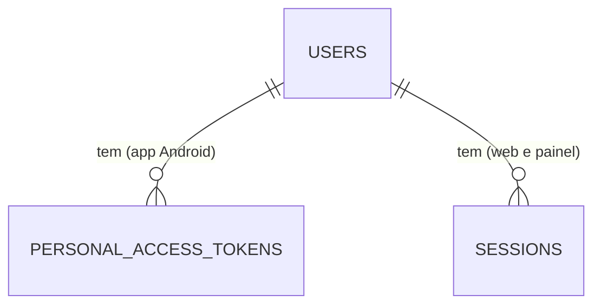

# Base de dados

MySQL/MariaDB, relacional. O modelo completo planeado (taxonomia, formação, mercado, comunidade) está em [arquitetura.md, secção 4](arquitetura.md#4-modelo-de-dados). Este documento descreve **o que existe hoje** e as regras para mudar.

> O teste `DocumentationTest` falha se uma tabela da base de dados não aparecer aqui entre acentos graves (por exemplo `users`). Documenta cada tabela nova no mesmo commit da migração.

## Convenções

| Regra | Porquê |
|---|---|
| Conjunto de caracteres `utf8mb4`, colação `utf8mb4_unicode_ci` | Acentos e emojis; a pesquisa trata "informatica" e "Informática" como iguais |
| Tabelas e colunas em inglês, no plural e em `snake_case` | Convenção do Laravel |
| Chave primária `id` (inteiro grande sem sinal), salvo nas tabelas do framework | Simples e rápido |
| Datas em UTC (`timestamp`); a app mostra-as na hora de Angola | Sem confusões com fusos horários |
| `created_at` e `updated_at` em todas as tabelas de negócio | Saber quando mudou |
| `deleted_at` (*soft delete*) só onde for preciso recuperar | Apagar a conta remove os dados pessoais a sério (ver [seguranca.md](seguranca.md#dados-pessoais-e-menores)) |
| Valores fixos guardados como texto curto e convertidos para enum no PHP | `role` → `App\Enums\UserRole` |
| `country_code` (sempre `AO` por agora) em instituições, vagas e estatísticas | Preparado para outros países |
| Todos os dados recolhidos têm `source_url` e `last_verified_at` | Transparência |

## Migrações

- **Uma migração nunca se edita depois de ir para produção.** Para mudar, cria-se uma nova.
- **As alterações são compatíveis com a versão anterior do código.** Durante um deploy, o código antigo e o novo convivem por instantes. Para mudar o nome de uma coluna, primeiro acrescenta-se a nova, depois migram-se os dados e só no deploy seguinte se apaga a antiga.
- O `down()` funciona sempre, para se poder voltar atrás em desenvolvimento.
- Em produção, as migrações correm no deploy (`php artisan migrate --force`), depois da cópia de segurança.

## Bases de dados

| Nome | Onde | Para quê |
|---|---|---|
| `kaye` | O teu PC (MariaDB do XAMPP) e o container local | Desenvolvimento |
| `kaye_test` | O teu PC e o CI | Testes PHPUnit e E2E; é apagada e recriada pelos testes |
| Produção | Hostinger | Utilizadores reais; só o deploy lhe toca |

## Tabelas atuais

### Do Kayé

#### `users`

Uma pessoa com conta. O login é feito só com o Google (e, no iOS, com a Apple).

| Coluna | Tipo | Notas |
|---|---|---|
| `id` | bigint | |
| `google_sub` | varchar, único, pode ser vazio | Identificador da conta Google |
| `apple_sub` | varchar, único, pode ser vazio | Identificador Apple (Fase 2, iOS) |
| `email` | varchar, único | Vem do Google |
| `name` | varchar | |
| `avatar_url` | varchar(2048) | Fotografia do Google |
| `birth_year` | smallint | **Só o ano**, não a data (Lei n.º 22/11: recolher o mínimo). Define se é menor |
| `province` | varchar(64) | Província, nunca a morada |
| `current_education_level` | varchar(32) | |
| `locale` | varchar(5), por omissão `pt` | `pt`, `en` ou `fr` (`App\Enums\Locale`) |
| `role` | varchar(16), por omissão `user`, indexado | `user`, `moderator` ou `admin` (`App\Enums\UserRole`) |
| `xp` | int | Pontos da gamificação |
| `password` | varchar, pode ser vazio | **Só para o admin local**, até o painel passar para o login Google. Os utilizadores nunca têm senha |
| `remember_token` | varchar | Sessão do painel |
| `created_at`, `updated_at`, `deleted_at` | timestamp | |

### Do Laravel (infraestrutura)

| Tabela | Para quê | Dados pessoais |
|---|---|---|
| `sessions` | Sessões do painel (e, com o login, da app web) | Sim: IP e browser. Apagadas quando a sessão expira (120 min) |
| `personal_access_tokens` | Tokens da API para a app Android. Guardados como *hash* SHA-256, expiram em 30 dias e são limpos todos os dias às 02:00 | Não |
| `cache`, `cache_locks` | Cache e bloqueios (inclui os contadores do limite de pedidos) | Não |
| `jobs`, `job_batches`, `failed_jobs` | Fila de tarefas, processada pelo cron | Pode haver, nos dados da tarefa: não pôr dados pessoais nas tarefas |
| `migrations` | Que migrações já correram | Não |

A tabela `password_reset_tokens`, que vem com o Laravel, foi retirada: não há senhas para recuperar.

## Diagrama atual

## Cópias de segurança

| O quê | Quando | Onde | Retenção |
|---|---|---|---|
| Cópia automática da Hostinger | Diária | Hostinger | A do plano |
| Cópia cifrada própria (`mysqldump` + cifra) | Semanal e antes de cada deploy com migrações | Fora da Hostinger | 4 semanas |
| **Teste de reposição** | Mensal | Base de dados de teste | Uma cópia que nunca foi reposta não é uma cópia |

Os passos de reposição estão em [infraestrutura.md](infraestrutura.md#cópias-de-segurança).
