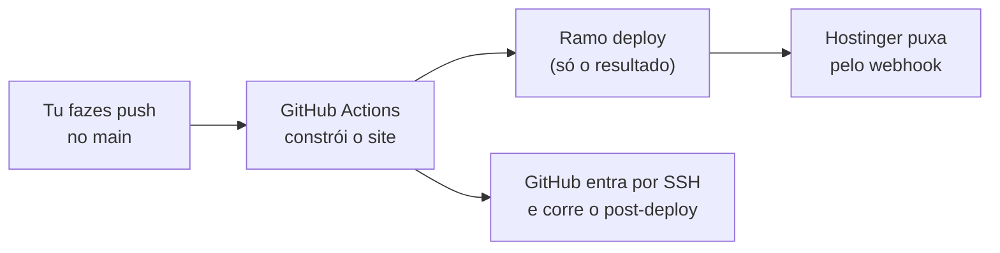

# Guia: pôr o Kayé na Hostinger, passo a passo

Este guia é para quem nunca fez um deploy. Cada passo diz **onde clicar**, **o que escrever** e **como saber que correu bem**. O resumo técnico está em [infraestrutura.md](infraestrutura.md).

> Os nomes dos menus do hPanel mudam de vez em quando. Se um nome não bater certo, procura pelo mais parecido ou usa a pesquisa do hPanel.

## A ideia em 30 segundos

O servidor da Hostinger é partilhado: não tem Node nem Composer e não aguenta processos sempre ligados. Por isso **não construímos o site lá**. Construímos no GitHub e a Hostinger só **puxa o resultado já pronto**.



Pensa assim: o **GitHub é a cozinha**, o ramo `deploy` é o **prato pronto** e a Hostinger é a **mesa** onde ele é servido. Tu só tens de montar a mesa uma vez (este guia). Depois, cada `push` no `main` serve um prato novo sozinho.

## O que vais precisar

| Coisa | Onde |
|---|---|
| Conta Hostinger com o site criado | já tens (endereço temporário) |
| Acesso ao repositório no GitHub (és dono) | github.com |
| Conta Google (para criar o login Google) | console.cloud.google.com |
| Um terminal no teu PC (PowerShell serve) | já tens |
| Um gestor de senhas ou um ficheiro seguro | para guardar o `.env` |

**Regra de ouro:** senhas, chaves privadas e o conteúdo do `.env` **nunca** vão para a conversa nem para o GitHub.

---

## Passo 0: pôr o código no GitHub

Ainda tens o trabalho no ramo `feat/hostinger-deploy`, só no teu PC.

1. No terminal, na pasta do projeto: `git push -u origin feat/hostinger-deploy`
2. No GitHub, abre o **Pull Request** para o `main`. Espera que os testes fiquem verdes.
3. Faz **Merge**.

**Como sei que correu bem:** o PR aparece como "Merged". Nesta altura o workflow Deploy vai correr e **vai falhar ou avisar** porque ainda não montaste a mesa. É normal.

---

## Passo 1: criar a chave SSH

O SSH é a "porta dos fundos" por onde o GitHub (e tu) entram no servidor para correr comandos. Em vez de senha, usa-se um **par de chaves**: uma **pública** (podes mostrar) e uma **privada** (nunca mostras).

1. No PowerShell: `ssh-keygen -t ed25519 -f $HOME\.ssh\kaye_hostinger -C "kaye-deploy"`
2. Quando pedir *passphrase*, carrega Enter (vazio). O GitHub não consegue escrever uma passphrase.
3. Isto cria dois ficheiros em `C:\Users\Mena\.ssh\`:
   - `kaye_hostinger.pub` → **pública**
   - `kaye_hostinger` → **privada**
4. Abre a pública no Bloco de Notas e copia tudo (uma linha, começa por `ssh-ed25519`).
5. hPanel → o teu site → **Avançado → Acesso SSH** → **Adicionar chave SSH** → cola → grava.
6. Testa: `ssh -i $HOME\.ssh\kaye_hostinger -p 65002 u727672645@93.127.189.106`

**Como sei que correu bem:** aparece um terminal da Hostinger (uma linha com o teu utilizador). Escreve `exit` para sair. Se pedir senha, a chave não ficou bem colada no hPanel.

---

## Passo 2: criar a base de dados

1. hPanel → **Bases de dados → Bases de dados MySQL**.
2. Cria uma base nova e um utilizador novo (só para o Kayé). A Hostinger põe um prefixo, por exemplo `u727672645_kaye`.
3. Cria uma senha forte. **Copia para o teu gestor de senhas** e para mais nenhum lado por agora.
4. Anota quatro coisas: nome da base, nome do utilizador, senha, e o *host* (normalmente `localhost`).

---

## Passo 3: o login Google

O Kayé só deixa entrar com Google. O Google precisa de saber que o teu site é de confiança.

1. Vai a console.cloud.google.com → escolhe (ou cria) um projeto "Kayé".
2. **APIs e serviços → Credenciais → Criar credenciais → ID de cliente OAuth**, tipo **Aplicação Web**.
3. Em **Origens JavaScript autorizadas** põe:
   `https://steady-darkgoldenrod-goshawk-92.hostingersite.com`
4. Em **URIs de redirecionamento autorizados** põe:
   `https://steady-darkgoldenrod-goshawk-92.hostingersite.com/auth/google/callback`
5. Guarda. O Google mostra o **ID de cliente** e o **Segredo do cliente**. Copia os dois para o gestor de senhas.

**Atenção:** o endereço tem de ser **exatamente** este, com `https` e sem `/` no fim da origem. Uma letra diferente e o login dá erro `redirect_uri_mismatch`.

---

## Passo 4: ligar o Git da Hostinger ao ramo `deploy`

É aqui que a Hostinger aprende a "puxar o prato pronto".

1. hPanel → **Avançado → Git**.
2. Repositório: `git@github.com:edu-mena/kaye.git`
3. Ramo: `deploy`
4. Pasta de destino: **vazia** (a raiz do site, `public_html`). Se o hPanel disser que a pasta tem ficheiros, apaga o `default.php` de exemplo antes.
5. Clica em **Criar**. O hPanel mostra uma **chave de deploy** (começa por `ssh-rsa` ou `ssh-ed25519`). Copia-a.
6. No GitHub: repositório → **Settings → Deploy keys → Add deploy key**. Cola. Título "Hostinger". **Não marques** "Allow write access". Grava.
7. De volta ao hPanel: clica em **Implementar/Deploy** para a primeira puxada.
8. O hPanel mostra também um **URL de webhook**. Copia. No GitHub: **Settings → Webhooks → Add webhook**. Em *Payload URL* cola, em *Content type* `application/json`, evento só *push*. Grava.

**Como sei que correu bem:** no hPanel, a pasta do site passa a ter ficheiros (`artisan`, `app`, `vendor`, `public`…). No GitHub, o webhook mostra um visto verde em *Recent Deliveries*.

---

## Passo 5: PHP 8.4

1. hPanel → **Avançado → Configuração do PHP**.
2. Versão **8.4**.
3. Extensões ligadas: `intl`, `pdo_mysql`, `mbstring`, `zip`, `gd`, `sodium`, `openssl`.
4. Confirma por SSH: `php -v`. Se mostrar outra versão, usa `PHP=/opt/alt/php84/usr/bin/php` à frente dos comandos do passo 7.

---

## Passo 6: o ficheiro `.env` no servidor

O `.env` é o ficheiro com as **senhas e configurações**. Fica só no servidor, o `git pull` não lhe toca.

1. Entra por SSH (comando do passo 1).
2. Vai à pasta do site: `cd ~/domains/steady-darkgoldenrod-goshawk-92.hostingersite.com/public_html`
   (se o caminho não existir, corre `ls ~/domains` e vê o nome certo).
3. Copia o modelo: `cp .env.example .env` e abre com `nano .env`.
4. Muda estas linhas (o resto fica como está):

| Variável | Valor |
|---|---|
| `APP_ENV` | `production` |
| `APP_DEBUG` | `false` |
| `APP_URL` | `https://steady-darkgoldenrod-goshawk-92.hostingersite.com` |
| `SESSION_SECURE_COOKIE` | `true` |
| `LOG_STACK` | `json` |
| `DB_HOST` | o *host* do passo 2 (normalmente `localhost`) |
| `DB_DATABASE`, `DB_USERNAME`, `DB_PASSWORD` | os do passo 2 |
| `GOOGLE_CLIENT_ID`, `GOOGLE_CLIENT_SECRET` | os do passo 3 |
| `ADMIN_EMAILS` | o teu email de administrador |
| `MAIL_*` | os dados SMTP do email da Hostinger (hPanel → Emails) |

5. Grava no `nano`: `Ctrl+O`, Enter, `Ctrl+X`.
6. **Guarda uma cópia do `.env` no gestor de senhas.** Se a Hostinger restaurar uma cópia de segurança, o `.env` pode perder-se.

A `APP_KEY` (a chave que protege as sessões) **não se escreve à mão**: gera-se no passo 7.

---

## Passo 7: a primeira arrancada

Ainda por SSH, na pasta do site:

```bash
php artisan key:generate --force
scripts/post-deploy.sh
```

O `post-deploy.sh` faz, por ordem: cria as tabelas da base de dados (`migrate`), carrega o catálogo de carreiras (`kaye:import`), prepara as caches (`optimize`), verifica a configuração de produção e corre o teste de fumo. **Pára no primeiro erro** e diz qual.

**Como sei que correu bem:** acaba com tudo verde. Abre `https://steady-darkgoldenrod-goshawk-92.hostingersite.com` no telemóvel: deve aparecer a landing do Kayé. Se aparecer "Erro 500", vê o fim do ficheiro `storage/logs/` (`tail -n 50 storage/logs/*.log`).

---

## Passo 8: o cron (o "relógio" do site)

Sem processos sempre ligados, o Kayé usa um relógio que acorda o Laravel **todos os minutos** para enviar emails, notificações e lembretes.

1. hPanel → **Avançado → Cron Jobs → Criar**.
2. Tipo: personalizado, tudo em `*` (todos os minutos).
3. Comando (troca `<site>` pelo nome certo da pasta):

```
cd ~/domains/<site>/public_html && php artisan schedule:run >> /dev/null 2>&1
```

**Como sei que correu bem:** espera 2 minutos e abre `https://steady-darkgoldenrod-goshawk-92.hostingersite.com/api/v1/health`. Tem de aparecer `"cron": "ok"`. Se disser `unknown`, o cron nunca correu; se disser `stale`, parou.

---

## Passo 9: deixar o GitHub fazer o deploy sozinho

Agora que a mesa está montada, ensina-se o GitHub a entrar no servidor.

1. No GitHub: repositório → **Settings → Environments → New environment** → `production`.
2. Nesse ambiente, adiciona **Secrets**:

| Segredo | Valor |
|---|---|
| `HOSTINGER_SSH_HOST` | `93.127.189.106` |
| `HOSTINGER_SSH_PORT` | `65002` |
| `HOSTINGER_SSH_USER` | `u727672645` |
| `HOSTINGER_SSH_KEY` | o conteúdo **todo** do ficheiro `kaye_hostinger` (a **privada**), incluindo as linhas `BEGIN` e `END` |
| `HOSTINGER_SSH_KNOWN_HOSTS` | a saída de `ssh-keyscan -p 65002 93.127.189.106` |
| `HOSTINGER_SITE_DIR` | o caminho da pasta do site, p. ex. `domains/steady-darkgoldenrod-goshawk-92.hostingersite.com/public_html` |

3. E uma **Variable** (não segredo): `SITE_URL` = `https://steady-darkgoldenrod-goshawk-92.hostingersite.com`
4. **Actions → Deploy → Run workflow** (ramo `main`).

**Como sei que correu bem:** o workflow termina verde, com duas etapas: *publish* e *finish*. A partir daqui, cada merge no `main` faz tudo sozinho.

---

## Passo 10: confirmar as cópias de segurança

hPanel → **Websites → o teu site → Cópias de segurança**. Deve haver uma cópia de hoje ou de ontem. Para restaurar: escolhe a data e **Restaurar**. Antes disso, **guarda o `.env`** fora da Hostinger e depois corre `scripts/post-deploy.sh`.

---

## Se algo correr mal

| Sintoma | Causa provável | O que fazer |
|---|---|---|
| `ssh` pede senha | chave pública mal colada | repete o passo 1.5 |
| Erro 500 ao abrir o site | falta `.env` ou `APP_KEY` | passos 6 e 7; vê `storage/logs` |
| Login Google dá `redirect_uri_mismatch` | endereço diferente no Google | passo 3, copia o endereço exato |
| `"cron": "unknown"` ou `"stale"` | cron não criado ou comando errado | passo 8 |
| O site não muda depois do push | webhook falhou | GitHub → Webhooks → *Recent Deliveries*; ou *Deploy* no hPanel à mão |
| `post-deploy.sh` diz "PHP 8.4 or newer" | o `php` do SSH é antigo | `PHP=/opt/alt/php84/usr/bin/php scripts/post-deploy.sh` |
| Workflow Deploy falha na etapa *finish* | faltam segredos ou o servidor não puxou | passo 9; vê o texto do erro no GitHub |

## Voltar atrás

Se uma versão correr mal: **Actions → Deploy → Run workflow** escolhendo o commit anterior do `main`. Ou faz `git revert` do commit mau e deixa o deploy automático correr.
