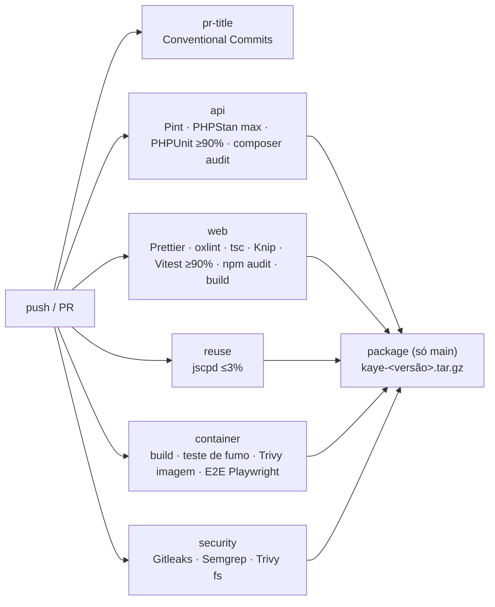

# Infraestrutura, containers e CI/CD

Como o Kayé é construído, testado e publicado. A arquitetura das peças está em [arquitetura.md](arquitetura.md); o método de trabalho, em [engenharia.md](engenharia.md).

## Ambientes

| Ambiente | Onde | Base de dados | Para quê |
|---|---|---|---|
| Local | O teu PC: PHP em `C:\php` + MariaDB do XAMPP (ou `docker compose`) | `kaye`, `kaye_test` | Desenvolver e testar |
| CI | GitHub Actions (Ubuntu) | MariaDB 11.4 em serviço ou em container | Verificar cada push e cada PR |
| Staging | Subdomínio `staging.` na Hostinger | Separada | Testar a release antes de produção |
| Produção | Domínio principal na Hostinger + Cloudflare | Produção | Utilizadores |

## Containers

**Para que servem:** dar ao CI e aos testes E2E o mesmo ambiente que a produção (PHP 8.4, Apache com `.htaccess`, sem ferramentas de desenvolvimento), e deixar o Kayé pronto para um VPS.

**Onde não correm:** na produção atual. O alojamento partilhado da Hostinger não corre containers ([ADR-0004](decisoes/0004-containers-fora-de-producao.md)). Por isso a imagem copia o modelo da Hostinger, e o mesmo código corre nos dois sítios.

| Ficheiro | O que faz |
|---|---|
| `docker/Dockerfile` | Imagem em 4 etapas: compila a app React → base PHP 8.4 + Apache → dependências de produção → imagem final |
| `docker/php.ini` | Definições de produção (`expose_php=Off`, opcache, limites) |
| `docker/entrypoint.sh` | No arranque: valida a `APP_KEY`, corre as migrações (se pedido) e põe a configuração em cache |
| `compose.yaml` | Stack local e de CI: a imagem + MariaDB 11.4 |
| `.dockerignore` | Deixa de fora segredos (`.env`), `vendor`, `node_modules`, Android e docs |

**Endurecimento:**

- corre como `www-data`, na porta 8080;
- sistema de ficheiros só de leitura (só as pastas temporárias em memória são graváveis);
- sem *capabilities* do Linux e com `no-new-privileges`;
- sem `.env`, sem testes e sem o Laravel Boost;
- o Apache não mostra a versão (`ServerTokens Prod`).

```sh
docker compose up --build --wait        # abre http://localhost:8080
scripts/smoke-test.sh http://localhost:8080
docker compose logs app                 # logs JSON
docker compose down                     # parar (a base de dados fica no volume db-data)
```

## Pipeline de CI

Definida em `.github/workflows/ci.yml`. Corre em cada push para o `main` e em cada PR. Todos os jobs correm em paralelo; o `package` só corre se todos passarem.



- O CI só tem permissão de leitura (`permissions: contents: read`).
- As actions estão fixadas pelo hash do commit; o Dependabot atualiza-as.
- Um push novo no mesmo ramo cancela a execução anterior.

## Entrega (CD)

### O pacote

O job `package` corre `scripts/package-release.sh <versão>` e guarda `kaye-<versão>.tar.gz` como artefacto durante 30 dias. O pacote leva:

- o Laravel com as dependências de produção (`--no-dev`, *classmap* otimizado);
- a app React compilada em `public/spa`;
- os ficheiros do Filament;
- um ficheiro `RELEASE` com a versão.

Não leva `.env`, testes nem ferramentas de desenvolvimento. O script falha se encontrar o Laravel Boost.

### O deploy na Hostinger

**Pendente:** falta o acesso SSH à Hostinger. Quando existir, um workflow `deploy.yml` (manual, com aprovação no ambiente `production`) vai fazer:

```
~/kaye/
  releases/<versão>/        uma pasta por release
  shared/.env               o .env de produção, fora das releases
  shared/storage/           logs, cache e sessões (persistem entre releases)
  current -> releases/<versão>
public_html -> ~/kaye/current/public
```

1. Enviar o pacote por SSH e extraí-lo para `releases/<versão>`.
2. Ligar `shared/.env` e `shared/storage` à release.
3. Fazer uma cópia de segurança da base de dados (`mysqldump`, cifrada).
4. `php artisan migrate --force` e `php artisan kaye:import` (o catálogo que a app lê de `/api/v1`; só muda o que difere), depois `config:cache`, `route:cache` e `view:cache`.
5. `php artisan kaye:check-production`: se falhar, **pára aqui**. O site continua na versão anterior.
6. Trocar `current` para a nova release (`ln -sfn`, uma operação atómica).
7. `php artisan queue:restart`.
8. `scripts/smoke-test.sh https://<domínio>`: se falhar, volta automaticamente à release anterior.
9. Guardar as 5 últimas releases e apagar as mais antigas.

O staging recebe cada versão do `main` automaticamente; a produção recebe-a com um clique e aprovação.

### Voltar atrás (rollback)

Basta apontar `current` para a release anterior (`ln -sfn releases/<anterior> current`) e correr `php artisan queue:restart`. Leva segundos. Como as migrações são sempre compatíveis com a versão anterior ([base-de-dados.md](base-de-dados.md#migrações)), não é preciso desfazê-las.

## Variáveis de ambiente

> O `DocumentationTest` falha se uma variável do `apps/api/.env.example` não estiver nesta tabela.

| Variável | Local | Produção | Notas |
|---|---|---|---|
| `APP_NAME` | `Kayé` | `Kayé` | |
| `APP_ENV` | `local` | `production` | |
| `APP_KEY` | gerada (`php artisan key:generate`) | gerada, **secreta** | Cifra cookies e sessões. Mudá-la termina todas as sessões |
| `APP_DEBUG` | `true` | `false` | Obrigatório: `kaye:check-production` |
| `APP_URL` | `http://localhost:8000` | `https://<domínio>` | Obrigatório `https` |
| `APP_LOCALE`, `APP_FALLBACK_LOCALE` | `pt` | `pt` | |
| `APP_FAKER_LOCALE` | `pt_PT` | `pt_PT` | Só para dados de teste |
| `APP_MAINTENANCE_DRIVER` | `file` | `file` | `php artisan down` |
| `BCRYPT_ROUNDS` | `12` | `12` | Só para a senha do admin local |
| `LOG_CHANNEL` | `stack` | `stack` | |
| `LOG_STACK` | `single` | `json` | Container: `stderr_json` |
| `LOG_LEVEL` | `debug` | `info` | |
| `LOG_DAILY_DAYS` | `14` | `14` | Retenção dos logs |
| `LOG_DEPRECATIONS_CHANNEL` | `null` | `null` | |
| `DB_CONNECTION` | `mysql` | `mysql` | |
| `DB_HOST`, `DB_PORT` | `127.0.0.1`, `3306` | do hPanel | |
| `DB_DATABASE`, `DB_USERNAME` | `kaye`, `root` | do hPanel | Um utilizador só para o Kayé, só com acesso a esta base |
| `DB_PASSWORD` | vazio | **secreta** | |
| `SESSION_DRIVER` | `database` | `database` | Sem Redis no partilhado |
| `SESSION_LIFETIME` | `120` | `120` | Minutos |
| `SESSION_ENCRYPT` | `false` | `false` | |
| `SESSION_PATH`, `SESSION_DOMAIN` | `/`, `null` | `/`, `null` | |
| `SESSION_SECURE_COOKIE` | `false` | `true` | Obrigatório: `kaye:check-production` |
| `CACHE_STORE` | `database` | `database` | |
| `QUEUE_CONNECTION` | `database` | `database` | O cron processa a fila |
| `FILESYSTEM_DISK` | `local` | `local` | |
| `BROADCAST_CONNECTION` | `log` | `log` | Não usado |
| `MAIL_MAILER` | `log` | `smtp` (quando houver emails) | |
| `MAIL_FROM_ADDRESS`, `MAIL_FROM_NAME` | `ola@kaye.ao`, `Kayé` | do domínio | |
| `ADMIN_EMAILS` | `admin@kaye.test` | os emails da equipa | Vazio = ninguém entra no painel |
| `CORS_ALLOWED_ORIGINS` | `https://localhost,capacitor://localhost` | igual | As origens das apps nativas |
| `SANCTUM_TOKEN_EXPIRATION` | `43200` | `43200` | 30 dias |
| `SANCTUM_STATEFUL_DOMAINS` | não se define | não se define | Os domínios cujo browser usa a sessão com CSRF. Sem ela, só o de `APP_URL`; nunca `localhost` sozinho, que é a origem da app Android |
| `GOOGLE_CLIENT_ID` | o ID de cliente web de teste | o ID de cliente web | Login Google ([arquitetura.md, 5.1](arquitetura.md#51-login-com-google)). É também o `aud` aceite nos tokens do Android. Vazio = ninguém entra. O URI de redirecionamento a registar no Google Cloud é `APP_URL/auth/google/callback` |
| `GOOGLE_CLIENT_SECRET` | o segredo de teste | **secreta** | Só para a troca do código do OAuth na web |
| `WAITLIST_EXPORT_TOKEN` | vazio | **secreta**, 16 caracteres ou mais | A senha de `GET /api/v1/waitlist/export` (CSV da lista de espera e das críticas). Vazia ou curta = a exportação fica fechada (401); o painel exporta na mesma |
| `UPSTASH_REDIS_REST_URL`, `UPSTASH_REDIS_REST_TOKEN` | vazio | só no dia da migração, depois apagam-se | O Upstash Redis das antigas funções do Vercel, lido uma vez por `php artisan kaye:migrate-redis`. Também aceita os nomes do Vercel, `KV_REST_API_URL` e `KV_REST_API_TOKEN` |
| `SENTRY_LARAVEL_DSN` | vazio | o DSN do projeto | Obrigatório em produção |
| `SENTRY_TRACES_SAMPLE_RATE` | `0.1` | `0.1` | |

Só nos containers: `ALLOW_EPHEMERAL_APP_KEY` (cria uma `APP_KEY` descartável; nunca em produção), `RUN_MIGRATIONS` (corre as migrações no arranque) e `RUN_IMPORT` (corre `kaye:import` a seguir, para o catálogo estar na base; o `compose.yaml` liga-o).

> O `DocumentationTest` também falha se uma variável `VITE_*` de `apps/web/src/env.d.ts` não estiver descrita aqui.

Só na app: `VITE_DATA_SOURCE`, de onde vem o conteúdo: `api` lê `/api/v1` (o Laravel); sem ela, ou com `demo`, a app usa os dados de demonstração que traz dentro ([ADR 0005](decisoes/0005-frontend-primeiro-com-dados-de-demonstracao.md)). O `apps/web/.env.production` põe `api` no build que o Laravel serve (Docker, CI, Hostinger); o site de teste no Vercel (`--mode static`) e a app Android (`--mode native`) continuam com `demo` até à mudança. Em modo `api`, se a API falhar a app mostra o erro, nunca os dados de demonstração. `VITE_API_URL`, o endereço completo da API para as apps nativas (`https://<domínio>/api/v1`). A app web usa `/api/v1` no mesmo domínio. `VITE_KAYE_EMAIL`: o email do Kayé para correções ("Ajuda-nos a completar") e para os pedidos de conversa com mentores. `VITE_KAYE_WHATSAPP`: o número de WhatsApp do Kayé, só dígitos com o indicativo (`244…`), para os pedidos de conversa com mentores ([mentores.md](mentores.md)). Sem nenhuma das duas, o botão "Pedir conversa" não aparece; as duas são públicas (vão no código da app), por isso nunca um número ou email pessoal.

Só no site de teste (Vercel): `KV_REST_API_URL` e `KV_REST_API_TOKEN`, criadas ao ligar a base Upstash Redis ao projeto, para as páginas públicas ([ADR 0014](decisoes/0014-pagina-publica-do-cartao.md)). `WAITLIST_EXPORT_TOKEN`: a senha para descarregar a lista de espera e as críticas em CSV (ver o README).

## Segredos no GitHub (para o deploy)

| Segredo | Ambiente |
|---|---|
| `HOSTINGER_SSH_HOST`, `HOSTINGER_SSH_PORT`, `HOSTINGER_SSH_USER` | `staging`, `production` |
| `HOSTINGER_SSH_KEY` (chave privada só para o deploy) | `staging`, `production` |
| `HOSTINGER_SSH_KNOWN_HOSTS` (impressão digital do servidor) | `staging`, `production` |

## Cópias de segurança

- **Antes de cada deploy com migrações:** `mysqldump`, cifrado com uma chave que fica fora da Hostinger.
- **Todas as semanas:** a mesma cópia, guardada fora da Hostinger.
- **Todos os meses:** repor a última cópia numa base de teste e correr o teste de fumo contra ela.

## Custos

| Item | Custo |
|---|---|
| GitHub (repositório privado, Actions, Dependabot) | Grátis; o GitHub Student Developer Pack dá o GitHub Pro (ambientes com aprovação em repositórios privados) |
| Sentry, UptimeRobot, Cloudflare | Planos grátis |
| Docker Desktop | Grátis para uso pessoal e educativo |
| Hostinger, domínio, Google Play | Ver [arquitetura.md](arquitetura.md#custos-previstos) |
