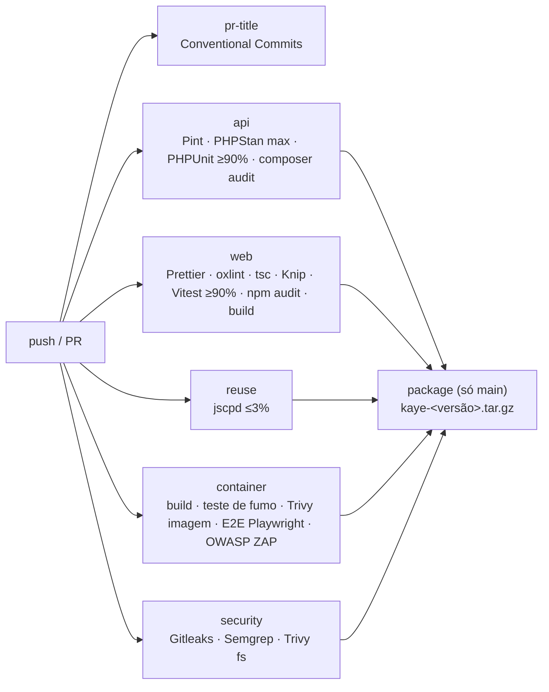
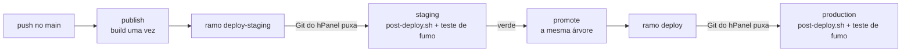

# Infraestrutura, containers e CI/CD

Como o Kayé é construído, testado e publicado. A arquitetura das peças está em [arquitetura.md](arquitetura.md); o método de trabalho, em [engenharia.md](engenharia.md).

## Ambientes

| Ambiente | Onde | Base de dados | Para quê |
|---|---|---|---|
| Local | O teu PC: PHP em `C:\php` + MariaDB do XAMPP (ou `docker compose`) | `kaye`, `kaye_test` | Desenvolver e testar |
| CI | GitHub Actions (Ubuntu) | MariaDB 11.4 em serviço ou em container | Verificar cada push e cada PR |
| Produção | `https://kayeangola.com` (o `www` redireciona para aqui), Hostinger Cloud Startup | Produção | Utilizadores e apresentações |
| Staging | `https://staging.kayeangola.com`, um site à parte na mesma Hostinger (pasta `domains/staging.kayeangola.com/public_html`) | Própria (`…_kaye_staging`) | Cada release passa aqui primeiro; `APP_ENV=staging` e `noindex` |
| Vercel (antigo site de teste) | `kaye-indol.vercel.app` | Nenhuma | Só redireciona (301) para `https://kayeangola.com`, com o mesmo caminho, até 26/12/2026; depois apagam-se o projeto do Vercel e a base Upstash |

O Cloudflare à frente da Hostinger fica para depois do lançamento: o CDN da Hostinger já está à frente do site.

## Containers

**Para que servem:** dar ao CI e aos testes E2E o mesmo ambiente que a produção (PHP 8.4, Apache com `.htaccess`, sem ferramentas de desenvolvimento), e deixar o Kayé pronto para um VPS.

**Onde não correm:** na produção atual. O alojamento partilhado da Hostinger não corre containers ([ADR-0004](decisoes/0004-containers-fora-de-producao.md)). Por isso a imagem copia o modelo da Hostinger, e o mesmo código corre nos dois sítios.

| Ficheiro | O que faz |
|---|---|
| `docker/Dockerfile` | Imagem em 5 etapas: compila a app React → base PHP 8.4 + Apache → dependências de produção → tema do painel (Vite, sobre o CSS do Filament em `vendor/`) → imagem final |
| `docker/php.ini` | Definições de produção (`expose_php=Off`, opcache, limites) |
| `docker/entrypoint.sh` | No arranque: valida a `APP_KEY`, corre as migrações (se pedido), cria a conta de teste do painel (só com `E2E_ADMIN_PASSWORD`) e põe a configuração em cache |
| `compose.yaml` | Stack local e de CI: a imagem + MariaDB 11.4 |
| `.dockerignore` | Deixa de fora segredos (`.env`), `vendor`, `node_modules`, Android e docs |

**Endurecimento:**

- corre como `www-data`, na porta 8080;
- sistema de ficheiros só de leitura (só as pastas temporárias em memória são graváveis);
- sem *capabilities* do Linux e com `no-new-privileges`;
- sem `.env`, sem testes e sem o Laravel Boost;
- o Apache não mostra a versão (`ServerTokens Prod`).

```sh
docker compose up --build --wait        # abre http://localhost:8080
scripts/smoke-test.sh http://localhost:8080
docker compose logs app                 # logs JSON
docker compose down                     # parar (a base de dados fica no volume db-data)
```

## Pipeline de CI

Definida em `.github/workflows/ci.yml`. Corre em cada push para o `main` e em cada PR. Todos os jobs correm em paralelo; o `package` só corre se todos passarem.



- O CI só tem permissão de leitura (`permissions: contents: read`).
- **Auditorias de dependências:** `composer audit` falha com qualquer aviso de segurança; `npm audit --audit-level=moderate` falha a partir de moderado, **incluindo** as dependências de desenvolvimento (mais rigoroso do que `--omit=dev` com `high`).
- **OWASP ZAP *baseline*:** depois do E2E, o ZAP percorre o container (`http://localhost:8080`) e analisa as respostas sem atacar. As regras que fazem falhar o CI estão em `.zap/rules.tsv` (cabeçalhos de segurança, fugas de versão ou de erros); o relatório fica nos artefactos.
- O job `api` instala o cliente MariaDB, para o `BackupTest` fazer um `mysqldump` real e repor a cópia em `kaye_test_restore`.
- As actions estão fixadas pelo hash do commit; o Dependabot atualiza-as.
- Um push novo no mesmo ramo cancela a execução anterior.

## Entrega (CD)

### O pacote

O job `package` corre `scripts/package-release.sh <versão>` e guarda `kaye-<versão>.tar.gz` como artefacto durante 30 dias. O pacote leva:

- o Laravel com as dependências de produção (`--no-dev`, *classmap* otimizado);
- a app React compilada em `public/spa`;
- os ficheiros do Filament e o tema do painel compilado em `public/build` (`npm run build` em `apps/api`, [design.md](design.md#painel-de-administração-admin));
- um ficheiro `RELEASE` com a versão.

Não leva `.env`, testes, `node_modules` nem ferramentas de desenvolvimento. O script falha se encontrar o Laravel Boost ou se faltar o tema do painel (`public/build/manifest.json`), e o `publish-deploy.sh` volta a verificar o tema antes de o pôr no ramo `deploy`.

### O deploy na Hostinger

Hostinger Cloud Startup, partilhado: sem Node, sem Composer no servidor, sem processos longos. Por isso a construção acontece no GitHub e o servidor só **puxa** o resultado.



O workflow `.github/workflows/deploy.yml` tem quatro jobs, sempre por esta ordem:

1. **publish** constrói a release uma vez e põe-na no ramo `deploy-staging`.
2. **staging** (ambiente `staging` do GitHub) espera que o site de staging puxe esse commit e corre `scripts/finish-deploy.sh`: o `post-deploy.sh` por SSH e o teste de fumo de fora.
3. **promote** só corre com o staging verde: copia **exatamente a árvore testada** do `deploy-staging` para o ramo `deploy` (sem voltar a construir).
4. **production** (ambiente `production`) faz o mesmo que o passo 2, no site de produção.

Se o staging falhar, a produção não recebe nada. Um ambiente sem os seus segredos faz falhar o deploy (em vez de o saltar), para a produção nunca avançar sem staging.

- **Os ramos `deploy-staging` e `deploy`** só têm builds: a app Laravel na raiz, `vendor/` sem ferramentas de desenvolvimento, a app web compilada em `public/spa/`, `scripts/` e um ficheiro `RELEASE` com o commit. Não se edita à mão. É o `scripts/publish-deploy.sh` que o monta (reutiliza o `scripts/package-release.sh`).
- **A raiz do site** (`public_html`) é a pasta da app. Só `public/` é servido: o `.htaccess` da raiz (`apps/api/.htaccess`) reescreve tudo para lá e força HTTPS. Assim `.env`, `vendor/` e `storage/` nunca são acessíveis; o teste de fumo confirma-o.
- **O que o servidor guarda e o `git pull` não toca:** `.env`, `storage/` (logs, cache, sessões) e tudo o que não está no ramo.
- **Fila e cache** na base de dados, menos o que está em todos os pedidos públicos: as respostas da API, os limites de pedidos e as definições do painel ficam em ficheiros em `storage/framework/cache/` (`content` e `local`), porque, em carga, o alojamento recusa abrir ligações ao MySQL ([ADR 0029](decisoes/0029-cache-em-ficheiros.md)). Uma só linha de cron no hPanel: `* * * * * cd ~/domains/<site>/public_html && php artisan schedule:run >> /dev/null 2>&1`. O agendador bate o pulso do cron todos os minutos (`CronHeartbeat`), e `GET /api/v1/health` mostra `checks.cron`: `ok`, `stale` (parou há mais de 5 minutos) ou `unknown` (nunca bateu). O teste de fumo na Hostinger exige `ok`.
- **O endereço** vem todo de `APP_URL`: o redirecionamento do Google (`APP_URL/auth/google/callback`), o domínio com sessão (Sanctum) e os links dos emails. O domínio de produção é `kayeangola.com` (24 de novembro de 2026). Trocar de endereço é mudar o `APP_URL` no `.env`, juntar o novo endereço no Google Cloud (origem e URI de redirecionamento), mudar na GitHub (ambiente `production`) o segredo `HOSTINGER_SITE_DIR` e a variável `SITE_URL` (e a variável `KAYE_API_URL`, da recolha de dados) e correr `php artisan optimize`. Os `.htaccess` mandam o `www.` para o domínio sem `www` e o `http` para `https`, para as cookies e o login Google verem um só site.
- **PWA e HTTPS** (ADR 0002): `worker-src 'self'` e `manifest-src 'self'` na CSP (`SecurityHeaders`); `Cache-Control: no-cache` no `sw.js` e no `manifest.webmanifest`, ficheiros do `/spa/assets/` imutáveis, e `Service-Worker-Allowed: /` no `sw.js` (`apps/api/public/.htaccess`). O `.htaccess` da raiz também apaga o cabeçalho `X-Powered-By` (o PHP da Hostinger ignora o `docker/php.ini`, por isso o `expose_php=Off` não chega lá). O `.htaccess` manda o http para https, menos em `localhost` (container e testes). `X-Forwarded-Proto` é aceite por trás do proxy da Hostinger e, mais tarde, do Cloudflare.

#### Pôr no ar pela primeira vez

> Primeira vez e nunca fizeste um deploy? Segue o [guia passo a passo](guia-hostinger.md), com o que clicar e como confirmar cada passo. A lista abaixo é o resumo.

1. **Chave SSH.** No teu PC: `ssh-keygen -t ed25519 -f ~/.ssh/kaye_hostinger -C "kaye-deploy"` (sem usar a senha da Hostinger). No hPanel → *Avançado → Acesso SSH*, cola o conteúdo de `kaye_hostinger.pub`. A chave **privada** (`kaye_hostinger`) nunca sai do teu PC, exceto para o segredo do GitHub abaixo. Testa: `ssh -i ~/.ssh/kaye_hostinger -p 65002 u727672645@93.127.189.106`.
2. **Base de dados.** hPanel → *Bases de dados MySQL*: cria a base e o utilizador só para o Kayé. A senha escreve-se no `.env` do servidor, nunca na conversa.
3. **O `.env` do servidor**, por SSH, na pasta do site: copia `apps/api/.env.example` e preenche como na tabela abaixo: `APP_ENV=production`, `APP_DEBUG=false`, `APP_URL=https://kayeangola.com`, `SESSION_SECURE_COOKIE=true`, `LOG_STACK=json`, os dados da base, o email (SMTP da Hostinger), `ADMIN_EMAILS`, `GOOGLE_CLIENT_ID` e `GOOGLE_CLIENT_SECRET`, as chaves VAPID e `SENTRY_LARAVEL_DSN`. A `APP_KEY` gera-se uma vez com `php artisan key:generate`, depois de o primeiro deploy trazer o código.
4. **Google Cloud** → Credenciais → ID de cliente OAuth (aplicação web): origem `https://kayeangola.com` e URI de redirecionamento `https://kayeangola.com/auth/google/callback`.
5. **Git no hPanel** (*Avançado → Git*): repositório `git@github.com:edu-mena/kaye.git` (SSH), ramo `deploy`, pasta de destino vazia (a raiz do site). O hPanel mostra uma **chave de deploy** pública: no GitHub, *Settings → Deploy keys → Add*, só leitura. Depois copia o URL do **webhook** do hPanel e põe-no no GitHub, *Settings → Webhooks → Add* (tipo `application/json`, evento *push*).
6. **PHP 8.4.** hPanel → *Avançado → Configuração do PHP*: 8.4, com as extensões `intl`, `pdo_mysql`, `mbstring`, `zip`, `gd`, `sodium`, `openssl`. Se o `php` da linha de comandos não for 8.4 (`php -v`), usa `PHP=/opt/alt/php84/usr/bin/php scripts/post-deploy.sh`.
7. **Cron:** a linha acima, em *Avançado → Cron Jobs*.
8. **Segredos no GitHub** (*Settings → Environments → production*): os da tabela abaixo. A `HOSTINGER_SSH_KNOWN_HOSTS` obtém-se com `ssh-keyscan -p 65002 93.127.189.106`.
9. **A primeira vez:** *Actions → Deploy → Run workflow*. Sem os segredos SSH, o workflow publica o ramo e avisa; nesse caso, depois do webhook, por SSH: `cd ~/domains/<site>/public_html && php artisan key:generate --force && scripts/post-deploy.sh`.

Cada push no `main` repete, primeiro em staging e depois em produção: publicar no ramo, a Hostinger puxa, e o `scripts/finish-deploy.sh` espera pelo `RELEASE` certo (até 5 minutos; cada tentativa de SSH desiste ao fim de 10 segundos), corre o `post-deploy.sh` com `PHP=/opt/alt/php84/usr/bin/php` (se acabar com 255, uma falha passageira da ligação ou do PHP, tenta mais duas vezes; com outro código, falha logo) e o teste de fumo contra `SITE_URL`. Se uma etapa falhar, o workflow fica vermelho e diz qual.

#### O que o `post-deploy.sh` faz

Primeiro espera que o `composer install` do Git da Hostinger acabe: ela corre-o sozinha ao puxar, às vezes com atraso, e correr o `artisan` a meio falha com 255. Por isso espera até passarem 30 segundos sem nenhum `composer` a correr. Depois **repõe o `vendor/` e o `bootstrap/cache` tal como estão no ramo `deploy`** (`git checkout` + `git clean`): esse `install` traz de volta o `laravel/boost` e as outras ferramentas de desenvolvimento, e pode deixar o `vendor/` a meio. Se o `vendor/` continuar diferente do ramo, o deploy pára. Não se corre um segundo `composer`: a 27/11/2026, um `composer install --no-dev` correu ao mesmo tempo que o da Hostinger, deixou o `vendor/` partido e o site deu erro 500 durante cerca de 3 minutos. Depois apaga a configuração, as rotas e os eventos em cache da release anterior (uma chave de configuração nova faltaria no arranque e o `artisan` morria antes de as limpar) e corre: `migrate --force`, `kaye:import` (o catálogo que a app lê de `/api/v1`; só muda o que difere), `optimize` (config, rotas e vistas em cache), `kaye:check-production` (se falhar, pára), `queue:restart` e `scripts/smoke-test.sh` contra o `APP_URL`.

### Staging

Um site à parte no hPanel (`staging.kayeangola.com`), com tudo próprio: pasta, base de dados, `.env`, Git e cron. Partilha só o servidor e a conta SSH. Como se monta: [guia-hostinger.md](guia-hostinger.md#staging).

- **`.env`:** igual ao de produção, menos isto: `APP_ENV=staging`, `APP_URL=https://staging.kayeangola.com`, `DB_*` da base de staging, uma `APP_KEY` própria, `HEALTH_TOKEN` próprio (o mesmo do segredo do ambiente `staging` no GitHub), `BACKUP_DISK=local` e sem `DB_RESTORE_DATABASE` (as cópias e o teste de reposição são só de produção), `MAIL_MAILER=log` (o staging nunca envia emails a pessoas reais) e sem `WAITLIST_EXPORT_TOKEN`, `INGEST_TOKEN` nem chaves VAPID.
- **`noindex`:** fora de produção, o `SecurityHeaders` junta `X-Robots-Tag: noindex, nofollow` a todas as respostas do Laravel (`SecurityHeadersTest`), para o staging nunca aparecer no Google.
- **`kaye:check-production`** aceita `APP_ENV=staging`, mas só com um `APP_URL` em `https://staging.`: um `.env` de staging copiado para produção por engano falha o deploy (`CheckProductionConfigTest`).
- **O Sentry** recebe os erros de staging com o ambiente `staging` (vem do `APP_ENV`), separados dos de produção.
- **Login Google no staging:** só funciona se `https://staging.kayeangola.com/auth/google/callback` estiver nos URIs de redirecionamento do ID de cliente no Google Cloud. O resto do site não precisa dele.

### Voltar atrás (rollback)

Corre o *Deploy* à mão (*Run workflow*) escolhendo o commit anterior do `main`: a versão antiga passa pelo staging e depois pelo ramo `deploy`, e a Hostinger puxa-a. As migrações são sempre compatíveis com a versão anterior ([base-de-dados.md](base-de-dados.md#migrações)), por isso não se desfazem. Se o `main` já tiver avançado, faz `git revert` do commit mau.

### O teste de fumo no endereço de produção

```sh
SMOKE_REQUIRE_CRON=1 scripts/smoke-test.sh https://kayeangola.com
```

Além do que corre no CI, em `https://` confirma que o http vai para o https, o HSTS, o `sw.js` e o manifest sem cache, o `Service-Worker-Allowed: /`, o `worker-src` na CSP e o pulso do cron.


## Variáveis de ambiente

> O `DocumentationTest` falha se uma variável do `apps/api/.env.example` não estiver nesta tabela.

| Variável | Local | Produção | Notas |
|---|---|---|---|
| `APP_NAME` | `Kayé` | `Kayé` | |
| `APP_ENV` | `local` | `production` | |
| `APP_KEY` | gerada (`php artisan key:generate`) | gerada, **secreta** | Cifra cookies e sessões. Mudá-la termina todas as sessões |
| `APP_DEBUG` | `true` | `false` | Obrigatório: `kaye:check-production` |
| `APP_URL` | `http://localhost:8000` | `https://<domínio>` | Obrigatório `https` |
| `APP_LOCALE`, `APP_FALLBACK_LOCALE` | `pt` | `pt` | |
| `APP_FAKER_LOCALE` | `pt_PT` | `pt_PT` | Só para dados de teste |
| `APP_MAINTENANCE_DRIVER` | `file` | `file` | `php artisan down` |
| `BCRYPT_ROUNDS` | `12` | `12` | Só para a senha do admin local |
| `LOG_CHANNEL` | `stack` | `stack` | |
| `LOG_STACK` | `single` | `json` | Container: `stderr_json` |
| `LOG_LEVEL` | `debug` | `info` | |
| `LOG_DAILY_DAYS` | `14` | `14` | Retenção dos logs |
| `LOG_DEPRECATIONS_CHANNEL` | `null` | `null` | |
| `DB_CONNECTION` | `mysql` | `mysql` | |
| `DB_HOST`, `DB_PORT` | `127.0.0.1`, `3306` | do hPanel | |
| `DB_DATABASE`, `DB_USERNAME` | `kaye`, `root` | do hPanel | Um utilizador só para o Kayé, só com acesso a esta base |
| `DB_PASSWORD` | vazio | **secreta** | |
| `SESSION_DRIVER` | `database` | `database` | Sem Redis no partilhado |
| `SESSION_LIFETIME` | `120` | `120` | Minutos |
| `SESSION_ENCRYPT` | `false` | `false` | |
| `SESSION_PATH`, `SESSION_DOMAIN` | `/`, `null` | `/`, `null` | |
| `SESSION_SECURE_COOKIE` | `false` | `true` | Obrigatório: `kaye:check-production` |
| `CACHE_STORE` | `database` | `database` | A cache por defeito (filas, locks, batimento do cron). As respostas da API, os limites de pedidos e as definições usam ficheiros ([ADR 0029](decisoes/0029-cache-em-ficheiros.md)); os testes trocam-nos por `array` com `CONTENT_CACHE_STORE` e `LOCAL_CACHE_STORE` (só no `phpunit.xml`) |
| `QUEUE_CONNECTION` | `database` | `database` | O cron processa a fila: a cada minuto, o agendador corre `queue:work --stop-when-empty --max-time=50` (`routes/console.php`). Basta a linha de cron do hPanel, `* * * * * php artisan schedule:run` |
| `FILESYSTEM_DISK` | `local` | `local` | |
| `BROADCAST_CONNECTION` | `log` | `log` | Não usado |
| `MAIL_MAILER` | `log` (os emails vão para o log) | `smtp` | O SMTP da Hostinger |
| `MAIL_SCHEME` | `null` | `smtps` | TLS desde o início, na porta 465 |
| `MAIL_HOST`, `MAIL_PORT` | `127.0.0.1`, `2525` | `smtp.hostinger.com`, `465` | |
| `MAIL_USERNAME`, `MAIL_PASSWORD` | `null` | `ola@kayeangola.com` e a senha dessa caixa, **secreta** (entre aspas simples) | |
| `MAIL_FROM_ADDRESS`, `MAIL_FROM_NAME` | `ola@kayeangola.com`, `Kayé` | `ola@kayeangola.com` (caixa criada no hPanel a 27/11/2026), `Kayé` | O domínio já tem MX, SPF, DKIM e DMARC da Hostinger; sem eles os emails vão para o spam |
| `MAIL_HOURLY_LIMIT` | `80` | abaixo do limite por hora do plano | Quantos emails as campanhas e os lembretes enviam por hora (`kaye:send-messages`) |
| `PUSH_HOURLY_LIMIT` | `1000` | `1000` | O mesmo para o Web Push |
| `VAPID_SUBJECT` | `mailto:ola@kayeangola.com` | igual | O contacto que os serviços de push veem |
| `VAPID_PUBLIC_KEY`, `VAPID_PRIVATE_KEY` | vazio (push desligado) | geradas uma vez, a privada **secreta** | `php artisan webpush:vapid --show` gera o par. A pública chega à app por `GET /api/v1/push/key`; vazia, a app não mostra o push. Mudá-las invalida todas as subscrições |
| `ADMIN_EMAILS` | `admin@kaye.test` | os emails da equipa | Vazio = ninguém entra no painel |
| `CORS_ALLOWED_ORIGINS` | `https://localhost,capacitor://localhost` | igual | As origens das apps nativas |
| `SANCTUM_TOKEN_EXPIRATION` | `43200` | `43200` | 30 dias |
| `API_READS_PER_MINUTE` | `300` | `300` | Leituras da API por minuto, por conta ou IP ([seguranca.md](seguranca.md)). Só o container de testes (`compose.yaml`) sobe para 5000: os testes E2E abrem muitos browsers ao mesmo tempo a partir de um só IP, e passavam o limite (429) |
| `SANCTUM_STATEFUL_DOMAINS` | não se define | não se define | Os domínios cujo browser usa a sessão com CSRF. Sem ela, só o de `APP_URL`; nunca `localhost` sozinho, que é a origem da app Android |
| `GOOGLE_CLIENT_ID` | o ID de cliente web de teste | o ID de cliente web | Login Google ([arquitetura.md, 5.1](arquitetura.md#51-login-com-google)). É também o `aud` aceite nos tokens do Android. Vazio = ninguém entra. O URI de redirecionamento a registar no Google Cloud é `APP_URL/auth/google/callback` |
| `GOOGLE_CLIENT_SECRET` | o segredo de teste | **secreta** | Só para a troca do código do OAuth na web |
| `WAITLIST_EXPORT_TOKEN` | vazio | **secreta**, 16 caracteres ou mais | A senha de `GET /api/v1/waitlist/export` (CSV da lista de espera e das críticas). Vazia ou curta = a exportação fica fechada (401); o painel exporta na mesma |
| `INGEST_TOKEN` | vazio | **secreta**, 16 caracteres ou mais; o mesmo valor no segredo `INGEST_TOKEN` do GitHub | A senha de `POST /api/v1/ingest/jobs`, com que as corridas do GitHub Actions enviam os factos das vagas. Vazia ou curta = fechado (401) |
| `ANTHROPIC_API_KEY` | vazio | **secreta**, a chave da API do Claude (opcional, é paga) | Com chave, a IA escreve o resumo de cada notícia recolhida; vazia (o normal), o resumo é um excerto curto cortado por regras ([ADR 0023](decisoes/0023-resumo-das-noticias-por-ia.md)) |
| `NEWS_AI_MODEL` | `claude-haiku-5-5` | o mesmo | O modelo que escreve os resumos das notícias |
| `AI_MODEL` | `claude-sonnet-5-5` | o mesmo; `claude-opus-5-5` só a pedido | O modelo de "Pesquisar com IA" ([ia.md](ia.md)). Usa a mesma `ANTHROPIC_API_KEY`; sem ela, a pesquisa no painel fica desligada (o MCP funciona na mesma) |
| `AI_EFFORT` | `medium` | `medium` | O esforço do modelo (`low` a `max`) |
| `AI_DAILY_BUDGET_USD` | `2` | o que quiseres gastar por dia | O máximo, em dólares, de todas as pesquisas de um dia (hora de Angola). Gasto: as tarefas ficam `skipped` sem chamar a API |
| `AI_TASK_MAX_TOKENS` | `300000` | `300000` | Os tokens (entrada + saída) de uma tarefa, somando todas as voltas |
| `MCP_TOKEN_DAYS` | `90` | `90` | Quanto dura um token MCP criado no painel |
| `UPSTASH_REDIS_REST_URL`, `UPSTASH_REDIS_REST_TOKEN` | vazio | só no dia da migração, depois apagam-se | O Upstash Redis das antigas funções do Vercel, lido uma vez por `php artisan kaye:migrate-redis`. Também aceita os nomes do Vercel, `KV_REST_API_URL` e `KV_REST_API_TOKEN` |
| `SENTRY_LARAVEL_DSN` | vazio | o DSN do projeto | Obrigatório em produção |
| `SENTRY_TRACES_SAMPLE_RATE` | `0.1` | `0.1` | |
| `HEALTH_TOKEN` | vazio | **secreta**, 16 caracteres ou mais; a mesma no monitor externo | Abre todas as verificações de `GET /api/v1/health` (fila, cron, disco). Vazia ou curta: a resposta só diz se o Kayé funciona |
| `QUEUE_STUCK_MINUTES` | `15` | `15` | Um trabalho à espera há mais tempo do que isto = fila parada: `/health` dá 503 e sai um email para `ADMIN_EMAILS` |
| `DISK_MIN_FREE_PERCENT` | `10` | `10` | Abaixo disto de espaço livre, o `/health` com token dá 503 |
| `PULSE_ENABLED` | `true` | `true` | O Pulse em `/admin/pulse` (pedidos e consultas lentas), guardado nesta base de dados. Não regista as leituras da cache (ADR 0029). Nos testes fica `false` |
| `BACKUP_DISK` | `local` | `backups` | Para onde vão as cópias diárias. `backups` = o bucket S3 abaixo, fora da Hostinger; `local` só em desenvolvimento |
| `BACKUP_ARCHIVE_PASSWORD` | vazio | **secreta**, longa; guardada também fora da Hostinger (gestor de senhas) | Cifra o zip de cada cópia (AES-256). Sem ela, uma cópia perdida não se abre: guarda-a bem |
| `BACKUP_S3_KEY`, `BACKUP_S3_SECRET` | vazio | **secretas**: uma chave só para este bucket | Acesso ao bucket das cópias (ler, escrever e apagar, nada mais) |
| `BACKUP_S3_BUCKET`, `BACKUP_S3_REGION`, `BACKUP_S3_ENDPOINT`, `BACKUP_S3_PATH_STYLE` | vazio, `auto`, vazio, `false` | os do fornecedor | AWS: a região e endpoint vazio. Cloudflare R2: região `auto` e endpoint `https://<conta>.r2.cloudflarestorage.com`. Backblaze B2: o endpoint S3 do bucket |
| `DB_DUMP_BINARY_PATH` | `C:/xampp/mysql/bin` no Windows | vazio (o `mysqldump` está no PATH) | Onde está o `mysqldump` |
| `DB_RESTORE_DATABASE` | `kaye_restore` | uma base vazia **criada no hPanel** só para isto | Onde `kaye:backup-restore-test` repõe a cópia. Tudo o que lá estiver é apagado; nunca é a base real (o comando recusa). Vazia = o teste semanal não corre |
| `DB_RESTORE_USERNAME`, `DB_RESTORE_PASSWORD` | vazio (usa `DB_USERNAME`) | o utilizador dessa base, **secreta** | |

Só nos containers: o `compose.yaml` traz uma `APP_KEY` fixa e pública, só para a stack local e do CI (uma chave nova em cada arranque deixava ilegíveis as definições cifradas e o segundo fator do admin, porque a base sobrevive ao reinício); `RUN_MIGRATIONS` (corre as migrações no arranque) e `RUN_IMPORT` (corre `kaye:import` a seguir, para o catálogo estar na base; o `compose.yaml` liga-o).

Só nos testes E2E (o `compose.yaml` e o servidor local do `playwright.config.ts`): `E2E_ADMIN_EMAIL` (por omissão `admin@kaye.test`, que tem de estar em `ADMIN_EMAILS`), `E2E_ADMIN_PASSWORD` (12 caracteres ou mais) e `E2E_ADMIN_TOTP_SECRET` (o segredo base32 do segundo fator). Com elas, `php artisan db:seed --class=E2eAdminSeeder` cria o administrador com que `e2e/admin.spec.ts` entra no painel; sem elas, o *seeder* recusa-se. **Nunca em produção.**

**Definições no painel.** `ANTHROPIC_API_KEY`, `AI_DAILY_BUDGET_USD`, `AI_TASK_MAX_TOKENS`, `MCP_TOKEN_DAYS`, `MAIL_HOURLY_LIMIT`, `PUSH_HOURLY_LIMIT`, `HEALTH_TOKEN`, `INGEST_TOKEN` e `WAITLIST_EXPORT_TOKEN` também se mudam no painel (Sistema → Definições, só administradores). O valor gravado lá, cifrado com a `APP_KEY` na tabela `settings`, vale em vez do `.env`; "Voltar ao .env" apaga-o ([ADR 0028](decisoes/0028-painel-completo.md)).

> O `DocumentationTest` também falha se uma variável `VITE_*` de `apps/web/src/env.d.ts` não estiver descrita aqui.

Só na app: `VITE_DATA_SOURCE`, de onde vem o conteúdo: `api` lê `/api/v1` (o Laravel); sem ela, ou com `demo`, a app usa os dados de demonstração que traz dentro ([ADR 0005](decisoes/0005-frontend-primeiro-com-dados-de-demonstracao.md)). O `apps/web/.env.production` põe `api` no build que o Laravel serve (Docker, CI, Hostinger); o site de teste no Vercel (`--mode static`) e a app Android (`--mode native`) continuam com `demo` até à mudança. Em modo `api`, se a API falhar a app mostra o erro, nunca os dados de demonstração. `VITE_API_URL`, o endereço completo da API para as apps nativas (`https://<domínio>/api/v1`). A app web usa `/api/v1` no mesmo domínio. `VITE_KAYE_EMAIL`: o email do Kayé para correções ("Ajuda-nos a completar") e para os pedidos de conversa com mentores; o `apps/web/.env.production` põe `ola@kayeangola.com` (27/11/2026). `VITE_KAYE_WHATSAPP`: o número de WhatsApp do Kayé, só dígitos com o indicativo (`244…`), para os pedidos de conversa com mentores ([mentores.md](mentores.md)). Sem nenhuma das duas, o botão "Pedir conversa" não aparece; as duas são públicas (vão no código da app), por isso nunca um número ou email pessoal. `VITE_PLUS_ENABLED`: `true` mostra o Kayé Plus (cadeados nas funcionalidades pagas, o cartão na home, o item do menu e a página `/plus`); por defeito é `false` e a app fica exatamente como sem o Plus. Nada é cobrado em nenhum dos casos ([ADR 0024](decisoes/0024-plano-kaye-plus.md)). Está em `apps/web/.env.example`; é pública (vai no código da app).

Só no antigo site de teste (Vercel), até ser apagado a 26/12/2026: `KV_REST_API_URL` e `KV_REST_API_TOKEN`, da base Upstash Redis das antigas funções ([ADR 0014](decisoes/0014-pagina-publica-do-cartao.md)), e `WAITLIST_EXPORT_TOKEN`. Desde 26/11/2026 o Vercel só redireciona e já não as usa.

## Segredos no GitHub (para o deploy)

| Segredo | Ambiente |
|---|---|
| `HOSTINGER_SSH_HOST`, `HOSTINGER_SSH_PORT`, `HOSTINGER_SSH_USER` | `staging`, `production` |
| `HOSTINGER_SITE_DIR` (a pasta do site no servidor: `domains/kayeangola.com/public_html` e `domains/staging.kayeangola.com/public_html`) | `staging`, `production`, cada um a sua |
| Variável (não segredo) `SITE_URL`: o endereço a testar depois do deploy | `staging`, `production`, cada um o seu |
| `HEALTH_TOKEN` (opcional, o mesmo valor do `.env` desse site): com ele, o teste de fumo de fora também lê o cron | `staging`, `production`, cada um o seu |
| `HOSTINGER_SSH_KEY` (chave privada só para o deploy) | `staging`, `production` |
| `HOSTINGER_SSH_KNOWN_HOSTS` (impressão digital do servidor) | `staging`, `production` |

## Monitor de disponibilidade

UptimeRobot (plano grátis), conta do Eduardo:

| Monitor | Tipo | Intervalo | Alerta |
|---|---|---|---|
| `https://kayeangola.com/api/v1/health` | HTTP(s), espera 2xx | 5 minutos | Email ao Eduardo quando cai e quando volta |

Criado a 27/11/2026 (monitor `804824557`, região América do Norte, a do plano grátis).

Sem `HEALTH_TOKEN`, o `/api/v1/health` responde 200 se a base de dados responde e 503 se não ([observabilidade.md](observabilidade.md)). O cron, a fila e o disco veem-se no próprio deploy (`kaye:health`) e com o token. O staging não tem monitor: falha à vista no deploy.

## Cópias de segurança

- **As da Hostinger (Cloud Startup):** o plano inclui cópias diárias automáticas dos ficheiros e das bases de dados, guardadas durante alguns dias. **Confirma no hPanel** (*Websites → o site → Cópias de segurança*) que aparece a cópia de hoje: só tu vês essa página. Restaurar: nessa página, escolhe a data e *Restaurar* (ficheiros, base de dados ou ambos). Repor ficheiros pode apagar o `.env` e o `storage/`: guarda uma cópia do `.env` fora da Hostinger (num gestor de senhas) antes de restaurar, e depois corre o `scripts/post-deploy.sh`.
- **As nossas, fora da Hostinger (ADR 0026):** `spatie/laravel-backup`, pelo cron.

| Quando (hora de Angola) | Comando | O quê |
|---|---|---|
| Diário, 03:00 | `kaye:backup` | Escreve as contagens de cada tabela (`backup-manifest.json`), faz o `mysqldump` e envia um zip cifrado (AES-256, `BACKUP_ARCHIVE_PASSWORD`) para `BACKUP_DISK` |
| Diário, 03:30 | `backup:clean` | Apaga as cópias com mais de 30 dias |
| Diário, 04:00 | `backup:monitor` | Email para `ADMIN_EMAILS` se a cópia mais recente tiver mais de um dia |
| Domingo, 04:30 | `kaye:backup-restore-test` | Repõe a cópia mais recente em `DB_RESTORE_DATABASE`, compara as contagens com as do manifesto e esvazia essa base no fim. Falha (e aparece no log do cron) se faltar uma tabela ou uma linha |

Só as falhas mandam email. As tabelas que mudam a cada segundo (sessões, cache, fila, Pulse, `activity_log`, tokens) só se verifica que existem.

**Configurar (Eduardo, uma vez):**

1. Cria um bucket privado num fornecedor compatível com S3. O mais simples e gratuito até 10 GB: Cloudflare R2 (*R2 → Create bucket*, depois *Manage API tokens → Object Read & Write* só para esse bucket).
2. No `.env` da Hostinger: `BACKUP_DISK=backups`, as `BACKUP_S3_*` e uma `BACKUP_ARCHIVE_PASSWORD` longa. Guarda essa senha também no gestor de senhas: sem ela nenhuma cópia abre.
3. No hPanel, cria uma segunda base de dados vazia (p. ex. `u123_kaye_restore`) e põe o nome e o utilizador em `DB_RESTORE_*`.
4. Corre uma vez à mão: `php artisan kaye:backup` e depois `php artisan kaye:backup-restore-test`. O segundo tem de acabar em "restores".

Em produção, o bucket é do Cloudflare R2 (`BACKUP_S3_REGION=auto`, `BACKUP_S3_PATH_STYLE=true`, endpoint da conta) e a base de teste é `u727672645_kaye_restore`. A primeira cópia (14,8 MB, cifrada) e o primeiro teste de reposição correram a 27/11/2026, ambos bem. O staging não faz cópias (`BACKUP_DISK=local`, sem `DB_RESTORE_DATABASE`).

**Repor de verdade:** descarrega o zip mais recente do bucket, abre-o com a `BACKUP_ARCHIVE_PASSWORD`, e importa `db-dumps/mysql-<base>.sql` no phpMyAdmin do hPanel (ou `mysql < ficheiro.sql`) com o site em manutenção (`php artisan down`).

## Fim do Vercel

O Vercel foi o site de teste antes do servidor. A mudança fez-se a 26/11/2026, por esta ordem:

1. `apps/web/vercel.json` passou a só redirecionar (301) tudo para `https://kayeangola.com`, com o mesmo caminho e a mesma query (`kaye-indol.vercel.app/carreiras?x=1` → `kayeangola.com/carreiras?x=1`). Inscrições feitas no site antigo chegam assim ao Laravel.
2. Só depois, em produção: `php artisan kaye:migrate-redis --dry-run` e a seguir sem `--dry-run`. As contagens no MySQL têm de ser iguais às do Redis.
3. As credenciais do Upstash saíram do `.env` de produção logo a seguir.
4. **A 26/12/2026** (30 dias): apagar o projeto `kaye` do Vercel e a base Upstash, e com eles as funções `apps/web/api`, o `apps/web/vercel.json` e o `.vercelignore`.

## Custos

| Item | Custo |
|---|---|
| GitHub (repositório público desde 25/11/2026, Actions, Dependabot) | Grátis: num repositório público o Actions não tem limite de minutos. O Dependabot é mensal, um PR por ecossistema, e a corrida leve das vagas é de 3 em 3 horas ([scrapers/README.md](../scrapers/README.md)), para gastar pouco na mesma |
| Sentry, UptimeRobot, Cloudflare | Planos grátis |
| Docker Desktop | Grátis para uso pessoal e educativo |
| Hostinger, domínio, Google Play | Ver [arquitetura.md](arquitetura.md#custos-previstos) |
